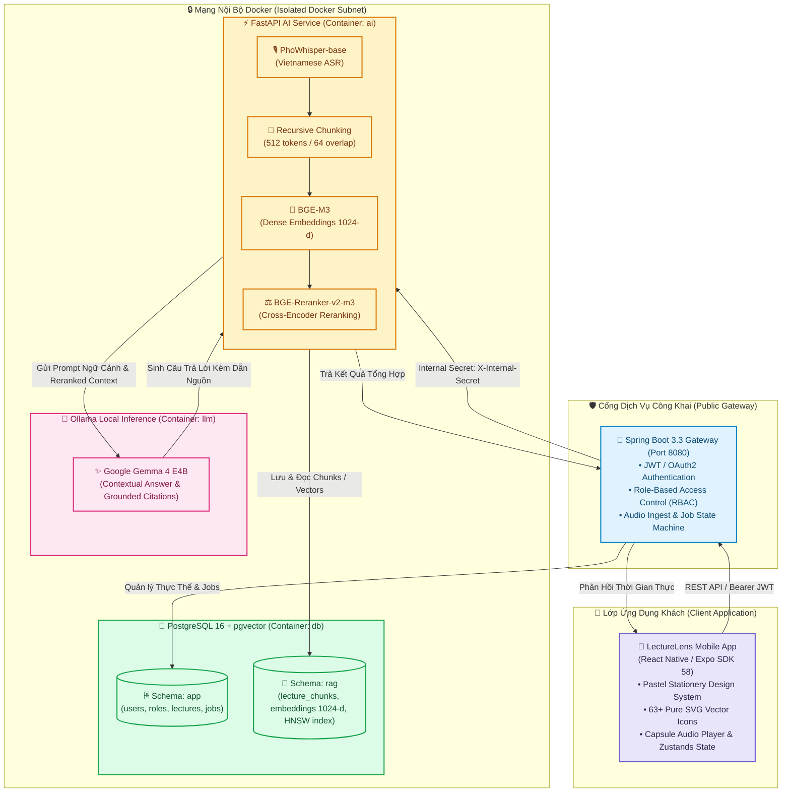

<div align="center">

# 🦉 LectureLens

### Nền Tảng Học Tập Thông Minh & Trợ Lý Bài Giảng AI Tiếng Việt

**Biến bản ghi âm bài giảng thành cơ sở tri thức số hóa cá nhân — Trợ lý AI Cú Mèo đồng hành cùng sinh viên mọi lúc, mọi nơi.**

[](https://expo.dev/)
[](https://reactnative.dev/)
[](https://www.typescriptlang.org/)
[](https://spring.io/projects/spring-boot)
[](https://fastapi.tiangolo.com/)
[](https://github.com/pgvector/pgvector)
[](https://ollama.ai/)
[](https://jestjs.io/)
[](./LICENSE)

---

[Tính Năng Cốt Lõi](#-tính-năng-cốt-lõi-core-features) • [Ngôn Ngữ Thiết Kế](#-ngôn-ngữ-thiết-kế-pastel-stationery) • [Kiến Trúc Hệ Thống](#-kiến-trúc-hệ-thống-architecture) • [Cấu Trúc Dự Án](#-cấu-trúc-dự-án-project-structure) • [Bắt Đầu Nhanh](#-bắt-đầu-nhanh-quickstart) • [Kiểm Thử & Đảm Bảo Chất Lượng](#-kiểm-thử--đảm-bảo-chất-lượng-qa) • [Lộ Trình Phát Triển](#-lộ-trình-phát-triển-roadmap)

</div>

---

## 📖 Giới thiệu (Overview)

Trong các buổi giảng đường đại học và hội thảo học thuật, sinh viên thường gặp khó khăn trong việc vừa tập trung lắng nghe giảng viên vừa ghi chép đầy đủ nội dung. Việc nghe lại toàn bộ các đoạn ghi âm kéo dài từ 2 đến 3 tiếng là vô cùng tốn thời gian và kém hiệu quả.

**LectureLens** ra đời nhằm giải quyết triệt để bài toán này. Ứng dụng đóng vai trò như một **bàn học điện tử thông minh**, tự động chuyển đổi âm thanh bài giảng thành văn bản tiếng Việt chính xác, cấu trúc hóa thành các ghi chú theo định dạng sổ tay học tập, hỗ trợ truy vấn ngữ nghĩa hai giai đoạn (RAG) và tạo tự động bộ công cụ ôn tập (Flashcards, Trắc nghiệm).

> [!NOTE]
> **Điểm khác biệt cốt lõi:** LectureLens vận hành theo triết lý **Privacy-First & On-Premise AI**. Toàn bộ quy trình phiên âm, trích xuất đặc trưng vector và suy luận ngôn ngữ lớn được thực thi hoàn toàn trong môi trường máy chủ nội bộ thông qua các mô hình AI mã nguồn mở tiên tiến, cam kết **không truyền dữ liệu bài giảng ra bất kỳ dịch vụ AI đám mây bên thứ ba nào**.

---

## ✨ Tính Năng Cốt Lõi (Core Features)

```
       🎙️ Audio Recording & Upload
                 │
                 ▼
       ⚡ PhoWhisper Speech-to-Text (Vietnamese ASR)
                 │
                 ▼
       📑 Recursive Semantic Chunking & 1024-d Embedding
                 │
   ┌─────────────┴─────────────┐
   ▼                           ▼
🔍 2-Stage Neural RAG       📝 Smart Stationery Study
   • Dense Search (HNSW)       • Tóm tắt Cornell / Bàn học
   • BGE-Reranker-v2-m3        • Flashcards ghi nhớ tích cực
   • Ollama Gemma 4 E4B        • Trắc nghiệm Quiz tương tác
   • Trích dẫn mốc thời gian    • Trợ lý Cú Mèo đồng hành
```

### 1. 🎙️ Phiên Âm Tiếng Việt Tự Động & Đồng Bộ Âm Thanh (Vietnamese ASR)
- Nhận dạng giọng nói tiếng Việt với độ chính xác cao bằng **PhoWhisper-base** được tinh chỉnh chuyên biệt cho ngữ điệu và thuật ngữ bài giảng tiếng Việt.
- Tự động gán mốc thời gian (*Timestamps*) cho từng câu nói, hỗ trợ người học bấm vào bất kỳ dòng văn bản nào để phát lại chính xác đoạn âm thanh tương ứng tại mốc giây đó.

### 2. 🧠 Tìm Kiếm & Hỏi Đáp Ngữ Nghĩa Hai Giai Đoạn (2-Stage Neural RAG)
- **Giai đoạn 1 (Candidate Retrieval):** Sử dụng mô hình **BGE-M3** để tạo vector 1024 chiều, kết hợp chỉ mục **HNSW** trên PostgreSQL pgvector để tìm kiếm nhanh Top-25 phân đoạn bài giảng liên quan.
- **Giai đoạn 2 (Precision Reranking):** Sử dụng mô hình Cross-Encoder **BGE-Reranker-v2-m3** để chấm điểm tương quan sâu và chọn lọc Top 3-5 đoạn xuất sắc nhất.
- **Suy luận ngữ cảnh:** Mô hình ngôn ngữ lớn **Gemma 4 E4B** tổng hợp câu trả lời chính xác, mạch lạc và luôn đính kèm trích dẫn mốc thời gian gốc (`[MM:SS]`), loại bỏ hiện tượng ảo giác (hallucination).

### 3. 🦉 Trợ Lý Học Tập Cú Mèo (AI Study Companion)
- Linh vật **Cú Mèo LectureLens** đồng hành trong suốt quá trình học tập: giải thích khái niệm trừu tượng, gợi ý câu hỏi ôn tập, khích lệ tiến độ học và cung cấp mẹo ghi nhớ nhanh.
- Tích hợp cửa sổ trò chuyện thông minh trực tiếp trên giao diện phát bài giảng (Split-view & Bottom Sheet).

### 4. 🗂️ Thẻ Ghi Nhớ (Flashcards) & Bài Trắc Nghiệm Tự Động (Quiz)
- Tự động rút trích các thuật ngữ trọng tâm, định lý, công thức để tạo bộ thẻ ghi nhớ tương tác với hiệu ứng lật mặt mượt mà.
- Tự động tạo bài kiểm tra trắc nghiệm 4 lựa chọn kèm lời giải thích chi tiết trích xuất từ bài giảng.

### 5. 🎛️ Trình Phát Bài Giảng Thông Minh (Capsule Audio Player)
- Hỗ trợ tua nhanh/chậm đa tốc độ (`0.75x`, `1.0x`, `1.25x`, `1.5x`, `2.0x`), tua tới/lùi 10 giây.
- Mini Player dạng con nhộng ghim cố định ở đáy màn hình, duy trì phát âm thanh liên tục khi sinh viên duyệt tài liệu hoặc làm bài tập.

---

## 🎨 Ngôn Ngữ Thiết Kế: Pastel Stationery

LectureLens được xây dựng dựa trên hệ thống thiết kế **Pastel Stationery Study Companion** — mô phỏng chân thực cảm giác ấm áp, gần gũi của bàn học sinh viên với giấy can, bút dạ quang, băng dính washi và giấy ghi chú sticky note:

| Yếu tố | Token Thiết Kế | Giá Trị Màu | Ứng Dụng |
| :--- | :--- | :---: | :--- |
| **Canvas Nền** | `bg-stationery-canvas` | `#FFFAF5` | Giấy mỹ thuật trắng ngà ấm áp, chống mỏi mắt khi đọc lâu |
| **Bề Mặt Card** | `bg-stationery-surface` | `#FFFFFF` | Mặt thẻ bài học viền bo mềm mại (`rounded-2xl`) |
| **Tím Chủ Đạo** | `primary-lavender` | `#6D5FD0` | Màu thương hiệu chính, nút tương tác, trạng thái active |
| **Hồng Sakura** | `accent-sakura` | `#F875AA` | Nổi bật trợ lý Cú Mèo, tag phân loại bài học, điểm nhấn |
| **Xanh Bạc Hà** | `accent-mint` | `#10B981` | Mốc thời gian (Timestamps), trạng thái hoàn thành |
| **Vàng Ghi Chú** | `accent-sticky` | `#FFF1C9` | Khối tóm tắt ghi chú, trích đoạn bài giảng quan trọng |
| **Đường Kẻ Vở** | `border-stationery-ruled` | `#F0EAE1` | Đường viền ngăn cách tinh tế, đường chỉ phân cách bài tập |

### Hệ Thống 63+ Biểu Tượng Pure SVG Độc Quyền

Toàn bộ hệ thống giao diện sử dụng bộ icon vector SVG được thiết kế riêng tại [`FE/src/shared/widgets/icons/LlIcon.tsx`](file:///d:/02-Projects/LectureLens/lecture_lens/FE/src/shared/widgets/icons/LlIcon.tsx):
- **Chuẩn hóa tỷ lệ:** Lưới vẽ 24x24 pixel tiêu chuẩn, đầu bo tròn thân thiện (`strokeLinecap="round"`, `strokeLinejoin="round"`), độ dày nét 1.5 - 2px (Stroke Weight 500).
- **Trạng thái đồng nhất:** Hỗ trợ linh hoạt chế độ viền mảnh (Outline) và tô đặc (Filled) khi được kích hoạt.
- **Không phụ thuộc font:** 100% vector SVG gốc, không phụ thuộc glyph icon fonts của bên thứ ba, loại bỏ hoàn toàn lỗi vỡ layout hoặc hiển thị emoji lệch nền tảng.
- **Hỗ trợ tiếp cận (Accessibility):** Kích thước vùng bấm tối thiểu đạt chuẩn 44x44px theo khuyến nghị WCAG Mobile.

---

## 🏗️ Kiến Trúc Hệ Thống (Architecture)

Hệ thống LectureLens được cấu trúc thành 2 khối lớn: **Frontend (Ứng dụng di động Client)** và **Backend (Hệ thống RAG Microservices)**:



---

## 📂 Cấu Trúc Dự Án (Project Structure)

```
lecture_lens/
├── package.json                   # Root orchestrator: điều phối scripts chạy toàn dự án
├── AGENTS.md                      # Nguyên tắc kiến trúc & hướng dẫn trợ lý lập trình
├── README.md                      # Tài liệu tổng quan sản phẩm (File này)
│
├── FE/                            # 📱 FRONTEND (React Native / Expo SDK 58)
│   ├── assets/                    # Biểu tượng tĩnh, hình ảnh linh vật Cú Mèo
│   ├── src/
│   │   ├── core/                  # Theme, Tokens, ThemeContext, Formatting Utilities
│   │   ├── features/              # Các mô-đun màn hình chức năng:
│   │   │   ├── auth/              # Đăng nhập, Đăng ký, Quên mật khẩu
│   │   │   ├── library/           # Danh sách bài giảng, Lọc theo môn học, Tìm kiếm
│   │   │   ├── lecture-detail/    # Trình nghe audio, Bản phiên âm, Ghi chú Cornell
│   │   │   ├── ai-chat/           # Trò chuyện trợ lý Cú Mèo, Trích dẫn thời gian thực
│   │   │   ├── flashcards/        # Lật thẻ ghi nhớ kiến thức, Phân loại độ nhớ
│   │   │   ├── quiz/              # Bộ câu hỏi trắc nghiệm ôn tập tương tác
│   │   │   ├── upload/            # Tải lên & ghi âm bài giảng trực tiếp
│   │   │   └── settings/          # Cấu hình tài khoản, Chế độ màu, Trợ giúp
│   │   ├── navigation/            # RootStack, MainBottomTab Navigator
│   │   └── shared/                # Thư viện dùng chung:
│   │       ├── store/             # Quản lý trạng thái toàn cục (Zustand)
│   │       ├── models/            # Kiểu dữ liệu TypeScript (Lecture, Chunk, Quiz, Flashcard)
│   │       └── widgets/           # Components UI tái sử dụng (Button, Card, LlIcon 63+ icons)
│   ├── __tests__/                 # Kiểm thử tự động (Jest + ts-jest, 82 test suites)
│   ├── app.json                   # Cấu hình Expo Application
│   └── package.json               # Cấu hình dependencies Frontend
│
└── BE/                            # ⚙️ BACKEND (Microservices RAG Tiếng Việt)
    ├── spring-gateway/            # Cổng API Gateway & Nghiệp vụ (Spring Boot 3.3)
    ├── ai-service/                # Dịch vụ AI & RAG Pipelines (FastAPI + PyTorch)
    ├── db/                        # Kịch bản khởi tạo Multi-Schema PostgreSQL + pgvector
    ├── ollama/                    # Modelfile cấu hình suy luận Gemma 4 E4B
    ├── models/                    # Bộ nhớ cache trọng số AI (PhoWhisper, BGE-M3, Reranker, Gemma)
    ├── download_models.py         # Kịch bản tự động tải mô hình từ Hugging Face
    ├── docker-compose.yml         # File điều phối khởi chạy toàn bộ 4 dịch vụ container
    ├── .env.example               # Mẫu biến môi trường bảo mật
    └── README.md                  # 📘 Tài liệu đặc tả kỹ thuật Backend chi tiết
```

---

## 🚀 Bắt Đầu Nhanh (Quickstart)

### Yêu Cầu Tiên Quyết (Prerequisites)
- **Node.js**: Phiên bản `v20.x` hoặc `v22.x` (LTS)
- **Docker & Docker Compose**: v2.20+
- **Python**: Phiên bản `3.10+` (nếu cần tải weights mô hình thủ công)
- **Thiết bị chạy app**: Ứng dụng di động [Expo Go](https://expo.dev/go) trên điện thoại (iOS / Android) hoặc Android Emulator / iOS Simulator.

---

### Khởi Chạy Frontend (Mobile App)

Bạn có thể chạy các lệnh điều phối trực tiếp ngay tại thư mục gốc:

```bash
# 1. Cài đặt các gói phụ thuộc (nếu chưa cài)
npm install --prefix FE

# 2. Khởi động máy chủ phát triển Expo Dev Server
npm run fe

# 3. Chạy kiểm tra định dạng TypeScript
npm run typecheck

# 4. Chạy toàn bộ bộ kiểm thử tự động
npm test
```

> [!TIP]
> Khi Metro Bundler hiển thị mã QR trên Terminal, hãy mở ứng dụng **Expo Go** trên điện thoại và quét mã QR để trải nghiệm ứng dụng ngay lập tức mà không cần biên dịch native code.

Nếu muốn làm việc trực tiếp bên trong thư mục `FE/`:
```bash
cd FE
npx expo start              # Bật Metro Bundler
npx expo start --web        # Trải nghiệm trên trình duyệt Web
npx expo run:android        # Biên dịch chạy trên Android
npx expo run:ios            # Biên dịch chạy trên iOS (yêu cầu macOS)
```

---

### Khởi Chạy Backend (SmartLecture AI System)

Toàn bộ hệ thống Backend SmartLecture AI được đóng gói hoàn chỉnh bằng Docker Compose:

```bash
cd BE

# 1. Tạo file cấu hình môi trường từ mẫu có sẵn
cp .env.example .env

# 2. Tải trọng số các mô hình AI từ Hugging Face (Khoảng ~21.5 GB)
python download_models.py

# 3. Khởi chạy toàn bộ hệ thống bằng Docker Compose
docker compose up -d --build
```

Sau khi hoàn tất, các dịch vụ sẽ sẵn sàng:
- **Spring Boot Gateway**: `http://localhost:8080` (Mở công khai đón nhận request từ Client)
- **FastAPI AI Service**: `http://ai:8000` (Nội bộ Docker)
- **PostgreSQL pgvector**: `db:5432` (Nội bộ Docker)
- **Ollama LLM Engine**: `http://llm:11434` (Nội bộ Docker)

> 👉 **Xem hướng dẫn kỹ thuật chi tiết:** [**Tài Liệu Kỹ Thuật SmartLecture AI (BE/README.md)**](./BE/README.md)

---

## 🧪 Kiểm Thử & Đảm Bảo Chất Lượng (QA)

Dự án áp dụng quy trình kiểm thử nghiêm ngặt trước mỗi lần phát hành:

```bash
# Kiểm thử toàn bộ Unit Test & Widget Test
npm test

# Kết quả kiểm thử tiêu chuẩn:
# PASS  FE/__tests__/LlIcon.test.tsx
# PASS  FE/__tests__/ThemeContext.test.tsx
# PASS  FE/__tests__/LectureStore.test.tsx
# Test Suites: 10 passed, 10 total
# Tests:       82 passed, 82 total
# Snapshots:   0 total
# Time:        3.42 s
```

- **TypeScript Strict Mode:** Toàn bộ mã nguồn tuân thủ nghiêm ngặt chuẩn gõ tĩnh (`tsc --noEmit`), đảm bảo 0 lỗi kiểu dữ liệu.
- **Iconography Consistency Audit:** Kiểm tra 100% các icon hiển thị qua bộ widget `LlIcon`, không còn ký tự unicode hay emoji chưa được chuẩn hóa.

---

## 🗺️ Lộ Trình Phát Triển (Roadmap)

- [x] **Giai đoạn 1: MVP Core & Design System**
  - [x] Kiến trúc Monorepo FE (Expo SDK 58) & BE (Spring Boot + FastAPI).
  - [x] Thiết kế nhận diện Pastel Stationery & hoàn thiện 63+ Pure SVG Icons.
  - [x] Trình phát âm thanh Capsule Audio Player & danh mục bài giảng.
- [x] **Giai đoạn 2: Vietnamese RAG Engine**
  - [x] Tích hợp pipeline PhoWhisper nhận dạng giọng nói bài giảng tiếng Việt.
  - [x] Xây dựng cơ chế nhúng đa chiều BGE-M3 & Re-ranking Cross-Encoder.
  - [x] Tích hợp suy luận nội bộ Gemma 4 E4B qua Ollama với trích dẫn timestamp.
- [ ] **Giai đoạn 3: Trải Nghiệm Học Tập Đa Nền Tảng (Đang thực hiện)**
  - [ ] Diarization: Tự động phân tách giọng giảng viên và sinh viên phát biểu.
  - [ ] Web Desktop Study Dashboard tối ưu màn hình lớn.
  - [ ] Đồng bộ hóa ghi chú Cornell xuất khẩu sang định dạng PDF và Notion.
- [ ] **Giai đoạn 4: Personalization & On-Device Small LLM**
  - [ ] Thuật toán ngắt quãng Spaced Repetition (SM-2) cho Flashcards.
  - [ ] Tích hợp mô hình ngôn ngữ lượng tử hóa siêu nhẹ chạy trực tiếp trên thiết bị di động khi không có internet.

---

## 🤝 Đóng Góp Phát Triển (Contributing)

Mọi đóng góp từ cộng đồng đều được hoan nghênh nồng nhiệt! Để đóng góp:
1. **Fork** dự án về tài khoản GitHub của bạn.
2. Tạo một nhánh tính năng mới: `git checkout -b feature/AmazingFeature`.
3. Cam kết các thay đổi: `git commit -m "feat: Add amazing new feature"`.
4. Đẩy lên nhánh của bạn: `git push origin feature/AmazingFeature`.
5. Mở một **Pull Request** kèm giải thích chi tiết các thay đổi.

---

## 📄 Bản Quyền (License)

Dự án được phân phối dưới giấy phép **Apache-2.0 License**. Xem chi tiết tại tệp [LICENSE](./LICENSE).

---

<div align="center">
  <sub>Được phát triển với tâm huyết bởi <b>LectureLens Engineering Team</b> 🦉🎓</sub><br/>
  <sub><i>"Lắng nghe bài giảng, thấu hiểu tri thức."</i></sub>
</div>
