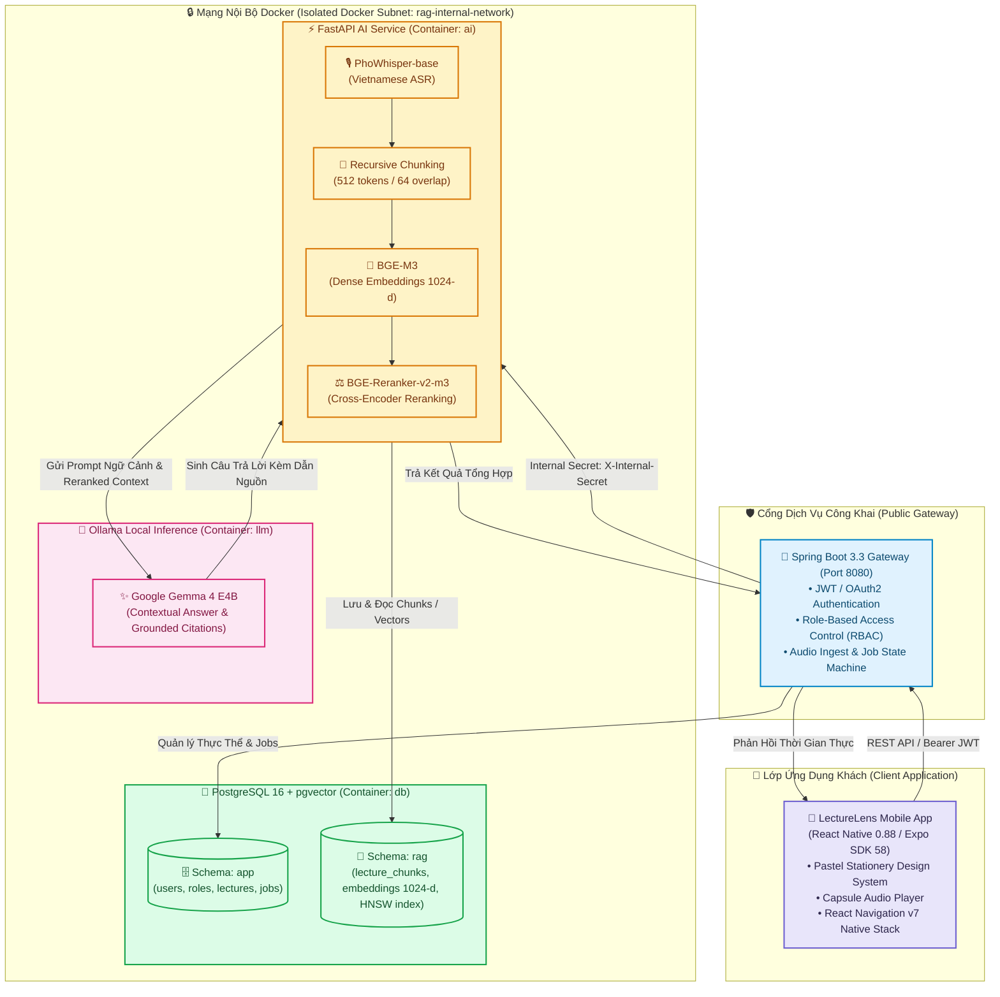

<div align="center">

# 🦉 LectureLens

### Nền Tảng Học Tập Thông Minh & Trợ Lý Bài Giảng AI Tiếng Việt
**Chuyển đổi bài giảng thành sổ tay điện tử thông minh — Kiến trúc On-Premise 2-Stage Neural RAG bảo mật tuyệt đối.**

[](https://expo.dev/)
[](https://reactnative.dev/)
[](https://www.typescriptlang.org/)
[](https://spring.io/projects/spring-boot)
[](https://fastapi.tiangolo.com/)
[](https://github.com/pgvector/pgvector)
[](https://ollama.ai/)
[](https://jestjs.io/)
[](./LICENSE)

---

[Tổng Quan](#-tổng-quan-overview) • [Tính Năng Cốt Lõi](#-tính-năng-cốt-lõi-core-features) • [Ngôn Ngữ Thiết Kế](#-ngôn-ngữ-thiết-kế-pastel-stationery) • [Kiến Trúc Hệ Thống](#-kiến-trúc-hệ-thống-architecture) • [Cấu Trúc Dự Án](#-cấu-trúc-dự-án-project-structure) • [Bắt Đầu Nhanh](#-bắt-đầu-nhanh-quickstart) • [Kiểm Thử & QA](#-kiểm-thử--đảm-bảo-chất-lượng-qa) • [Kỹ Năng & Công Cụ Kỹ Thuật](#-kỹ-năng--công-cụ-kỹ-thuật-agents--skills) • [Lộ Trình](#-lộ-trình-phát-triển-roadmap)

</div>

---

## 📖 Tổng Quan (Overview)

Trong môi trường giảng đường đại học và các khóa học chuyên sâu, sinh viên thường xuyên gặp áp lực kép: vừa phải chú ý lắng nghe phân tích từ giảng viên, vừa phải ghi chép lại khối lượng kiến thức lớn. Việc nghe lại toàn bộ bản ghi âm dài 2 đến 3 tiếng là rào cản lớn đối với quá trình ôn tập và tra cứu.

**LectureLens** được xây dựng như một **bàn học điện tử thông minh**, tự động chuyển đổi âm thanh bài giảng thành văn bản tiếng Việt chính xác, cấu trúc hóa thành các ghi chú theo định dạng Cornell Notes, hỗ trợ truy vấn ngữ nghĩa hai giai đoạn (2-Stage Neural RAG) kèm trích dẫn mốc thời gian (`[MM:SS]`), đồng thời tự động tạo bộ công cụ ôn tập cá nhân (Flashcards, Quizzes).

> [!IMPORTANT]
> **Triết lý Cốt lõi — Privacy-First & On-Premise AI (ADR 0001):**
> Toàn bộ quy trình nhận dạng tiếng nói (PhoWhisper), trích xuất đặc trưng vector (BGE-M3), tái định vị (BGE-Reranker-v2-m3) và suy luận mô hình ngôn ngữ lớn (Gemma 4 E4B qua Ollama) được thực thi hoàn toàn cục bộ trên máy chủ của trường hoặc máy trạm nội bộ. Cam kết **Zero Cloud Leakage**: tuyệt đối không truyền âm thanh hay tài liệu bài giảng ra bất kỳ dịch vụ đám mây bên thứ ba nào.

---

## ✨ Tính Năng Cốt Lõi (Core Features)

```
       🎙️ Audio Recording & Upload
                 │
                 ▼
       ⚡ PhoWhisper Speech-to-Text (Vietnamese ASR with [MM:SS])
                 │
                 ▼
       📑 Recursive Semantic Chunking & 1024-d Embedding (BGE-M3)
                 │
   ┌─────────────┴─────────────┐
   ▼                           ▼
🔍 2-Stage Neural RAG       📝 Smart Stationery Study
   • Dense Search (HNSW)       • Ghi chép Cornell Notes
   • BGE-Reranker-v2-m3        • Flashcards ghi nhớ tích cực
   • Ollama Gemma 4 E4B        • Trắc nghiệm Quiz tương tác
   • Trích dẫn mốc thời gian   • Trợ lý Cú Mèo (Owl Companion)
```

### 1. 🎙️ Nhận Dạng Tiếng Nói Tiếng Việt Chuyên Biệt (Vietnamese ASR)
- Sử dụng mô hình **PhoWhisper-base** được tối ưu hóa cho ngữ điệu và thuật ngữ bài giảng tiếng Việt.
- Tự động gán mốc thời gian (*Timestamps*) cho từng câu nói theo định dạng chuẩn `[MM:SS]`.
- Người học có thể nhấn vào bất kỳ đoạn văn bản nào để phát lại âm thanh chính xác tại thời điểm đó.

### 2. 🧠 Truy Vấn Ngữ Nghĩa Hai Giai Đoạn (2-Stage Neural RAG)
- **Giai đoạn 1 (Candidate Retrieval):** Mô hình **BGE-M3** chuyển đổi truy vấn thành vector dense 1024 chiều, kết hợp chỉ mục **HNSW** (`vector_cosine_ops`) trên PostgreSQL pgvector để lọc nhanh Top-25 phân đoạn ứng viên.
- **Giai đoạn 2 (Precision Reranking):** Cross-Encoder **BGE-Reranker-v2-m3** chấm điểm tương quan sâu giữa câu hỏi và từng phân đoạn để chọn lọc Top 3–5 đoạn có độ phù hợp cao nhất.
- **Suy luận có cơ sở (Grounded Generation):** Mô hình ngôn ngữ lớn **Gemma 4 E4B** (Ollama) tổng hợp câu trả lời dựa trên ngữ cảnh được cung cấp, luôn kèm trích dẫn mốc thời gian gốc (`[MM:SS]`), loại bỏ hiện tượng ảo giác (hallucination).

### 3. 🦉 Trợ Lý Cú Mèo (Owl Companion)
- Linh vật AI đồng hành cùng sinh viên: giải thích các khái niệm trừu tượng, gợi ý câu hỏi ôn tập, khích lệ tiến độ và hỗ trợ giải đáp thắc mắc trực tiếp trong giao diện bài giảng.

### 4. 🗂️ Bộ Công Cụ Ôn Tập Thông Minh (Flashcards & Quizzes)
- **Cornell Notes:** Cấu trúc ghi chú bài giảng thành 3 khu vực: Tóm tắt tổng quan (Summary), Thuật ngữ/Gợi ý (Cues), và Nội dung chi tiết (Notes).
- **Flashcards:** Tự động trích xuất thuật ngữ trọng tâm, công thức và định lý thành thẻ ghi nhớ hai mặt (Front/Back) phục vụ phương pháp Active Recall.
- **Quizzes:** Tự động sinh câu hỏi trắc nghiệm 4 lựa chọn kèm đáp án đúng và giải thích đối chiếu trực tiếp từ mốc thời gian gốc.

### 5. 🎛️ Trình Phát Bài Giảng Con Nhộng (Capsule Audio Player)
- Trình phát dạng con nhộng ghim cố định ở đáy màn hình, hỗ trợ đa tốc độ (`0.75x`, `1.0x`, `1.25x`, `1.5x`, `2.0x`) và tua 10 giây.
- Duy trì phát âm thanh liên tục không gián đoạn trong khi người học duyệt ghi chú hoặc làm bài kiểm tra.

---

## 🎨 Ngôn Ngữ Thiết Kế: Pastel Stationery

Giao diện LectureLens được xây dựng dựa trên hệ thống thiết kế **Pastel Stationery Study Companion** — mô phỏng không gian bàn học thân thuộc của sinh viên với giấy can, bút dạ quang, băng dính washi và thẻ sticky note:

| Yếu tố | Token Thiết Kế | Giá Trị Hex | Mục Đích Sử Dụng |
| :--- | :--- | :---: | :--- |
| **Canvas Nền** | `bg-stationery-canvas` | `#FFFAF5` | Giấy mỹ thuật ngà ấm áp, giảm thiểu mỏi mắt khi đọc lâu |
| **Bề Mặt Card** | `bg-stationery-surface` | `#FFFFFF` | Nền thẻ bài học bo góc mềm mại (`rounded-2xl`) |
| **Tím Chủ Đạo** | `primary-lavender` | `#6D5FD0` | Màu thương hiệu nhận diện, nút tương tác, trạng thái active |
| **Hồng Sakura** | `accent-sakura` | `#F875AA` | Điểm nhấn trợ lý Cú Mèo, thẻ phân loại chủ đề |
| **Xanh Bạc Hà** | `accent-mint` | `#10B981` | Mốc thời gian (Timestamps), trạng thái hoàn thành |
| **Vàng Ghi Chú** | `accent-sticky` | `#FFF1C9` | Khối tóm tắt bài học, đoạn ghi chú quan trọng |
| **Đường Kẻ Vở** | `border-stationery-ruled` | `#F0EAE1` | Đường phân cách tinh tế giữa các phân đoạn |

---

## 🏗️ Kiến Trúc Hệ Thống (Architecture)

Toàn bộ hệ thống tuân thủ mô hình phân lớp rõ ràng giữa ứng dụng di động khách (Client) và hạ tầng vi dịch vụ backend an toàn:



---

## 📂 Cấu Trúc Dự Án (Project Structure)

```
lecture_lens/
├── package.json                   # Root orchestrator: điều phối scripts chạy toàn dự án
├── AGENTS.md                      # Nguyên tắc kiến trúc & hướng dẫn trợ lý AI
├── GLOSSARY.md                    # Từ điển ngôn ngữ miền Ubiquitous Language chuẩn
├── README.md                      # Tài liệu tổng quan dự án (File này)
│
├── docs/                          # 📚 Tài liệu kỹ thuật dự án
│   ├── adr/                       # Architecture Decision Records
│   │   ├── 0001-privacy-first-local-ai-architecture.md
│   │   └── README.md
│   └── agents/                    # Hướng dẫn quy trình domain, triage & issues
│       ├── domain.md
│       ├── issue-tracker.md
│       └── triage-labels.md
│
├── FE/                            # 📱 FRONTEND (React Native 0.88 / Expo SDK 58)
│   ├── assets/                    # Biểu tượng tĩnh & hình ảnh linh vật Cú Mèo
│   ├── __tests__/                 # Kiểm thử tự động (Jest + jest-expo)
│   │   ├── App.test.tsx
│   │   └── sanity.test.ts
│   ├── App.tsx                    # Thành phần gốc khởi chạy ứng dụng
│   ├── app.json                   # Cấu hình dự án Expo
│   ├── eslint.config.js           # Cấu hình kiểm tra chuẩn mã nguồn
│   ├── package.json               # Dependencies ứng dụng di động
│   └── tsconfig.json              # Cấu hình TypeScript Strict Mode
│
├── BE/                            # ⚙️ BACKEND (Microservices RAG Tiếng Việt)
│   ├── models/                    # Bộ nhớ cache trọng số AI tải cục bộ (PhoWhisper, BGE, Gemma)
│   │   ├── bge-m3/
│   │   ├── bge-reranker-v2-m3/
│   │   ├── gemma-4-e4b/
│   │   └── phowhisper-base/
│   ├── download_models.py         # Kịch bản tải mô hình từ Hugging Face
│   ├── .env.example               # Mẫu biến môi trường bảo mật
│   ├── .gitignore                 # Loại trừ các file trọng số nhị phân lớn (>100MB)
│   ├── smartlecture_ai_architecture.png # Sơ đồ kiến trúc hạ tầng
│   └── README.md                  # 📘 Đặc tả kỹ thuật Backend & AI Service chi tiết
│
├── stitch_lecturelens_app_design_system/ # 🎨 Thiết kế giao diện & Screens mẫu (Stitch)
│   ├── pastel_stationery_study_companion/
│   ├── th_vi_n_b_i_gi_ng/
│   ├── chi_ti_t_b_i_gi_ng_b_n_ghi/
│   └── ...
│
└── tools/                         # 🛠️ Hệ thống Kỹ năng & Công cụ Kỹ thuật
    ├── mattpocock-skills/         # Kỹ năng kỹ thuật Matt Pocock (TDD, Codebase Design, Domain)
    └── Understand-Anything/       # Công cụ phân tích mã nguồn & Knowledge Graph
```

---

## 🚀 Bắt Đầu Nhanh (Quickstart)

### Yêu Cầu Tiên Quyết (Prerequisites)
- **Node.js**: Phiên bản `v20.x` hoặc `v22.x` (LTS)
- **Python**: Phiên bản `3.10+` với `pip`
- **Docker & Docker Compose**: v2.20+ (khi triển khai hạ tầng Backend)
- **Ứng dụng kiểm thử di động**: [Expo Go](https://expo.dev/go) trên thiết bị thật hoặc máy ảo Android Emulator / iOS Simulator.

---

### Khởi Chạy Frontend (Mobile App)

Thao tác trực tiếp từ thư mục gốc thông qua npm scripts:

```bash
# 1. Cài đặt dependencies cho Frontend
npm install --prefix FE

# 2. Khởi chạy máy chủ phát triển Expo Dev Server
npm run fe

# 3. Kiểm tra tĩnh kiểu dữ liệu TypeScript
npm run typecheck

# 4. Chạy bộ kiểm thử tự động
npm test
```

> [!TIP]
> Quét mã QR hiển thị trên Terminal bằng camera điện thoại (đối với iOS) hoặc thông qua ứng dụng **Expo Go** (đối với Android) để trải nghiệm ứng dụng ngay lập tức.

---

### Khởi Chạy Backend & AI Engine

Toàn bộ dịch vụ backend được cấu hình vận hành độc lập:

```bash
cd BE

# 1. Tạo file cấu hình môi trường
cp .env.example .env

# 2. Tải trọng số 4 mô hình AI về thư mục models/ (~21.5 GB)
pip install huggingface_hub
python download_models.py

# 3. Khởi chạy cụm dịch vụ qua Docker Compose
docker compose up -d --build
```

Sau khi hoàn tất khởi chạy:
- **Spring Boot Gateway**: `http://localhost:8080` (Cổng Ingress công khai)
- **FastAPI AI Service**: `http://ai:8000` (Nội bộ Docker qua `X-Internal-Secret`)
- **PostgreSQL 16 + pgvector**: `db:5432` (Nội bộ Docker, phân vùng `app` và `rag`)
- **Ollama LLM Engine**: `http://llm:11434` (Nội bộ Docker phục vụ Gemma 4 E4B)

> 👉 **Xem chi tiết đặc tả hạ tầng:** [**Tài Liệu Kỹ Thuật Backend (BE/README.md)**](./BE/README.md)

---

## 🧪 Kiểm Thử & Đảm Bảo Chất Lượng (QA)

Quy trình kiểm thử được tự động hóa nghiêm ngặt:

```bash
# Chạy bộ kiểm thử tự động
npm test

# Kết quả kiểm thử tiêu chuẩn:
# PASS  __tests__/App.test.tsx
# PASS  __tests__/sanity.test.ts
# Test Suites: 2 passed, 2 total
# Tests:       2 passed, 2 total
```

- **TypeScript Strict Checking:** `npm run typecheck` đảm bảo 100% mã nguồn không phát sinh lỗi kiểu dữ liệu.
- **Expo Linter:** `npm run lint` tuân thủ các quy tắc của `eslint-config-expo`.

---

## 🛠️ Kỹ Năng & Công Cụ Kỹ Thuật (Agents & Skills)

Dự án tích hợp hai hệ sinh thái công cụ kỹ thuật tiêu chuẩn cao tại `.agents/skills/` và `tools/`:

### 1. Matt Pocock Engineering Skills (`tools/mattpocock-skills`)
- **Domain Modeling & Ubiquitous Language:** Luôn đối chiếu thuật ngữ qua [GLOSSARY.md](./GLOSSARY.md) và [docs/agents/domain.md](./docs/agents/domain.md). Tránh tuyệt đối các từ ngữ không chuẩn hóa (ví dụ: dùng đúng `LectureLens`, không dùng `SmartLecture` hay `LectureApp`).
- **Codebase Design (Deep Modules & Seams):**
  - Xây dựng các mô-đun sâu (**Deep Modules**): Giao diện nhỏ gọn, ẩn giấu khối lượng tính toán phức tạp bên trong (ví dụ: 2-Stage Neural RAG Engine nhận câu hỏi, ẩn toàn bộ ma trận vector và cross-encoder).
  - Xác định ranh giới thay đổi (**Seams**): Tách biệt rõ ràng ranh giới giữa Ingress Gateway và AI Engine bằng header xác thực nội bộ.
- **TDD (Test-Driven Development):** Xây dựng lát cắt dọc (**Vertical Slices**) và kiểm thử bề mặt giao diện trước khi triển khai chi tiết.

### 2. Understand Anything (`tools/Understand-Anything`)
- **Phân tích cấu trúc mã nguồn:**
  ```bash
  # Quét và cập nhật manifest cấu trúc dự án
  node tools/Understand-Anything/understand-anything-plugin/skills/understand/scan-project.mjs . .ua/manifest.json --exclude "node_modules/**,.venv/**,models/**,stitch_lecturelens_app_design_system/**,tools/**"
  
  # Trích xuất ngữ cảnh miền nghiệp vụ
  python tools/Understand-Anything/understand-anything-plugin/skills/understand-domain/extract-domain-context.py .
  ```
- **Bản đồ tri thức tương tác (Interactive Knowledge Graph):** Trực quan hóa các luồng xử lý dữ liệu và mối liên kết thành phần.

---

## 🗺️ Lộ Trình Phát Triển (Roadmap)

- [x] **Giai đoạn 1: Nền Tảng Dự Án & Ngôn Ngữ Thiết Kế**
  - [x] Thiết lập cấu trúc Monorepo FE (Expo SDK 58 / React Native 0.88) và BE.
  - [x] Định hình hệ thống thiết kế Pastel Stationery Study Companion & bảng màu tokens.
  - [x] Thiết lập bộ kiểm thử tự động, ESLint và TypeScript cấu hình chặt chẽ.
  - [x] Chuẩn hóa Ubiquitous Language trong `GLOSSARY.md` và ADR 0001.
- [x] **Giai đoạn 2: Trọng Số Mô Hình & Hạ Tầng 2-Stage RAG**
  - [x] Tải và chuẩn bị bộ 4 mô hình AI cục bộ (`phowhisper-base`, `bge-m3`, `bge-reranker-v2-m3`, `gemma-4-e4b`).
  - [x] Thiết kế cơ sở dữ liệu phân vùng `app` và `rag` với chỉ mục HNSW trên PostgreSQL pgvector.
  - [x] Đặc tả quy chuẩn pipeline Ingest và Query kèm Guardrails trích dẫn timestamp `[MM:SS]`.
- [ ] **Giai đoạn 3: Hoàn Thiện Các Màn Hình Ứng Dụng Khách (In Progress)**
  - [ ] Triển khai React Navigation v7 (RootStack + MainTabNavigator).
  - [ ] Hiện thực giao diện thư viện bài giảng, màn hình nghe Capsule Audio Player.
  - [ ] Tích hợp giao diện trò chuyện Trợ lý Cú Mèo và ghi chú Cornell Notes.
  - [ ] Hiện thực bộ lật thẻ ghi nhớ Flashcards và câu hỏi trắc nghiệm Quizzes.
- [ ] **Giai đoạn 4: Nâng Cao & Tối Ưu Hóa Trải Nghiệm**
  - [ ] Diarization: Tự động phân tách giọng giảng viên và sinh viên tương tác.
  - [ ] Spaced Repetition (Thuật toán SM-2) cho hệ thống Flashcard.
  - [ ] Nghiên cứu mô hình ngôn ngữ siêu nhỏ chạy trực tiếp On-Device khi không có kết nối mạng.

---

## 📄 Bản Quyền (License)

Dự án được phân phối dưới giấy phép **Apache-2.0 License**. Xem chi tiết tại tệp [LICENSE](./LICENSE).

---

<div align="center">
  <sub>Được phát triển với tâm huyết bởi <b>LectureLens Engineering Team</b> 🦉🎓</sub><br/>
  <sub><i>"Lắng nghe bài giảng, thấu hiểu tri thức."</i></sub>
</div>
