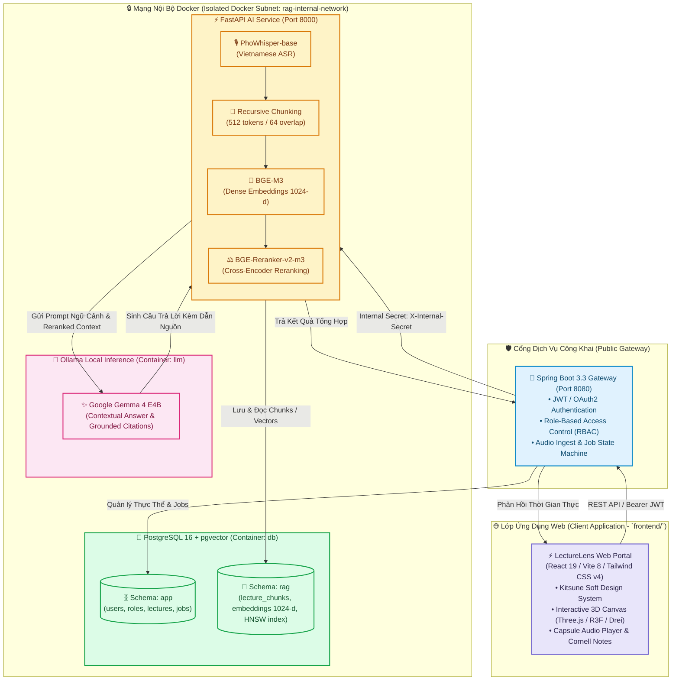

<div align="center">

# 🦉 LectureLens

### Nền Tảng Học Tập Thông Minh & Trợ Lý Bài Giảng AI Tiếng Việt
**Chuyển đổi bài giảng thành sổ tay điện tử thông minh — Kiến trúc On-Premise 2-Stage Neural RAG bảo mật tuyệt đối.**

[](https://react.dev/)
[](https://vitejs.dev/)
[](https://www.typescriptlang.org/)
[](https://tailwindcss.com/)
[](https://threejs.org/)
[](https://spring.io/projects/spring-boot)
[](https://fastapi.tiangolo.com/)
[](https://github.com/pgvector/pgvector)
[](https://ollama.ai/)
[](https://oxc.rs/)
[](./LICENSE)

---

[Tổng Quan](#-tổng-quan-overview) • [Tính Năng Cốt Lõi](#-tính-năng-cốt-lõi-core-features) • [Ngôn Ngữ Thiết Kế](#-ngôn-ngữ-thiết-kế-kitsune-soft) • [Kiến Trúc Hệ Thống](#-kiến-trúc-hệ-thống-architecture) • [Cấu Trúc Dự Án](#-cấu-trúc-dự-án-project-structure) • [Bắt Đầu Nhanh](#-bắt-đầu-nhanh-quickstart) • [Kỹ Năng & Quản Trị Kỹ Thuật](#-kỹ-năng--quản-trị-kỹ-thuật-engineering-skills--agents) • [Lộ Trình](#-lộ-trình-phát-triển-roadmap)

</div>

---

## 📖 Tổng Quan (Overview)

Trong môi trường giảng đường đại học và các khóa học chuyên sâu, sinh viên thường xuyên gặp áp lực kép: vừa phải chú ý lắng nghe phân tích từ giảng viên, vừa phải ghi chép lại khối lượng kiến thức lớn. Việc nghe lại toàn bộ bản ghi âm dài 2 đến 3 tiếng là rào cản lớn đối với quá trình ôn tập và tra cứu.

**LectureLens** được xây dựng như một **bàn học điện tử thông minh**, tự động chuyển đổi âm thanh bài giảng thành văn bản tiếng Việt chính xác, cấu trúc hóa thành các ghi chú theo định dạng Cornell Notes, hỗ trợ truy vấn ngữ nghĩa hai giai đoạn (2-Stage Neural RAG) kèm trích dẫn mốc thời gian (`[MM:SS]`), đồng thời tự động tạo bộ công cụ ôn tập cá nhân (Flashcards, Quizzes).

> [!IMPORTANT]
> **Triết lý Cốt lõi — Privacy-First & On-Premise AI ([ADR 0001](./docs/adr/0001-privacy-first-local-ai-architecture.md)):**
> Toàn bộ quy trình nhận dạng tiếng nói (PhoWhisper), trích xuất đặc trưng vector (BGE-M3), tái định vị (BGE-Reranker-v2-m3) và suy luận mô hình ngôn ngữ lớn (Gemma 4 E4B qua Ollama) được thực thi hoàn toàn cục bộ trên máy chủ của trường hoặc máy trạm nội bộ. Cam kết **Zero Cloud Leakage**: tuyệt đối không truyền âm thanh hay tài liệu bài giảng ra bất kỳ dịch vụ đám mây bên thứ ba nào.

---

## ✨ Tính Năng Cốt Lõi (Core Features)

```
       🎙️ Audio Recording & Upload
                 │
                 ▼
       ⚡ PhoWhisper Speech-to-Text (Vietnamese ASR with [MM:SS])
                 │
                 ▼
       📑 Recursive Semantic Chunking & 1024-d Embedding (BGE-M3)
                 │
   ┌─────────────┴─────────────┐
   ▼                           ▼
🔍 2-Stage Neural RAG       📝 Smart Stationery Study
   • Dense Search (HNSW)       • Ghi chép Cornell Notes
   • BGE-Reranker-v2-m3        • Flashcards ghi nhớ tích cực
   • Ollama Gemma 4 E4B        • Trắc nghiệm Quiz tương tác
   • Trích dẫn mốc thời gian   • Trợ lý Cáo Kitsune 3D (Kitsune Fox)
```

### 1. 🎙️ Nhận Dạng Tiếng Nói Tiếng Việt Chuyên Biệt (Vietnamese ASR)
- Sử dụng mô hình **PhoWhisper-base** được tối ưu hóa cho ngữ điệu và thuật ngữ bài giảng tiếng Việt.
- Tự động gán mốc thời gian (*Timestamps*) cho từng câu nói theo định dạng chuẩn `[MM:SS]`.
- Người học có thể nhấn vào bất kỳ đoạn văn bản nào để phát lại âm thanh chính xác tại thời điểm đó.

### 2. 🧠 Truy Vấn Ngữ Nghĩa Hai Giai Đoạn (2-Stage Neural RAG)
- **Giai đoạn 1 (Candidate Retrieval):** Mô hình **BGE-M3** chuyển đổi truy vấn thành vector dense 1024 chiều, kết hợp chỉ mục **HNSW** (`vector_cosine_ops`) trên PostgreSQL pgvector để lọc nhanh Top-25 phân đoạn ứng viên.
- **Giai đoạn 2 (Precision Reranking):** Cross-Encoder **BGE-Reranker-v2-m3** chấm điểm tương quan sâu giữa câu hỏi và từng phân đoạn để chọn lọc Top 3–5 đoạn có độ phù hợp cao nhất.
- **Suy luận có cơ sở (Grounded Generation):** Mô hình ngôn ngữ lớn **Gemma 4 E4B** (Ollama) tổng hợp câu trả lời dựa trên ngữ cảnh được cung cấp, luôn kèm trích dẫn mốc thời gian gốc (`[MM:SS]`), loại bỏ hiện tượng ảo giác (hallucination).

### 3. 🦊 Trợ Lý Cáo Kitsune 3D (Kitsune Fox Companion)
- Linh vật AI đồng hành cùng sinh viên: Cáo Kitsune Pixel Art thông minh tương tác trên nền tảng 3D (React Three Fiber & Three.js), giải thích các khái niệm trừu tượng, gợi ý câu hỏi ôn tập, khích lệ tiến độ học tập và đồng hành suốt phiên học.

### 4. 🗂️ Bộ Công Cụ Ôn Tập Thông Minh (Flashcards & Quizzes)
- **Cornell Notes:** Cấu trúc ghi chú bài giảng thành 3 khu vực: Tóm tắt tổng quan (Summary), Thuật ngữ/Gợi ý (Cues), và Nội dung chi tiết (Notes).
- **Flashcards:** Tự động trích xuất thuật ngữ trọng tâm, công thức và định lý thành thẻ ghi nhớ hai mặt (Front/Back) phục vụ phương pháp Active Recall.
- **Quizzes:** Tự động sinh câu hỏi trắc nghiệm 4 lựa chọn kèm đáp án đúng và giải thích đối chiếu trực tiếp từ mốc thời gian gốc.

### 5. 🎛️ Trình Phát Bài Giảng Con Nhộng (Capsule Audio Player)
- Trình phát dạng con nhộng ghim cố định ở đáy màn hình, hỗ trợ đa tốc độ (`0.75x`, `1.0x`, `1.25x`, `1.5x`, `2.0x`) và tua 10 giây.
- Duy trì phát âm thanh liên tục không gián đoạn trong khi người học duyệt ghi chú hoặc làm bài kiểm tra.

---

## 🎨 Ngôn Ngữ Thiết Kế: Kitsune Soft

Giao diện LectureLens được xây dựng dựa trên hệ sinh thái thiết kế **Kitsune Soft** (*"kawaii-calm" Japanese soft-minimalism*) — lấy cảm hứng từ không gian bàn học thư thái của sinh viên Nhật Bản với chất liệu giấy Washi, bề mặt kính sữa Miruku Glass, thẻ Bento bo góc Squircle và chuyển động nảy xúc giác Mochi:

| Yếu tố | Token Thiết Kế | Giá Trị Hex / RGBA | Mục Đích Sử Dụng |
| :--- | :--- | :---: | :--- |
| **Canvas Nền** | `washi-cream` | `#FFF7FD` | Giấy Washi ngà ấm áp, chống mỏi mắt tuyệt đối khi học lâu |
| **Kính Mờ Sữa** | `surface-miruku` | `rgba(255, 255, 255, 0.76)` | Nền thẻ Bento bo góc Squircle 28px (`backdrop-blur: 16px`) |
| **San Hô Kitsune** | `kitsune-coral` | `#F47F72` | Màu thương hiệu nhận diện (Primary), nút CTA, viền focus |
| **Hồng Sakura** | `sakura-pink` | `#F5C3C9` | Điểm nhấn cánh hoa anh đào, thẻ phân loại môn học |
| **Xanh Sương Lam** | `mist-sky` | `#A9D4E8` | Thanh tiến độ học tập, thông báo giải thích cân bằng |
| **Vàng Mochi** | `mochi-yellow` | `#FFE27A` | Khối tóm tắt Cornell, đánh dấu sao, huy hiệu thành tích |
| **Xanh Matcha** | `matcha-mint` | `#BEE1D0` | Mốc thời gian timestamp `[MM:SS]`, trạng thái hoàn thành |
| **Mực Mận Chín** | `plum-ink` | `#261333` | Chữ tiêu đề & nội dung (WCAG AAA), nét outline icon 1.75px |

> 👉 **Xem chi tiết đặc tả thiết kế:** [**Tài Liệu Thiết Kế Kitsune Soft (docs/design-system.md)**](./docs/design-system.md)

---

## 🏗️ Kiến Trúc Hệ Thống (Architecture)

Toàn bộ hệ thống tuân thủ mô hình phân lớp rõ ràng giữa ứng dụng khách (Web Client) và hạ tầng vi dịch vụ backend an toàn:



---

## 📂 Cấu Trúc Dự Án (Project Structure)

```
lecture_lens/
├── package.json                   # Root orchestrator: điều phối scripts chạy toàn dự án
├── AGENTS.md                      # Hiến chương kỹ thuật & nguyên tắc kiến trúc cho AI agents
├── GLOSSARY.md                    # Từ điển ngôn ngữ miền Ubiquitous Language chuẩn
├── README.md                      # Tài liệu tổng quan dự án (Tệp này)
│
├── frontend/                      # 🌐 FRONTEND (React 19 / Vite 8 / Tailwind CSS v4 / Three.js)
│   ├── public/                    # Tài nguyên tĩnh, favicon, SVG icons
│   ├── src/                       # Mã nguồn ứng dụng
│   │   ├── assets/                # Hình ảnh, 27 SVG màn hình mẫu Kitsune Soft
│   │   ├── App.tsx                # Thành phần gốc & Canvas 3D tương tác
│   │   ├── index.css              # Entrypoint cấu hình Tailwind CSS v4
│   │   └── main.tsx               # Khởi chạy React DOM
│   ├── .oxlintrc.json             # Cấu hình linter siêu tốc oxlint
│   ├── index.html                 # Template HTML chính
│   ├── package.json               # Dependencies & scripts Frontend
│   ├── tsconfig.json              # Cấu hình TypeScript Strict Mode
│   ├── vite.config.ts             # Cấu hình Vite & plugins
│   └── README.md                  # 📘 Đặc tả kỹ thuật Frontend chi tiết
│
├── backend/                       # ⚙️ BACKEND & AI ENGINE (On-Premise 2-Stage Neural RAG)
│   ├── db/                        # 🐘 PostgreSQL 16 + pgvector Multi-Schema
│   │   ├── init/                  # 5 Script khởi tạo cơ sở dữ liệu (01 -> 05)
│   │   ├── postgresql.conf        # Cấu hình tối ưu HNSW & RAM
│   │   ├── rag_schema_complete.sql# Toàn bộ schema hợp nhất
│   │   ├── verify_rag_db.py       # Script kiểm tra kết nối & chỉ mục HNSW
│   │   └── README.md              # Đặc tả database & schema RAG
│   ├── models/                    # 🧠 Bộ nhớ cache trọng số AI tải cục bộ (~21.5 GB)
│   │   ├── bge-m3/                # Dense Embeddings 1024-d
│   │   ├── bge-reranker-v2-m3/    # Cross-Encoder Reranker
│   │   ├── gemma-4-e4b/           # Contextual LLM Gemma 4
│   │   └── phowhisper-base/       # ASR Tiếng Việt
│   ├── download_models.py         # Kịch bản tải mô hình từ Hugging Face
│   ├── .env.example               # Mẫu biến môi trường bảo mật
│   ├── smartlecture_ai_architecture.png # Sơ đồ kiến trúc hạ tầng
│   └── README.md                  # 📘 Đặc tả kỹ thuật Backend & AI Service chi tiết
│
├── docs/                          # 📚 Tài liệu kỹ thuật dự án
│   ├── design-system.md           # 🌸 Đặc tả chi tiết hệ thống thiết kế Kitsune Soft
│   ├── adr/                       # Architecture Decision Records (ADR 0001 Privacy-First)
│   │   ├── 0001-privacy-first-local-ai-architecture.md
│   │   └── README.md
│   └── agents/                    # Hướng dẫn quy trình domain, triage & issues
│       ├── domain.md
│       ├── issue-tracker.md
│       └── triage-labels.md
│
└── tools/                         # 🛠️ Hệ thống Kỹ năng & Công cụ Kỹ thuật
    ├── mattpocock-skills/         # Kỹ năng kỹ thuật Matt Pocock (TDD, Codebase Design, Domain)
    ├── Understand-Anything/       # Công cụ phân tích mã nguồn & Knowledge Graph
    └── stitch/                    # Công cụ sinh UI từ Google Stitch
        ├── prompts/               # Kịch bản prompt thiết kế
        ├── generate_all_prompts.py
        ├── parse_task.py
        └── stitch_generate.py
```

---

## 🚀 Bắt Đầu Nhanh (Quickstart)

### Yêu Cầu Tiên Quyết (Prerequisites)
- **Node.js**: Phiên bản `v20.x` hoặc `v22.x` (LTS)
- **Python**: Phiên bản `3.10+` với `pip`
- **Docker & Docker Compose**: v2.20+ (khi triển khai hạ tầng Backend)

---

### Khởi Chạy Frontend (Web Application)

Thao tác trực tiếp từ thư mục gốc thông qua npm scripts:

```bash
# 1. Cài đặt dependencies cho Frontend
npm install --prefix frontend

# 2. Khởi chạy máy chủ phát triển Vite Dev Server (localhost:5173)
npm run dev

# 3. Kiểm tra tĩnh kiểu dữ liệu TypeScript & đóng gói
npm run build
npm run typecheck

# 4. Kiểm tra chuẩn mã nguồn với oxlint
npm run lint

# 5. Xem trước bản build Production
npm run preview
```

---

### Khởi Chạy Backend & AI Engine

Hạ tầng Backend vận hành độc lập, bảo mật nội bộ:

```bash
cd backend

# 1. Tạo file cấu hình môi trường
cp .env.example .env

# 2. Tải trọng số 4 mô hình AI về thư mục models/ (~21.5 GB)
pip install huggingface_hub
python download_models.py

# 3. Xác minh kết nối & cấu trúc cơ sở dữ liệu vector
python db/verify_rag_db.py
```

Sau khi hoàn tất khởi chạy cụm Docker:
- **Spring Boot Gateway**: `http://localhost:8080` (Cổng Ingress công khai)
- **FastAPI AI Service**: `http://ai:8000` (Nội bộ Docker qua `X-Internal-Secret`)
- **PostgreSQL 16 + pgvector**: `db:5432` (Nội bộ Docker, phân vùng `app` và `rag`)
- **Ollama LLM Engine**: `http://llm:11434` (Nội bộ Docker phục vụ Gemma 4 E4B)

> 👉 **Xem chi tiết đặc tả hạ tầng:** [**Tài Liệu Kỹ Thuật Backend (backend/README.md)**](./backend/README.md)

---

## 🛠️ Kỹ Năng & Quản Trị Kỹ Thuật (Engineering Skills & Agents)

Dự án tích hợp hai hệ sinh thái công cụ kỹ thuật tiêu chuẩn cao tại `.agents/skills/` và `tools/`:

### 1. Matt Pocock Engineering Skills (`tools/mattpocock-skills`)
- **Domain Modeling & Ubiquitous Language:** Luôn đối chiếu thuật ngữ qua [GLOSSARY.md](./GLOSSARY.md) và [docs/agents/domain.md](./docs/agents/domain.md). Tránh tuyệt đối các từ ngữ không chuẩn hóa (dùng đúng `LectureLens`, không dùng `SmartLecture` hay `LectureApp`).
- **Codebase Design (Deep Modules & Seams):**
  - Xây dựng các mô-đun sâu (**Deep Modules**): Giao diện nhỏ gọn, ẩn giấu khối lượng tính toán phức tạp bên trong (ví dụ: 2-Stage Neural RAG Engine nhận câu hỏi, ẩn toàn bộ ma trận vector và cross-encoder).
  - Xác định ranh giới thay đổi (**Seams**): Tách biệt rõ ràng ranh giới giữa Client, Ingress Gateway và AI Engine.
- **TDD (Test-Driven Development):** Xây dựng lát cắt dọc (**Vertical Slices**) và kiểm thử qua giao diện Seam trước khi triển khai chi tiết.
- **Agent Constitution ([AGENTS.md](./AGENTS.md)):** Hướng dẫn các AI agent tuân thủ nghiêm ngặt tech stack và quy chuẩn kỹ thuật.

### 2. Understand Anything (`tools/Understand-Anything`)
- **Phân tích cấu trúc mã nguồn:**
  ```bash
  # Quét và cập nhật manifest cấu trúc dự án
  npm run understand:scan
  
  # Khởi chạy dashboard phân tích kiến trúc trực quan
  npm run understand:dashboard
  ```
- **Bản đồ tri thức tương tác (Interactive Knowledge Graph):** Trực quan hóa các luồng xử lý dữ liệu và mối liên kết thành phần.

---

## 🗺️ Lộ Trình Phát Triển (Roadmap)

- [x] **Giai đoạn 1: Nền Tảng Dự Án & Ngôn Ngữ Thiết Kế**
  - [x] Thiết lập nền tảng Web Frontend hiện đại (React 19 / Vite 8 / Tailwind CSS v4 / Three.js).
  - [x] Định hình hệ thống thiết kế Kitsune Soft, linh vật Cáo Kitsune Pixel Art & 27 màn hình mẫu SVG.
  - [x] Thiết lập oxlint siêu tốc và TypeScript cấu hình chặt chẽ.
  - [x] Chuẩn hóa Ubiquitous Language trong `GLOSSARY.md` và `AGENTS.md` (ADR 0001).
- [x] **Giai đoạn 2: Trọng Số Mô Hình & Hạ Tầng 2-Stage RAG**
  - [x] Tải và chuẩn bị bộ 4 mô hình AI cục bộ (`phowhisper-base`, `bge-m3`, `bge-reranker-v2-m3`, `gemma-4-e4b` ~21.5 GB).
  - [x] Thiết kế cơ sở dữ liệu phân vùng `app` và `rag` với chỉ mục HNSW trên PostgreSQL pgvector.
  - [x] Đặc tả quy chuẩn pipeline Ingest và Query kèm Guardrails trích dẫn timestamp `[MM:SS]`.
- [ ] **Giai đoạn 3: Hoàn Thiện Các Màn Hình Học Tập Trên Web (In Progress)**
  - [ ] Màn hình thư viện bài giảng & quản lý môn học (`Kitsune - Home Study Hub`).
  - [ ] Trình phát bài giảng Capsule Audio Player đồng bộ timestamps `[MM:SS]`.
  - [ ] Ghi chú thông minh Cornell Notes tương tác trực tiếp (`Kitsune - Audio Detail & Summary`).
  - [ ] Bộ lật thẻ ghi nhớ Flashcards (Active Recall) và trắc nghiệm Quizzes (`Kitsune Flashcard Front/Back`).
  - [ ] Trợ lý Cáo Kitsune 3D tương tác trực tiếp trong phòng học.
- [ ] **Giai đoạn 4: Đóng Gói Vi Dịch Vụ & Kết Nối Toàn Trực**
  - [ ] Hoàn thiện FastAPI AI Engine (`backend/services/ai`).
  - [ ] Hoàn thiện Spring Boot Gateway Service (`backend/services/gateway`).
  - [ ] Khởi chạy toàn diện thông qua Docker Compose nội bộ.
- [ ] **Giai đoạn 5: Nâng Cao & Tối Ưu Hóa Trải Nghiệm**
  - [ ] Diarization: Tự động phân tách giọng giảng viên và sinh viên tương tác.
  - [ ] Spaced Repetition (Thuật toán SM-2) cho hệ thống Flashcard.
  - [ ] Tối ưu hóa lượng tử hóa INT4/INT8 cho mô hình trên phần cứng phổ thông.

---

## 📄 Bản Quyền (License)

Dự án được phân phối dưới giấy phép **Apache-2.0 License**. Xem chi tiết tại tệp [LICENSE](./LICENSE).

---

<div align="center">
  <sub>Được phát triển với tâm huyết bởi <b>LectureLens Engineering Team</b> 🦊🎓</sub><br/>
  <sub><i>"Lắng nghe bài giảng, thấu hiểu tri thức."</i></sub>
</div>
