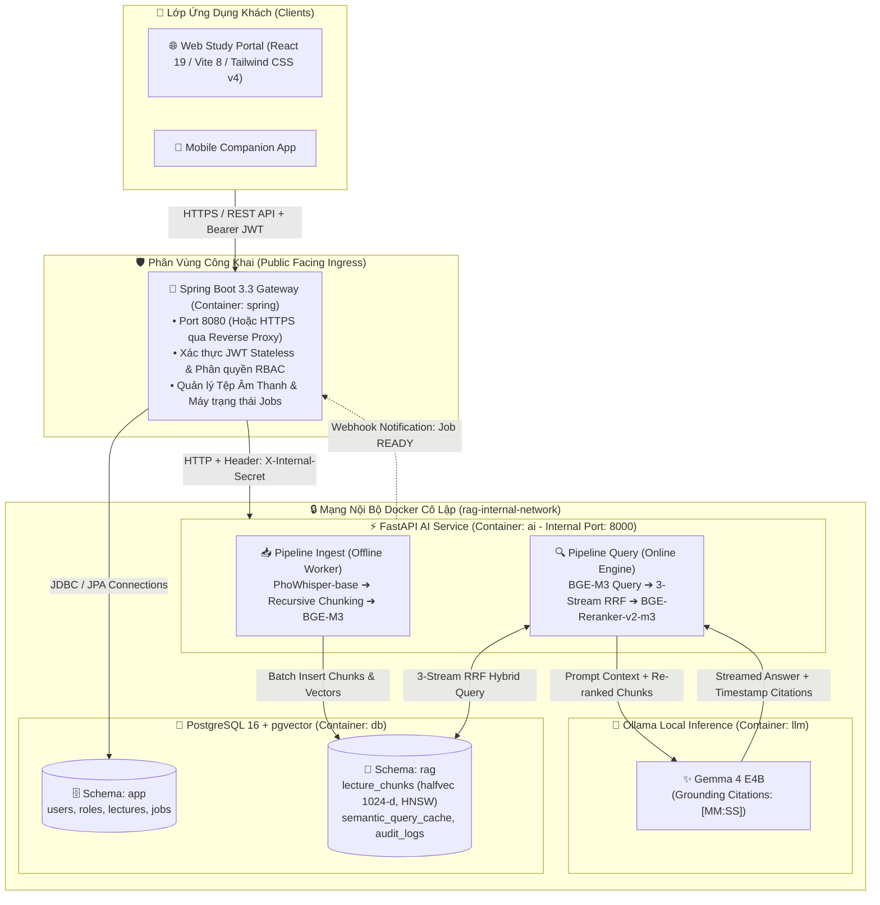

<div align="center">


# 🦉 LectureLens

### Nền Tảng Học Tập Thông Minh & Trợ Lý Bài Giảng AI Tiếng Việt
**Biến đổi bản ghi âm bài giảng thành sổ tay tri thức tương tác — Kiến trúc On-Premise 2-Stage Neural RAG bảo mật tuyệt đối.**

<br/>

[](https://react.dev/)
[](https://vitejs.dev/)
[-3178C6?style=for-the-badge&logo=typescript&logoColor=white)](https://www.typescriptlang.org/)
[](https://tailwindcss.com/)
[](https://threejs.org/)
[](https://spring.io/projects/spring-boot)
[](https://fastapi.tiangolo.com/)
[](https://github.com/pgvector/pgvector)
[](https://ollama.ai/)
[](https://oxc.rs/)
[](./LICENSE)

<br/>

[Tổng Quan](#-1-tổng-quan-dự-án-overview) • [Tính Năng Cốt Lõi](#-2-tính-năng-cốt-lõi-core-features) • [Ngôn Ngữ Thiết Kế Kitsune Soft](#-3-ngôn-ngữ-thiết-kế-kitsune-soft-design-system) • [Kiến Trúc Kỹ Thuật](#-4-kiến-trúc-hệ-thống-system-architecture) • [Bộ Mô Hình AI Cục Bộ](#-5-bộ-mô-hình-ai-on-premise-local-weights) • [Cơ Sở Dữ Liệu Vector Multi-Schema](#-6-cơ-sở-dữ-liệu-vector-multi-schema-database) • [Cấu Trúc Thư Mục](#-7-cấu-trúc-thư-mục-repository-structure) • [Hướng Dẫn Cài Đặt](#-8-hướng-dẫn-cài-đặt--vận-hành-quickstart) • [Quy Chuẩn Kỹ Sư](#-9-quy-chuẩn-kỹ-sư--triết-lý-phần-mềm-engineering-constitution)

</div>

---

## 📖 1. Tổng Quan Dự Án (Overview)

Trong các giảng đường đại học và môi trường nghiên cứu chuyên sâu, sinh viên thường xuyên đối mặt với **áp lực kép**: vừa phải tập trung nghe giảng viên phân tích các khái niệm trừu tượng, vừa phải cặm cụi ghi chép tài liệu. Việc nghe lại toàn bộ bản ghi âm bài giảng dài từ 2 đến 3 tiếng là một sự lãng phí thời gian khổng lồ trong mùa thi cử.

**LectureLens** ra đời như một **Bàn Học Điện Tử Thông Minh (Smart Study Hub)** được may đo riêng cho người học Việt Nam:
1. **Thu âm & Chuyển đổi chính xác cao:** Sử dụng mô hình nhận dạng giọng nói tiếng Việt chuyên biệt (`PhoWhisper-base`), tự động tách câu và gắn mốc thời gian (*Timestamps*) theo định dạng `[MM:SS]`.
2. **Cấu trúc hóa tri thức tự động:** Chuyển đổi nội dung bài giảng thành hệ thống ghi chép khoa học chuẩn **Cornell Notes** (Summary tổng quan, Cues từ khóa trọng tâm, và Notes chi tiết).
3. **Truy vấn ngữ nghĩa 2 giai đoạn (2-Stage Neural RAG):** Cho phép người học đặt câu hỏi trực tiếp trên toàn bộ kho bài giảng, nhận câu trả lời súc tích kèm mốc thời gian dẫn nguồn chính xác để bấm vào nghe lại tức thì.
4. **Bộ công cụ ôn tập cá nhân hóa:** Tự động trích xuất thẻ học **Kitsune Flashcard** hai mặt (Active Recall) liên kết trực tiếp với đoạn phát lại âm thanh gốc và bài kiểm tra trắc nghiệm tương tác.
5. **Linh vật Cáo Kitsune 3D đồng hành:** Tạo dựng không gian học tập thư thái, xua tan áp lực thi cử với linh vật Cáo Kitsune Pixel Art tương tác trên nền tảng Canvas 3D.

> [!IMPORTANT]
> **Triết lý Bất Biến — Privacy-First & Zero Cloud Leakage ([ADR 0001](./docs/adr/0001-privacy-first-local-ai-architecture.md)):**  
> Toàn bộ pipeline ASR, Vectorization, Reranking và LLM Inference được thực thi **100% cục bộ (On-Premise)** trên máy chủ hoặc máy trạm của tổ chức giáo dục.  
> **Cam kết không bao giờ truyền bất kỳ byte âm thanh, văn bản ghi chép hay vector bài giảng nào ra dịch vụ đám mây công cộng bên thứ ba.**

---

## ✨ 2. Tính Năng Cốt Lõi (Core Features)

```
                       🎙️ BÀI GIẢNG ÂM THANH (AUDIO INGEST)
                                      │
                                      ▼
               ⚡ NHẬN DẠNG TIẾNG NÓI TIẾNG VIỆT (PhoWhisper-base)
                     (Tự động gán mốc thời gian [MM:SS])
                                      │
                                      ▼
               📑 PHÂN ĐOẠN ĐỆ QUY & NHÚNG VECTOR (BGE-M3)
                     (512 tokens / 64 overlap, 1024 chiều)
                                      │
                 ┌────────────────────┴────────────────────┐
                 ▼                                         ▼
     🔍 2-STAGE NEURAL RAG                     📝 SMART STATIONERY STUDY
     • 3-Stream Hybrid Search (RRF)            • Ghi chép khoa học Cornell Notes
     • Cross-Encoder (BGE-Reranker-v2-m3)      • Kitsune Flashcard (Active Recall)
     • Ollama Gemma 4 E4B (Grounded)           • Lặp lại ngắt quãng Spaced Repetition
     • Trích dẫn mốc thời gian [MM:SS]         • Trợ lý Cáo Kitsune tương tác 3D
```

### 2.1. 🎙️ Nhận Dạng Giọng Nói Chuyên Biệt Cho Tiếng Việt (Vietnamese ASR)
- Ứng dụng mô hình **PhoWhisper-base** được huấn luyện tối ưu cho ngữ điệu học thuật, thuật ngữ chuyên ngành và các phương ngữ địa phương Việt Nam.
- Gắn timestamp `[MM:SS]` chính xác đến từng câu nói. Khi bấm vào bất kỳ dòng văn bản nào trên giao diện, trình phát âm thanh sẽ tự động nhảy đến đúng thời điểm giảng viên phát biểu.

### 2.2. 🔍 Truy Vấn Ngữ Nghĩa Hai Giai Đoạn (2-Stage Neural RAG)
- **Giai đoạn 1 — Candidate Retrieval:** Truy vấn lai 3 luồng đồng thời (**Dense HNSW Vector** + **Full-Text Search TSVECTOR** + **Trigram pg_trgm Fuzzy**) được hợp nhất bằng thuật toán **Reciprocal Rank Fusion (RRF)** để trích xuất nhanh Top-25 phân đoạn tiềm năng.
- **Giai đoạn 2 — Deep Precision Reranking:** Bộ tái định vị Cross-Encoder **BGE-Reranker-v2-m3** chấm điểm tương quan cặp (Query - Passage), loại bỏ triệt để các đoạn văn bản gây nhiễu và chọn lọc Top 3–5 đoạn đắt giá nhất.
- **Suy luận có dẫn nguồn (Grounded Generation):** Mô hình **Gemma 4 E4B** (qua Ollama) tổng hợp câu trả lời dựa trên văn cảnh trích xuất, bắt buộc đính kèm trích dẫn `[MM:SS]`, triệt tiêu hoàn toàn hiện tượng ảo giác (hallucination).

### 2.3. 🗂️ Bộ Công Cụ Học Tập Thông Minh (Smart Stationery)
- **Cấu Trúc Cornell Notes:** Bố cục 3 phần khoa học gồm Summary (khái quát nhanh), Cues (thuật ngữ trọng tâm, gợi ý câu hỏi) và Notes (nội dung bài giảng chi tiết).
- **Kitsune Flashcard (Active Recall & Spaced Repetition):** Thẻ học lật 3D hai mặt (Front: Câu hỏi kích thích tư duy; Back: Lời giải thích, đánh giá mức độ ghi nhớ và lối tắt phát lại đúng đoạn âm thanh bài giảng).
- **Capsule Audio Player:** Trình phát bài giảng dạng con nhộng ghim cố định ở đáy màn hình, hỗ trợ phát liên tục không ngắt quãng, điều chỉnh đa tốc độ (`0.75x` đến `2.0x`) và tua nhanh/chậm 10 giây.

### 2.4. 🦊 Linh Vật Cáo Kitsune 3D Tương Tác (Kitsune Fox Companion)
- Linh vật Cáo trắng Kitsune Pixel Art được tích hợp trong không gian 3D tương tác (`Three.js` + `@react-three/fiber` + `@react-three/drei`), mang lại trải nghiệm học tập ấm áp, trực quan và tràn đầy năng lượng tích cực.

---

## 🌸 3. Ngôn Ngữ Thiết Kế: Kitsune Soft (Design System)

Giao diện LectureLens được xây dựng dựa trên hệ thống thiết kế độc quyền **Kitsune Soft** (*"Kawaii-Calm" Japanese Soft-Minimalism*) — lấy cảm hứng từ bàn học tối giản, ấm cúng của sinh viên Nhật Bản:

### 3.1. Bảng Màu Cốt Lõi (Color Palette Tokens)

| Token CSS | Mã Màu HEX / RGBA | Vai Trò & Vị Trí Áp Dụng |
| :--- | :---: | :--- |
| **`washi-cream`** | `#FFF7FD` | Nền canvas toàn bộ ứng dụng: Giấy Washi ngà ấm áp, chống mỏi mắt tuyệt đối khi học lâu |
| **`kitsune-coral`** | `#F47F72` | San hô Kitsune: Màu thương hiệu chính (Primary CTA, viền focus, trạng thái active) |
| **`sakura-pink`** | `#F5C3C9` | Hồng hoa anh đào: Badge phân loại môn học, điểm nhấn linh vật |
| **`mist-sky`** | `#A9D4E8` | Xanh sương lam: Thanh tiến độ học tập, thông báo hệ thống cân bằng |
| **`mochi-yellow`** | `#FFE27A` | Vàng mochi: Đánh dấu sao yêu thích, khối tóm tắt bài học Cornell, huy hiệu học tập |
| **`matcha-mint`** | `#BEE1D0` | Xanh trà matcha: Trạng thái hoàn thành bài học, nhãn thời gian timestamp `[MM:SS]` |
| **`plum-ink`** | `#261333` | Mực mận chín cao cấp: Toàn bộ chữ tiêu đề, nội dung và viền nét icon (đạt chuẩn **WCAG AAA**) |

### 3.2. Bề Mặt & Động Lực Học (Surfaces & Mochi Physics)
- **Kính Mờ Sữa (Miruku Glass):** Nền thẻ nội dung bán trong suốt `rgba(255, 255, 255, 0.76)` kết hợp làm mờ hậu cảnh `backdrop-filter: blur(16px)` và bóng đổ ấm mận chín `rgba(38, 19, 51, 0.06)`.
- **Bo Góc Squircle & Pill:** Bo góc Squircle nảy nở `28px` cho các thẻ Bento bài học và bo tròn tuyệt đối `9999px` (Pill Shape) cho toàn bộ nút bấm, thanh điều khiển, trường nhập liệu.
- **Động Lực Học Mochi (Mochi Press Depth):** Mọi nút bấm và thẻ tương tác khi nhấn (`:active`) đều co nhẹ `scale(0.97)` trong thời gian `0.15s`, tạo cảm giác đàn hồi mềm mại như chạm vào bánh mochi tươi.

### 3.3. Danh Mục 28 Màn Hình Mẫu Đã Chuẩn Hóa Toàn Diện

Toàn bộ 28 màn hình đã được đối soát nội dung và đồng bộ hóa danh xưng 1:1 giữa hai thư mục:
- Vector SVG: [`frontend/src/assets/LectureLens App Design System - SVG/`](./frontend/src/assets/LectureLens%20App%20Design%20System%20-%20SVG/)
- Raster PNG (4x): [`frontend/src/assets/LectureLens App Design System - PNG/`](./frontend/src/assets/LectureLens%20App%20Design%20System%20-%20PNG/)

<details>
<summary><b>👉 Nhấn vào đây để xem chi tiết danh sách 28 màn hình chuẩn hóa</b></summary>
<br/>

| STT | Tên Tệp Chuẩn Hóa (`.svg` / `.png`) | Nhóm Nghiệp Vụ | Chức Vụ & Vai Trò Thực Tế |
| :---: | :--- | :--- | :--- |
| **01** | `01 - Splash - App Launch` | Khởi Động | Màn hình khởi động ứng dụng, logo Cáo Kitsune & tiến trình chuẩn bị |
| **02** | `02 - Onboarding - Step 1 (Record or Upload)` | Onboarding | Giới thiệu bước 1: Thu âm bài giảng trực tiếp hoặc tải file âm thanh |
| **03** | `03 - Onboarding - Step 2 (Find What Matters)` | Onboarding | Giới thiệu bước 2: Trợ lý AI tự động trích xuất điểm nhấn và tóm tắt trọng tâm |
| **04** | `04 - Onboarding - Step 3 (Remember It)` | Onboarding | Giới thiệu bước 3: Thẻ ghi nhớ Flashcard thông minh gắn kèm audio bài giảng |
| **05** | `05 - Auth - Sign In` | Xác Thực | Đăng nhập tài khoản sinh viên (Email trường / Mật khẩu / Google / Apple) |
| **06** | `06 - Auth - Create Account` | Xác Thực | Đăng ký tài khoản sinh viên mới kèm xác nhận điều khoản dịch vụ |
| **07** | `07 - Paywall - Kitsune Plus Subscription` | Gói Dịch Vụ | Màn hình nâng cấp gói học tập Kitsune Plus (không giới hạn giờ ASR & RAG) |
| **08** | `08 - Home - Study Hub Dashboard` | Bàn Học Chính | Bàn học thông minh: Tiếp tục nghe bài giảng, thẻ cần ôn hôm nay, chuỗi ngày streak |
| **09** | `09 - Home - Offline State` | Trạng Thái | Giao diện Home khi mất kết nối mạng, hiển thị thông báo offline và bài đã tải |
| **10** | `10 - Library - Lecture Archive` | Thư Viện | Kho lưu trữ bài giảng tổng hợp, hỗ trợ lọc theo môn học và mốc thời gian |
| **11** | `11 - Library - Empty State` | Thư Viện | Trạng thái rỗng của thư viện khi người dùng chưa có bản thu âm nào |
| **12** | `12 - Library - Offline State` | Thư Viện | Thư viện ngoại tuyến, chỉ truy cập kho bài học đã lưu vào bộ nhớ máy (Vault) |
| **13** | `13 - Audio - Add Audio Bottom Sheet` | Ghi Âm | Bảng điều khiển nạp âm thanh: Thu trực tiếp, tải file, dán link, Voice Memos |
| **14** | `14 - Audio - Live Recording` | Ghi Âm | Màn hình đang thu âm bài giảng trực tiếp: Hiển thị sóng âm, timer, gắn sao highlight |
| **15** | `15 - Audio - Processing Pipeline` | Xử Lý AI | Tiến trình AI tổng hợp 5 giai đoạn (Upload ➔ ASR ➔ Highlight ➔ Tóm tắt ➔ Flashcard) |
| **16** | `16 - Audio Detail - Synchronized Transcript` | Chi Tiết Audio | Trình phát bài giảng tab Lời thoại: Bản gỡ băng tự động đồng bộ theo từng mốc `[MM:SS]` |
| **17** | `17 - Audio Detail - Key Highlights` | Chi Tiết Audio | Trình phát bài giảng tab Điểm nhấn: Phân đoạn quan trọng do AI lọc hoặc sinh viên đánh dấu |
| **18** | `18 - Audio Detail - Cornell Summary Overview` | Chi Tiết Audio | Trình phát bài giảng tab Tóm tắt: Bản tóm tắt chuẩn Cornell Notes tổng quan |
| **19** | `19 - Audio Detail - Cornell Summary Chapter View` | Chi Tiết Audio | Bản tóm tắt Cornell mở rộng chi tiết theo chương kèm phím tua 10 giây |
| **20** | `20 - Subjects - Course Archive` | Môn Học | Danh mục tổng hợp tất cả môn học trong học kỳ kèm tỷ lệ hoàn thành |
| **21** | `21 - Subjects - Course Detail (Macroeconomics)` | Môn Học | Chi tiết môn học: Mức độ ghi nhớ, số thẻ cần ôn và danh sách bài giảng của môn |
| **22** | `22 - Search - Neural RAG & Audio Snippets` | Tìm Kiếm RAG | Tìm kiếm ngữ nghĩa 2-Stage Neural RAG trích xuất phân đoạn audio tức thì |
| **23** | `23 - Review - Spaced Repetition Study Hub` | Ôn Tập | Trung tâm ôn luyện ngắt quãng (Spaced Repetition), quản lý bộ thẻ (Decks) |
| **24** | `24 - Flashcard - Question (Front)` | Flashcard | Mặt trước thẻ học Flashcard (Active Recall Question) kèm gợi ý và mốc nghe lại |
| **25** | `25 - Flashcard - Answer (Back)` | Flashcard | Mặt sau thẻ học Flashcard: Lời giải thích, phát lại đoạn audio và tự chấm điểm |
| **26** | `26 - Review - Session Complete Celebration` | Ôn Tập | Màn hình chúc mừng hoàn thành phiên ôn tập, cập nhật streak và số thẻ làm đúng |
| **27** | `27 - Profile - Student Stats & Activity` | Hồ Sơ | Trang cá nhân sinh viên: Thống kê giờ học, streak, bản đồ nhiệt học tập (Heatmap) |
| **28** | `28 - Settings - App Preferences` | Cài Đặt | Cài đặt ứng dụng: Nhắc nhở học tập, tốc độ phát mặc định, ngôn ngữ ASR, cache |

</details>

---

## 🏗️ 4. Kiến Trúc Kỹ Thuật (System Architecture)

Hệ thống được thiết kế theo mô hình **Microservices Topology** với sự phân định ranh giới nghiêm ngặt giữa mạng Internet công khai và mạng nội bộ bảo mật:



### Cơ Chế An Toàn Mạng (Security Invariants):
1. **Chỉ mở cổng Ingress:** Duy nhất dịch vụ `spring` được bind port ra máy chủ vật lý (`8080:8080`).
2. **Khóa bí mật nội bộ (`X-Internal-Secret`):** Toàn bộ lời gọi nội bộ từ Spring Boot sang FastAPI bắt buộc phải đính kèm khóa bí mật, ngăn ngừa hoàn toàn truy cập trái phép.
3. **Cô lập CSDL & LLM:** Container `db`, `ai`, `llm` hoạt động trong subnet khép kín `rag-internal-network`, không mở bất kỳ cổng nào ra Internet.

---

## 🧠 5. Bộ Mô Hình AI On-Premise (Local Weights)

Hệ thống vận hành bằng 4 mô hình trí tuệ nhân tạo chuyên biệt với tổng dung lượng trọng số ~**21.5 GB**:

| Thư Mục Mô Hình | Định Danh Hugging Face | Dung Lượng | Kiến Trúc Mạng | Ngữ Cảnh Tối Đa | Nhiệm Vụ Kỹ Thuật |
| :--- | :--- | :---: | :--- | :---: | :--- |
| **`phowhisper-base`** | [`vinai/phowhisper-base`](https://huggingface.co/vinai/phowhisper-base) | ~290 MB | Whisper (Encoder-Decoder) | 30s audio / chunk | Phiên âm tiếng Việt phương ngữ, gán timestamp `[MM:SS]` |
| **`bge-m3`** | [`BAAI/bge-m3`](https://huggingface.co/BAAI/bge-m3) | ~2.2 GB | XLM-RoBERTa (1024-d) | 8192 tokens | Sinh Dense Embedding 1024 chiều và trọng số từ vựng |
| **`bge-reranker-v2-m3`** | [`BAAI/bge-reranker-v2-m3`](https://huggingface.co/BAAI/bge-reranker-v2-m3) | ~2.27 GB | Cross-Encoder | 8192 tokens | Tái xếp hạng ngữ nghĩa sâu Top-25 xuống Top 3–5 đoạn |
| **`gemma-4-e4b`** | [`google/gemma-4-E4B-it`](https://ai.google.dev/gemma) | ~15.8 GB | Gemma 4 Decoder-only | 8192 tokens | Suy luận ngữ cảnh, trả lời câu hỏi và đính kèm dẫn nguồn |

> [!TIP]
> **Quản lý trọng số lớn trên Git:** Các tệp nhị phân (`.bin`, `.safetensors`, `.pt`) đã được đưa vào `.gitignore`. Khi thiết lập dự án trên máy mới, chỉ cần chạy lệnh `npm run backend:download-models` để tải tự động toàn bộ trọng số.

---

## 🐘 6. Cơ Sở Dữ Liệu Vector (Multi-Schema Database)

Hệ thống cơ sở dữ liệu được tổ chức thành 2 schema phân lập trong PostgreSQL 16:

```
lecturelens_db
├── 🗄️ schema: app (Nghiệp vụ do Spring Boot quản trị)
│   ├── users (Thông tin sinh viên, giảng viên, vai trò RBAC)
│   ├── lectures (Metadata bài giảng, đường dẫn audio, thời lượng)
│   └── jobs (Máy trạng thái xử lý: QUEUED -> STT -> CHUNKING -> EMBEDDING -> READY)
│
└── 📐 schema: rag (Tri thức số hóa do FastAPI quản trị)
    ├── lecture_chunks (Phân đoạn bài giảng, halfvec 1024-d, timestamps, unaccent, TSVECTOR)
    ├── semantic_query_cache (Bộ đệm câu hỏi tương đồng >0.95, phản hồi <10ms)
    └── rag_audit_logs (Lưu vết độ trễ và chất lượng truy xuất)
```

### Các Đặc Tính Tối Ưu Nâng Cao:
- **`halfvec(1024)` (pgvector 0.7+):** Lưu trữ vector ở nửa độ chính xác FP16, giảm 50% RAM, tăng 1.8x tốc độ quét HNSW với độ bao phủ Recall duy trì > 99.2%.
- **3-Stream RRF Hybrid Search (`rag.search_vietnamese_rag_rrf`):** Kết hợp đồng thời:
  1. *Dense Stream:* Khoảng cách Cosine trên chỉ mục HNSW (`m=16`, `ef_construction=64`).
  2. *Lexical Stream:* Khớp từ khóa chuẩn xác qua `to_tsvector('simple', unaccent(content))`.
  3. *Fuzzy Stream:* Khớp mờ viết tắt hoặc gõ không dấu qua `pg_trgm`.
- **Mở Rộng Ngữ Cảnh 3 Chiều (`rag.get_expanded_context`):** Tự động liên kết `prev_chunk_id` và `next_chunk_id` để cung cấp cho LLM đoạn văn bản mạch lạc 2–3 phút xung quanh mốc trích xuất.

---

## 📂 7. Cấu Trúc Thư Mục (Repository Structure)

```
lecture_lens/
├── package.json                         # Monorepo Orchestrator: Quản trị toàn bộ scripts của dự án
├── AGENTS.md                            # Hiến chương kỹ thuật bắt buộc cho AI Agents
├── GLOSSARY.md                          # Từ điển ngôn ngữ miền chuẩn (Ubiquitous Language)
├── README.md                            # Hồ sơ kỹ thuật dự án (Tài liệu này)
│
├── frontend/                            # 🌐 LỚP WEB CLIENT (React 19, Vite 8, Tailwind v4, Three.js)
│   ├── public/                          # Tài nguyên tĩnh, favicon, web manifest
│   ├── src/                             # Mã nguồn ứng dụng
│   │   ├── assets/                      # Tài nguyên đồ họa
│   │   │   ├── LectureLens App Design System - PNG/ # 🌸 28 Màn hình mẫu raster (4x)
│   │   │   ├── LectureLens App Design System - SVG/ # 🌸 28 Màn hình mẫu vector sắc nét
│   │   │   └── logo-LectureLens.png     # Logo Cáo Kitsune Pixel Art
│   │   ├── App.tsx                      # Component chính & 3D Interactive Mascot Canvas
│   │   ├── index.css                    # Tailwind CSS v4 entrypoint & Kitsune Soft Tokens
│   │   └── main.tsx                     # Khởi chạy React DOM
│   ├── .oxlintrc.json                   # Cấu hình linter siêu tốc oxlint
│   ├── package.json                     # Quản lý thư viện Frontend
│   ├── tsconfig.json                    # Cấu hình TypeScript Strict Mode
│   └── vite.config.ts                   # Cấu hình Vite 8 & Tailwind CSS plugin
│
├── backend/                             # ⚙️ HẠ TẦNG BACKEND & AI ENGINE (On-Premise 2-Stage RAG)
│   ├── db/                              # 🐘 Cơ sở dữ liệu PostgreSQL 16 + pgvector
│   │   ├── init/                        # 5 SQL Scripts khởi tạo tự động
│   │   │   ├── 01_rag_extensions.sql    # Kích hoạt vector, pg_trgm, unaccent
│   │   │   ├── 02_rag_chunks_schema.sql # Bảng lecture_chunks với halfvec(1024)
│   │   │   ├── 03_rag_indexes.sql       # Chỉ mục HNSW, GIN TSVECTOR, GiST Trigram
│   │   │   ├── 04_rag_hybrid_search_rrf.sql # Hàm Hybrid Search 3 luồng & Context Expansion
│   │   │   └── 05_rag_telemetry_cache.sql   # Bảng Semantic Query Cache & Audit Logs
│   │   ├── postgresql.conf              # Cấu hình tối ưu bộ nhớ & HNSW
│   │   ├── rag_schema_complete.sql      # Schema hợp nhất hoàn chỉnh
│   │   ├── verify_rag_db.py             # Script tự động kiểm tra CSDL và chỉ mục
│   │   └── README.md                    # Tài liệu đặc tả cơ sở dữ liệu
│   ├── models/                          # 🧠 Thư mục lưu trữ 4 mô hình AI (~21.5 GB)
│   │   ├── phowhisper-base/             # ASR Tiếng Việt
│   │   ├── bge-m3/                      # Dense Embedding 1024-d
│   │   ├── bge-reranker-v2-m3/          # Cross-Encoder Reranker
│   │   └── gemma-4-e4b/                 # LLM Contextual Generation
│   ├── download_models.py               # Script tự động tải mô hình từ Hugging Face
│   ├── .env.example                     # Mẫu biến môi trường an toàn
│   └── README.md                        # Đặc tả chi tiết kiến trúc Backend
│
├── docs/                                # 📚 TÀI LIỆU KỸ THUẬT & KIẾN TRÚC
│   ├── design-system.md                 # Đặc tả hệ thống thiết kế Kitsune Soft
│   ├── adr/                             # Quyết định kiến trúc phần mềm (ADR)
│   │   └── 0001-privacy-first-local-ai-architecture.md
│   └── agents/                          # Hướng dẫn quy trình Domain & Issues
│
└── tools/                               # 🛠️ CÔNG CỤ & KỸ NĂNG KỸ THUẬT
    ├── mattpocock-skills/               # Bộ kỹ năng Deep Modules, TDD, Domain Modeling
    ├── Understand-Anything/             # Công cụ quét và sinh Knowledge Graph dự án
    └── stitch/                          # Công cụ hỗ trợ giao diện Google Stitch
```

---

## 🚀 8. Hướng Dẫn Cài Đặt & Vận Hành (Quickstart)

### 8.1. Yêu Cầu Tiên Quyết (Prerequisites)
- **Node.js:** Phiên bản `v20.x` hoặc `v22.x` (LTS)
- **Python:** Phiên bản `3.10+` kèm `pip`
- **Docker & Docker Compose:** Phiên bản `v2.20+`
- **Phần cứng đề xuất:** Card đồ họa NVIDIA RTX 3060 12GB VRAM (tối thiểu) hoặc RTX 4090 / A10G 24GB (khuyến nghị cho môi trường Production).

---

### 8.2. Khởi Chạy Frontend Web (Kitsune Soft Portal)

Thực thi trực tiếp từ thư mục gốc thông qua npm scripts:

```bash
# 1. Cài đặt các gói phụ thuộc
npm install --prefix frontend

# 2. Khởi chạy máy chủ phát triển Vite Dev Server (Port 5173)
npm run dev

# 3. Kiểm tra kiểu dữ liệu TypeScript & đóng gói thử nghiệm
npm run typecheck

# 4. Kiểm tra quy chuẩn mã nguồn bằng oxlint
npm run lint

# 5. Xem trước bản đóng gói Production
npm run preview
```

Giao diện Web phát triển sẽ sẵn sàng tại: `http://localhost:5173`

---

### 8.3. Khởi Chạy Backend & Cụm Mô Hình AI

```bash
# 1. Di chuyển vào thư mục backend
cd backend

# 2. Thiết lập biến môi trường từ mẫu an toàn
cp .env.example .env

# 3. Tải toàn bộ trọng số 4 mô hình AI về thư mục models/ (~21.5 GB)
pip install huggingface_hub
python download_models.py

# 4. Kiểm tra kết nối và xác minh chỉ mục CSDL RAG
python db/verify_rag_db.py
```

Khi triển khai trên Docker:
- **Spring Boot Gateway:** `http://localhost:8080` (Cổng công khai Ingress)
- **FastAPI AI Service:** `http://ai:8000` (Nội bộ qua `X-Internal-Secret`)
- **PostgreSQL 16 + pgvector:** `db:5432` (Nội bộ, phân vùng `app` và `rag`)
- **Ollama LLM Engine:** `http://llm:11434` (Nội bộ phục vụ Gemma 4 E4B)

---

## 🛡️ 9. Quy Chuẩn Kỹ Sư & Triết Lý Phần Mềm (Engineering Constitution)

Mọi kỹ sư và trợ lý AI khi làm việc trên kho lưu trữ **LectureLens** bắt buộc phải tuân thủ [Hiến Chương Kỹ Thuật (AGENTS.md)](./AGENTS.md) và các nguyên lý kỹ thuật từ Matt Pocock:

### 1. Thiết Kế Mô-đun Sâu (Deep Modules Principle)
- Giữ giao diện (**Interface**) của mọi component, service hoặc hàm ở mức tối giản, dễ hiểu và dễ tiếp cận.
- Ẩn giấu toàn bộ tính toán phức tạp vào phần triển khai (**Implementation**).
- *Ví dụ:* Giao diện tìm kiếm `search_vietnamese_rag_rrf` chỉ nhận câu hỏi và danh sách ID bài giảng; ẩn giấu hoàn toàn 3 luồng tính toán vector, trigram, full-text và thuật toán RRF bên dưới.

### 2. Tuân Thủ Ngôn Ngữ Miền Bắt Buộc (Ubiquitous Language)
- Luôn đối soát thuật ngữ với [GLOSSARY.md](./GLOSSARY.md).
- Dùng đúng: `LectureLens`, `Kitsune Soft`, `Kitsune Fox Companion`, `Capsule Audio Player`, `Cornell Notes`, `2-Stage Neural RAG`.
- Tránh tuyệt đối: `SmartLecture`, `LectureApp`, `Cloud AI API`.

### 3. Phát Triển Hướng Kiểm Thử Qua Ranh Giới (Test Through The Seam)
- Viết kiểm thử trước khi hiện thực hóa logic (TDD).
- Kiểm thử thông qua ranh giới thay đổi (**Seam**), không kiểm thử xuyên qua chi tiết triển khai nội bộ để đảm bảo mã nguồn dễ tái cấu trúc mà không làm gãy test.

---

## 🤝 Đóng Góp Phát Triển (Contributing)

Dự án hoan nghênh mọi đóng góp từ cộng đồng nghiên cứu giáo dục và mã nguồn mở:
1. Fork repository về tài khoản cá nhân.
2. Tạo nhánh tính năng mới (`git checkout -b feature/amazing-feature`).
3. Commit các thay đổi tuân thủ Conventional Commits (`git commit -m 'feat: add mochi tactile interactive card'`).
4. Kiểm tra linter và kiểu dữ liệu (`npm run lint && npm run typecheck`).
5. Đẩy nhánh lên repository của bạn (`git push origin feature/amazing-feature`).
6. Tạo một Pull Request mô tả chi tiết giải pháp kỹ thuật.

---

## 📜 Giấy Phép Bản Quyền (License)

Dự án được phân phối dưới giấy phép **Apache License 2.0**. Xem chi tiết tại tệp [LICENSE](./LICENSE).

---

<div align="center">
  <sub>Được phát triển với niềm đam mê nâng cao chất lượng giáo dục Việt Nam 🇻🇳</sub><br/>
  <sub>Bản quyền © 2026 <b>LectureLens Engineering Team</b>. Bảo lưu mọi quyền.</sub>
</div>
