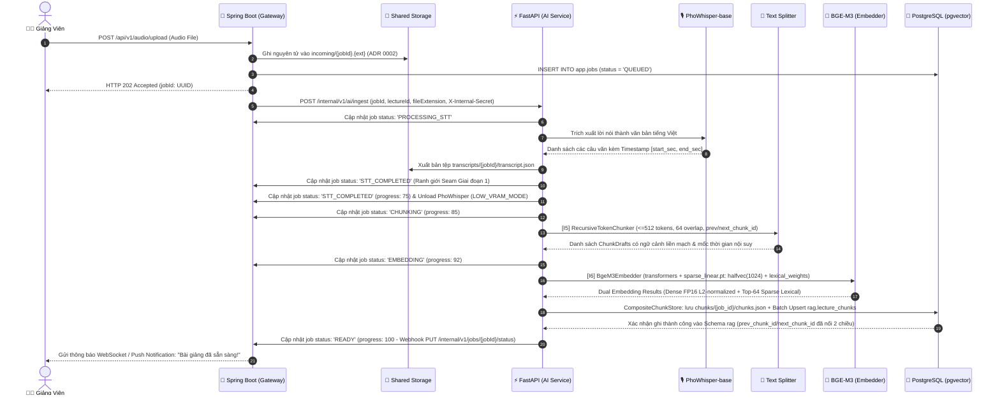
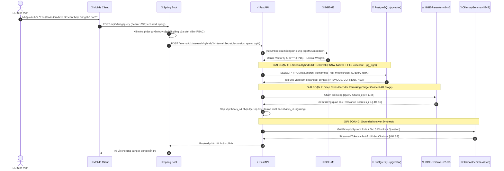

# 🎙️📚 LectureLens Backend – On-Premise 2-Stage Neural RAG Architecture

[](#2-kiến-trúc-hệ-thống-system-architecture)
[](https://spring.io/projects/spring-boot)
[](https://fastapi.tiangolo.com/)
[](https://github.com/pgvector/pgvector)
[](https://ollama.ai/)
[](https://pytorch.org/)
[](../LICENSE)

---

Tài liệu này đặc tả toàn diện kiến trúc kỹ thuật, quy trình xử lý dữ liệu âm thanh, cơ chế tìm kiếm tăng cường truy xuất (Retrieval-Augmented Generation — RAG) 2 giai đoạn, thiết kế cơ sở dữ liệu đa vùng (Multi-Schema), chính sách an toàn mạng và danh mục API cho hạ tầng **LectureLens Backend & AI Service** (Hạ tầng Backend & Dịch vụ Trí tuệ Nhân tạo xử lý bài giảng của dự án LectureLens).

---

## 📑 Mục Lục (Table of Contents)

- [1. Tổng Quan Kỹ Thuật (Technical Overview)](#1-tổng-quan-kỹ-thuật-technical-overview)
- [2. Kiến Trúc Hệ Thống (System Architecture)](#2-kiến-trúc-hệ-thống-system-architecture)
- [3. Đặc Tả Các Dịch Vụ Cốt Lõi (Core Services Specification)](#3-đặc-tả-các-dịch-vụ-cốt-lõi-core-services-specification)
  - [3.1. Spring Boot Gateway Service (`spring`)](#31-spring-boot-gateway-service-spring)
  - [3.2. FastAPI AI & RAG Engine (`ai`)](#32-fastapi-ai--rag-engine-ai)
  - [3.3. PostgreSQL 16 + pgvector Multi-Schema DB (`db`)](#33-postgresql-16--pgvector-multi-schema-db-db)
  - [3.4. Ollama LLM Runtime Engine (`llm`)](#34-ollama-llm-runtime-engine-llm)
- [4. Hai Luồng Xử Lý Dữ Liệu Cốt Lõi (Core Pipelines)](#4-hai-luồng-xử-lý-dữ-liệu-cốt-lõi-core-pipelines)
  - [4.1. Pipeline Ingest (Offline) — Audio Transcription & Vectorization](#41-pipeline-ingest-offline--audio-transcription--vectorization)
  - [4.2. Pipeline Query (Online) — 2-Stage Retrieval & Grounded Generation](#42-pipeline-query-online--2-stage-retrieval--grounded-generation)
- [5. Danh Mục Mô Hình AI & Quản Lý Trọng Số](#5-danh-mục-mô-hình-ai--quản-lý-trọng-số)
- [6. Thiết Kế Cơ Sở Dữ Liệu & Tối Ưu Chỉ Mục Vector (Database & Index Tuning)](#6-thiết-kế-cơ-sở-dữ-liệu--tối-ưu-chỉ-mục-vector-database--index-tuning)
- [7. Cơ Chế Bảo Mật & Cô Lập Mạng Docker (Security & Network Isolation)](#7-cơ-chế-bảo-mật--cô-lập-mạng-docker-security--network-isolation)
- [8. Yêu Cầu Phần Cứng & Phân Bổ Tài Nguyên (Hardware Sizing)](#8-yêu-cầu-phần-cứng--phân-bổ-tài-nguyên-hardware-sizing)
- [9. Đặc Tả Giao Diện Lập Trình (API Specifications)](#9-đặc-tả-giao-diện-lập-trình-api-specifications)
- [10. Hướng Dẫn Cài Đặt & Vận Hành (Deployment Guide)](#10-hướng-dẫn-cài-đặt--vận-hành-deployment-guide)

---

## 1. Tổng Quan Kỹ Thuật (Technical Overview)

Hạ tầng **LectureLens Backend & AI Service** được thiết kế nhằm đáp ứng 3 yêu cầu công nghệ khắt khe:

1. **Độ chính xác cao với tiếng Việt (Vietnamese Domain Specificity):** Sử dụng `PhoWhisper-base` cho nhận dạng tiếng nói (ASR) và `BGE-M3` cho embedding ngữ cảnh đa ngữ, có khả năng xử lý tốt thuật ngữ học thuật, từ mượn và dấu thanh điệu tiếng Việt.
2. **Tìm kiếm 2 giai đoạn chính xác tuyệt đối (2-Stage Neural RAG):** Kết hợp khả năng quét nhanh của chỉ mục vector xấp xỉ **HNSW** (Cosine Distance) với độ chính xác cao của bộ tái định vị **Cross-Encoder BGE-Reranker-v2-m3**, loại bỏ hoàn toàn các đoạn văn bản gây nhiễu trước khi đưa vào mô hình ngôn ngữ lớn.
3. **Bảo mật tuyệt đối & Vận hành Cục bộ (Zero Cloud Leakage — ADR 0001):** Hệ thống không sử dụng các dịch vụ AI bên thứ ba. Toàn bộ 4 mô hình AI đều được phục vụ trực tiếp trên hạ tầng Docker on-premise của tổ chức giáo dục.

---

## 2. Kiến Trúc Hệ Thống (System Architecture)

Hệ thống tuân thủ mô hình **Microservices Topology** với ranh giới phân tách rõ rệt giữa mạng công khai (Public Ingress) và mạng bảo mật nội bộ (Private Isolated Subnet):


<div align="center">
  <sub><b>Hình 1:</b> Sơ đồ kiến trúc tổng thể LectureLens Backend — Phân tách giữa Cổng Spring Boot công khai và Mạng nội bộ Docker an toàn.</sub>
</div>

<br/>

### Sơ đồ luồng tương tác hệ thống (System Interaction Flowchart)

```mermaid
flowchart TD
    subgraph Clients ["📱 Ứng Dụng Khách (Clients)"]
        MOBILE["📱 LectureLens Mobile App (Expo SDK 58 / React Native 0.88)"]
        LEGACY["🗄️ legacy/web-frontend (Lưu trữ lịch sử)"]
    end

    subgraph PublicDMZ ["🛡️ Phân Vùng Công Khai (Public Facing Ingress)"]
        SB["🍃 Spring Boot 3.3 Gateway (Container: spring)<br/>• Port 8080 (hoặc 443 via Reverse Proxy)<br/>• JWT Authentication & OAuth2<br/>• Role-Based Access Control (RBAC)<br/>• Job State Machine & Audio Storage"]
    end

    Clients -->|HTTPS / REST API + Bearer JWT| SB

    subgraph PrivateSubnet ["🔒 Mạng Nội Bộ Docker (Isolated Docker Network: rag-internal-network)"]
        direction TB

        subgraph AIService ["⚡ FastAPI AI Service (Container: ai)"]
            direction TB
            INGEST_FLOW["📥 Stage 1 + Stage 2 Ingest Worker<br/>[I4] PhoWhisper-base ➔ transcript.json<br/>➔ [I5] RecursiveTokenChunker (<=512 tok)<br/>➔ Unload ASR ➔ [I6] BgeM3Embedder ➔ chunks.json"]
            QUERY_FLOW["🔍 Query & Context Engine<br/>BGE-M3 Query ➔ 3-Stream RRF Hybrid Search<br/>➔ Doubly-Linked Context / Reranker"]
        end

        subgraph SharedVol ["💾 Shared Volume (/volumes/rag_data)"]
            VOLUME[("ingest/incoming, audio/manifest.json,<br/>transcripts/transcript.json, chunks/chunks.json")]
        end

        subgraph StorageLayer ["🐘 PostgreSQL 16 + pgvector (Container: db)"]
            direction LR
            SCHEMA_APP[("🗄️ Schema: app<br/>users, roles, classes,<br/>lectures, jobs")]
            SCHEMA_RAG[("📐 Schema: rag<br/>lecture_chunks: halfvec(1024) HNSW<br/>+ lexical_weights JSONB + tsv_content GIN + prev/next")]
        end

        subgraph LLMRuntime ["🦙 Ollama Local Inference (Container: llm)"]
            GEMMA["✨ Gemma 4 E4B<br/>(Contextual Answer & Citation Generation)"]
        end
    end

    SB -->|HTTP + Header: X-Internal-Secret| AIService
    SB -->|Ghi âm thanh nguyên tử| VOLUME
    AIService -->|Đọc/Ghi artifacts O(1)| VOLUME
    SB -->|JDBC / JPA Connections| SCHEMA_APP
    INGEST_FLOW -->|Batch Upsert Chunks & Dual Vectors| SCHEMA_RAG
    QUERY_FLOW <-->|3-Stream RRF & Expanded Context RPC| SCHEMA_RAG
    QUERY_FLOW -->|Prompt Context + Re-ranked Chunks| GEMMA
    GEMMA -->|Streamed Answer + Timestamp Citations| QUERY_FLOW
    AIService -.->|Webhook PUT /internal/v1/jobs/{jobId}/status| SB
```

> 📚 **Tài liệu chuẩn bắt buộc tham chiếu:**
> - **Single Source of Truth API Reference**: [`../docs/API-REFERENCE.md`](../docs/API-REFERENCE.md)
> - **Stage 2 Architectural Decision**: [`../docs/adr/0004-recursive-chunking-and-bge-m3-halfvec-indexing.md`](../docs/adr/0004-recursive-chunking-and-bge-m3-halfvec-indexing.md)

---

## 3. Đặc Tả Các Dịch Vụ Cốt Lõi (Core Services Specification)

### 3.1. Spring Boot Gateway Service (`spring`)
- **Ngôn ngữ & Nền tảng:** Java 17 LTS / Spring Boot 3.3.x.
- **Vai trò:** Lối vào độc quyền từ Internet vào hạ tầng Backend của LectureLens.
- **Trách nhiệm kỹ thuật:**
  - **Bảo mật & Phân quyền:** Xác thực qua Spring Security 6 với JWT Stateless Tokens. Kiểm soát quyền hạn (RBAC) nghiêm ngặt: `ADMIN`, `LECTURER`, `STUDENT`.
  - **Quản lý Tệp Âm Thanh:** Tiếp nhận tệp âm thanh tải lên (`.mp3`, `.wav`, `.m4a`, dung lượng lên tới 500MB), phân tích metadata âm thanh và lưu trữ tạm thời tại volume dùng chung.
  - **Máy trạng thái tác vụ (Job State Machine):** Khởi tạo và theo dõi trạng thái bài giảng:
    $$\text{QUEUED} \longrightarrow \text{PROCESSING\_STT} \longrightarrow \text{STT\_COMPLETED} \longrightarrow \text{CHUNKING} \longrightarrow \text{EMBEDDING} \longrightarrow \text{READY} \text{ (hoặc FAILED)}$$
  - **Đồng bộ liên dịch vụ:** Giao tiếp với FastAPI thông qua Spring `WebClient` có cấu hình Retry với Circuit Breaker (Resilience4j) và kiểm định khóa bí mật nội bộ (`X-Internal-Secret`).

### 3.2. FastAPI AI & RAG Engine (`ai`)
- **Ngôn ngữ & Môi trường:** Python 3.10+ / FastAPI 0.111 / Uvicorn (`docs_url="/internal/docs"`, `openapi_url="/internal/openapi.json"`).
- **Thư viện AI nền tảng:** `torch>=2.3.0`, `transformers>=4.40.0`, `numpy>=1.24.0`, `imageio-ffmpeg>=0.4.9`, `psycopg2-binary>=2.9.9` (`soundfile`, `librosa`, `httpx`, `pydantic-settings`).
- **Ràng buộc nạp mô hình (`bge-m3`):** Tải trực tiếp qua HuggingFace `transformers` (`AutoTokenizer`, `AutoModel`) kết hợp `torch.load("sparse_linear.pt", weights_only=True)` — **tuyệt đối không phụ thuộc `FlagEmbedding` hay `sentence-transformers`**.
- **Vai trò:** Thực hiện pipeline xử lý âm thanh, phiên âm, phân đoạn đệ quy (`[I5]`), nhúng kép (`[I6]`), đồng bộ `pgvector` và tìm kiếm 3-Stream RRF + mở rộng ngữ cảnh.
- **Trách nhiệm kỹ thuật:**
  - **Lazy-Loading & Sequential VRAM Offloading (`LOW_VRAM_MODE=true`):** Các model nặng (`PhoWhisperEngine`, `BgeM3Embedder`) được nạp lười (lazy-load) theo nhu cầu. Dưới khóa `GLOBAL_GPU_SEMAPHORE = asyncio.Semaphore(1)`, pipeline gọi `asr_engine.unload()` tại `STT_COMPLETED` (`gc.collect()` + `torch.cuda.empty_cache()`) trước khi nạp `BgeM3Embedder` ở `EMBEDDING` (tối ưu cho GPU 4 GB VRAM như RTX 3050).
  - **Background Ingestion Worker:** Chạy bất đồng bộ qua FastAPI `BackgroundTasks` và báo tiến độ về Spring Boot Gateway qua `SpringJobReporter` (`PUT /internal/v1/jobs/{jobId}/status`).
  - **2-Stage Neural Retrieval & Doubly-Linked Context:** Tìm kiếm lai 3 luồng RRF trong PostgreSQL (`dense_stream` `halfvec(1024)` HNSW + `lexical_stream` `tsv_content` `rag.immutable_unaccent` + `fuzzy_stream` `pg_trgm`), lưu kèm `lexical_weights` (`JSONB`) từ `BgeM3Embedder` và mở rộng ngữ cảnh liền kề (`[PREVIOUS, CURRENT, NEXT]`) bằng con trỏ `prev_chunk_id`/`next_chunk_id` qua `rag.get_expanded_context`.

### 3.3. PostgreSQL 16 + pgvector Multi-Schema DB (`db`)
- **Phiên bản:** PostgreSQL 16 (docker image `pgvector/pgvector:pg16`, extension `pgvector 0.7.0+`).
- **Kiến trúc Multi-Schema:**
  - `Schema app`: Chứa toàn bộ thực thể quan hệ phục vụ nghiệp vụ (Người dùng, lớp học, bài giảng, tác vụ xử lý). Quản lý bởi Spring Data JPA / Hibernate.
  - `Schema rag`: Chứa dữ liệu tri thức học thuật (`lecture_chunks` với `halfvec(1024)` và `lexical_weights JSONB`). Đồng bộ idempotent từ FastAPI thông qua `PostgresPgVectorChunkStore` (`psycopg2-binary` batch upsert).
- **Chỉ mục Vector HNSW & Hybrid:** Kết hợp `idx_chunks_hnsw_cosine` (`halfvec_cosine_ops`, `m = 16, ef_construction = 64`), GIN trên `tsv_content` (`idx_chunks_tsv`), GIN trigram trên `content_unaccent` (`idx_chunks_trgm_unaccent`), và B-tree nav `idx_chunks_nav`.

### 3.4. Ollama LLM Runtime Engine (`llm`)
- **Phiên bản:** Ollama v0.3.x+.
- **Mô hình phục vụ:** `google/gemma-4-E4B-it` (Gemma 4 Conditional Generation).
- **Cấu hình Modelfile:** Được cấu hình với nhiệt độ suy luận thấp (`temperature 0.2`) và hình phạt lặp lại (`repeat_penalty 1.15`) nhằm đảm bảo câu trả lời mang tính quy nạp, bám sát tuyệt đối vào ngữ cảnh trích xuất và không suy diễn thông tin ngoài bài giảng.

---

## 4. Hai Luồng Xử Lý Dữ Liệu Cốt Lõi (Core Pipelines)

### 4.1. Pipeline Ingest (Offline) — Audio Transcription & Vectorization

Quy trình tự động hóa chuyển đổi bài giảng âm thanh thô thành cơ sở tri thức vector:



#### Chi tiết kỹ thuật Ingestion (Stage 1 + Stage 2):
1. **Chuẩn hóa âm thanh (Audio Preprocessing):** File tải lên được chuyển đổi tự động bằng `ffmpeg` (`highpass=80`, `lowpass=7500`, `afftdn`, `loudnorm`) sang định dạng chuẩn: **16,000 Hz, Mono channel, 16-bit PCM**.
2. **ASR Timestamp Extraction (`[I4]`):** `PhoWhisperEngine` (kèm `EnergyVadChunker`) xuất ra `transcripts/{job_id}/transcript.json` gồm mảng các phân đoạn câu với độ phân giải thời gian chính xác:
   $$\text{Segment} = \{ \text{id}, \text{start\_time}, \text{end\_time}, \text{timestamp\_label}, \text{text} \}$$
3. **Sequential VRAM Offloading (`LOW_VRAM_MODE=true`):** Dưới điều phối tuần tự `GLOBAL_GPU_SEMAPHORE = asyncio.Semaphore(1)`, pipeline gọi `asr_engine.unload()` tại `STT_COMPLETED` (`75%`) để giải phóng hoàn toàn VRAM/RAM trước khi nạp `BgeM3Embedder` ở `EMBEDDING` (`92%`), giúp vận hành ổn định trên GPU **4 GB VRAM** (như RTX 3050).
4. **Recursive Context Chunking (`[I5]`):** `RecursiveTokenChunker` dùng `BgeM3TokenizerAdapter` gom các segment thành chunk không vượt quá **512 tokens** (`reserve_special_tokens=2` -> hiệu dụng `<=510`), duy trì **overlap 64 tokens**, nội suy mốc thời gian nếu phải tách đoạn dài đơn lẻ theo `. `, `? `, `! `, `; `, `\n`, `, `, ` `, và liên kết hai chiều `prev_chunk_id` / `next_chunk_id` (Doubly-Linked Chunks).
5. **BGE-M3 Dual Embedding (`[I6]`):** `BgeM3Embedder` nạp trực tiếp qua `transformers` + `sparse_linear.pt` (`weights_only=True`, không dùng `FlagEmbedding`) để sinh đồng thời Dense Vector **`halfvec(1024)`** (FP16 L2-normalized) và **`lexical_weights`** (`JSONB`, ReLU, Top-64 token không phải special/punctuation, `>=0.01`). Kết quả được lưu bất biến tại `chunks/{job_id}/chunks.json` và đồng bộ lên `rag.lecture_chunks`. (Có thể chạy độc lập Stage 2 từ `transcript.json` có sẵn qua `POST /internal/v1/ai/chunk-and-embed`).

---

### 4.2. Pipeline Query (Online) — 2-Stage Retrieval & Grounded Generation

Quy trình tìm kiếm ngữ nghĩa chuyên sâu và tổng hợp câu trả lời có dẫn nguồn:



#### Quy chuẩn cấu trúc Prompt suy luận (Grounding Guardrail):

```markdown
[HỆ THỐNG]
Bạn là Trợ lý Cáo Kitsune của LectureLens — hệ thống hỗ trợ học tập bài giảng tiếng Việt thông minh.
Nhiệm vụ của bạn là trả lời câu hỏi của người học DỰA TRÊN ngữ cảnh trích xuất dưới đây.

[QUY TẮC BẮT BUỘC]
1. Chỉ sử dụng thông tin có trong phần [NGỮ CẢNH BÀI GIẢNG]. Tuyệt đối không tự suy diễn thông tin ngoài bài giảng.
2. Mỗi khi đưa ra một luận điểm hoặc giải thích, PHẢI dẫn nguồn mốc thời gian bài giảng theo định dạng: [MM:SS].
3. Nếu ngữ cảnh không có thông tin để trả lời, hãy trả lời trung thực: "Bài giảng không đề cập đến nội dung này."

[NGỮ CẢNH BÀI GIẢNG]
- Đoạn 1 (08:15 - 09:40): Gradient descent cập nhật trọng số ngược chiều gradient của hàm mất mát...
- Đoạn 2 (14:20 - 15:55): Tốc độ học (learning rate) quyết định bước nhảy của thuật toán...

[CÂU HỎI CỦA SINH VIÊN]
{user_query}

[CÂU TRẢ LỜI CỦA LECTURELENS]
```

---

## 5. Danh Mục Mô Hình AI & Quản Lý Trọng Số

Hệ thống sử dụng bộ 4 mô hình AI chuyên trách:

| Thư mục cục bộ | Định danh Hugging Face | Dung lượng | Kiến trúc mạng | Ngữ cảnh tối đa | Nhiệm vụ kỹ thuật |
| :--- | :--- | :---: | :--- | :---: | :--- |
| **`phowhisper-base`** | [`vinai/phowhisper-base`](https://huggingface.co/vinai/phowhisper-base) | ~290 MB | Whisper (Encoder-Decoder) | 30s audio / chunk | Nhận dạng tiếng nói tiếng Việt, giải mã âm vị địa phương. |
| **`bge-m3`** | [`BAAI/bge-m3`](https://huggingface.co/BAAI/bge-m3) | ~2.2 GB | XLM-RoBERTa (1024-d) | 8192 tokens | Sinh đồng thời dense embedding `halfvec(1024)` và `lexical_weights` (`sparse_linear.pt`) qua `transformers`. |
| **`bge-reranker-v2-m3`** | [`BAAI/bge-reranker-v2-m3`](https://huggingface.co/BAAI/bge-reranker-v2-m3) | ~2.27 GB | Cross-Encoder (XLM-RoBERTa) | 8192 tokens | Tái xếp hạng ngữ nghĩa sâu 25 đoạn văn bản ứng viên. |
| **`gemma-4-e4b`** | [`google/gemma-4-E4B-it`](https://ai.google.dev/gemma) | ~15.8 GB | Gemma 4 Decoder-only | 8192 tokens | Suy luận ngữ cảnh, giải thích bài tập và tạo trích dẫn. |

### Chiến Lược Quản Lý Trọng Số (~21.5 GB) Trên GitHub

> [!WARNING]
> GitHub từ chối tất cả các tệp có kích thước lớn hơn **100 MB**. Tuyệt đối không commit các tệp `.safetensors`, `.bin`, `.pt` vào Git repository!

1. **Cấu hình `.gitignore` chuẩn hóa (`backend/.gitignore`):**
   ```gitignore
   # Loại bỏ các tệp nhị phân trọng số AI nặng
   models/**/*.bin
   models/**/*.safetensors
   models/**/*.pt
   models/**/*.bpe.model
   models/**/*.gguf
   models/**/.cache/
   
   # Giữ lại cấu trúc thư mục và file metadata nhẹ
   !models/**/config.json
   !models/**/tokenizer.json
   !models/**/generation_config.json
   !models/**/.gitkeep
   ```

2. **Kịch bản tải tự động (`download_models.py`):**
   Dự án trang bị sẵn script tự động sử dụng `huggingface_hub` để tải đầy đủ weights khi clone về môi trường mới:
   ```bash
   cd backend
   pip install huggingface_hub
   python download_models.py
   ```

---

## 6. Thiết Kế Cơ Sở Dữ Liệu & Tối Ưu Chỉ Mục Vector (Database & Index Tuning)

Toàn bộ cấu trúc cơ sở dữ liệu được khởi tạo tự động trong hệ thống:

```sql
-- Kích hoạt extension tính toán vector
CREATE EXTENSION IF NOT EXISTS "uuid-ossp";
CREATE EXTENSION IF NOT EXISTS vector;

-- Thiết lập 2 phân vùng Schema độc lập
CREATE SCHEMA IF NOT EXISTS app;
CREATE SCHEMA IF NOT EXISTS rag;

-- ==========================================================
-- SCHEMA: app (Nghiệp vụ ứng dụng, Người dùng, Bài giảng)
-- ==========================================================
CREATE TABLE app.users (
    id UUID PRIMARY KEY DEFAULT gen_random_uuid(),
    email VARCHAR(255) UNIQUE NOT NULL,
    password_hash VARCHAR(255) NOT NULL,
    full_name VARCHAR(150) NOT NULL,
    role VARCHAR(50) NOT NULL CHECK (role IN ('ADMIN', 'LECTURER', 'STUDENT')),
    avatar_url VARCHAR(500),
    created_at TIMESTAMP WITH TIME ZONE DEFAULT CURRENT_TIMESTAMP
);

CREATE TABLE app.lectures (
    id UUID PRIMARY KEY DEFAULT gen_random_uuid(),
    title VARCHAR(255) NOT NULL,
    subject VARCHAR(100) NOT NULL,
    description TEXT,
    lecturer_id UUID NOT NULL REFERENCES app.users(id) ON DELETE CASCADE,
    audio_file_path VARCHAR(500) NOT NULL,
    duration_seconds INT NOT NULL DEFAULT 0,
    created_at TIMESTAMP WITH TIME ZONE DEFAULT CURRENT_TIMESTAMP
);

CREATE TABLE app.jobs (
    id UUID PRIMARY KEY DEFAULT gen_random_uuid(),
    lecture_id UUID NOT NULL REFERENCES app.lectures(id) ON DELETE CASCADE,
    status VARCHAR(50) NOT NULL DEFAULT 'QUEUED' 
        CHECK (status IN ('QUEUED', 'PROCESSING_STT', 'STT_COMPLETED', 'CHUNKING', 'EMBEDDING', 'READY', 'FAILED')),
    progress_percentage INT DEFAULT 0,
    error_message TEXT,
    created_at TIMESTAMP WITH TIME ZONE DEFAULT CURRENT_TIMESTAMP,
    updated_at TIMESTAMP WITH TIME ZONE DEFAULT CURRENT_TIMESTAMP
);

-- ==========================================================
-- SCHEMA: rag (Tri thức số hóa & Không gian Vector đa chiều)
-- ==========================================================
-- Hợp đồng DDL chuẩn xác xem tại `backend/db/init/02_rag_chunks_schema.sql`, `03_rag_indexes.sql` & `04_rag_hybrid_search_rrf.sql`
CREATE TABLE IF NOT EXISTS rag.lecture_chunks (
    id UUID PRIMARY KEY DEFAULT gen_random_uuid(),
    lecture_id UUID NOT NULL,
    chunk_index INT NOT NULL,
    start_time_seconds NUMERIC(10, 3) NOT NULL,
    end_time_seconds NUMERIC(10, 3) NOT NULL,
    start_timestamp_display VARCHAR(10) GENERATED ALWAYS AS (
        rag.format_timestamp_display(start_time_seconds)
    ) STORED,
    end_timestamp_display VARCHAR(10) GENERATED ALWAYS AS (
        rag.format_timestamp_display(end_time_seconds)
    ) STORED,
    speaker_label VARCHAR(50) DEFAULT 'LECTURER',
    content TEXT NOT NULL,
    content_unaccent TEXT GENERATED ALWAYS AS (
        rag.immutable_unaccent(content)
    ) STORED,
    token_count INT NOT NULL DEFAULT 0,
    -- [I6] BGE-M3 Dual Embedding: halfvec(1024) FP16 + lexical_weights JSONB
    embedding_half halfvec(1024) NOT NULL,
    lexical_weights JSONB DEFAULT '{}'::jsonb,
    tsv_content TSVECTOR GENERATED ALWAYS AS (
        to_tsvector('simple', rag.immutable_unaccent(content))
    ) STORED,
    -- [I5] Doubly-Linked Chunks hỗ trợ mở rộng ngữ cảnh [PREVIOUS, CURRENT, NEXT]
    prev_chunk_id UUID,
    next_chunk_id UUID,
    metadata JSONB DEFAULT '{}'::jsonb,
    created_at TIMESTAMPTZ NOT NULL DEFAULT CURRENT_TIMESTAMP,
    CONSTRAINT uq_lecture_chunk UNIQUE (lecture_id, chunk_index)
);

-- ==========================================================
-- TỐI ƯU HÓA CHỈ MỤC HYBRID (HNSW halfvec + GIN FTS + pg_trgm)
-- ==========================================================
CREATE INDEX IF NOT EXISTS idx_chunks_hnsw_cosine
ON rag.lecture_chunks
USING hnsw (embedding_half halfvec_cosine_ops)
WITH (m = 16, ef_construction = 64);

CREATE INDEX IF NOT EXISTS idx_chunks_tsv
ON rag.lecture_chunks USING gin (tsv_content);

CREATE INDEX IF NOT EXISTS idx_chunks_trgm_unaccent
ON rag.lecture_chunks USING gin (content_unaccent gin_trgm_ops);

CREATE INDEX IF NOT EXISTS idx_chunks_lecture_timeline
ON rag.lecture_chunks (lecture_id, start_time_seconds);

CREATE INDEX IF NOT EXISTS idx_chunks_nav
ON rag.lecture_chunks (id, prev_chunk_id, next_chunk_id);
```

### Phân Tích Hiệu Năng Chỉ Mục HNSW (`halfvec_cosine_ops`)
- **Khoảng cách Cosine (`halfvec_cosine_ops`):** Đo lường độ tương đồng góc giữa hai vector FP16 chuẩn hóa L2 trong không gian $\mathbb{R}^{1024}$:
  $$\text{Cosine Similarity}(u, v) = \frac{u \cdot v}{\|u\| \|v\|} = 1 - (\text{embedding\_half} \Leftrightarrow \text{p\_query\_embedding})$$
- **Thời gian tìm kiếm (Query Latency):** Tối ưu bộ nhớ 50% so với `vector(1024)` FP32 và tăng tốc quét HNSW ~1.8x trong `rag.search_vietnamese_rag_rrf`.

---

## 7. Cơ Chế Bảo Mật & Cô Lập Mạng Docker (Security & Network Isolation)

```
        INTERNET (Untrusted Zone)
                   │
                   ▼ [Port 8080 - Public Ingress]
        ┌─────────────────────────────────────┐
        │     🍃 Spring Boot Gateway          │
        │  • JWT Auth & RBAC Verification     │
        │  • Rate Limiting & File Size Check  │
        └──────────────────┬──────────────────┘
                           │
    ╔══════════════════════╪══════════════════════════════════╗
    ║ MẠNG NỘI BỘ DOCKER (rag-internal-network - Trusted Zone) ║
    ║                                                          ║
    ║       Header: X-Internal-Secret: ${SECRET_KEY}           ║
    ║                      ▼                                   ║
    ║             ┌─────────────────┐                          ║
    ║             │ ⚡ FastAPI AI   │                          ║
    ║             └────┬───────┬────┘                          ║
    ║                  │       │                               ║
    ║         Internal │       │ Internal                      ║
    ║         JDBC     │       │ REST (11434)                  ║
    ║                  ▼       ▼                               ║
    ║    ┌──────────────────┐  ┌──────────────────┐            ║
    ║    │ 🐘 PostgreSQL    │  │ 🦙 Ollama        │            ║
    ║    │ (NO EXPOSE PORT) │  │ (NO EXPOSE PORT) │            ║
    ║    └──────────────────┘  └──────────────────┘            ║
    ╚══════════════════════════════════════════════════════════╝
```

1. **Cô Lập Mạng Cấp Container (Container Isolation):**
   - Chỉ duy nhất container `spring` được bind port ra host (`8080:8080`).
   - Các container `ai`, `db`, `llm` **hoàn toàn không mở cổng ra ngoài host** (`ports:` bị loại bỏ, chỉ dùng directive `expose:` nội bộ).
2. **Xác Thực Khóa Nội Bộ (Inter-Service Shared Secret):**
   - Mọi lời gọi HTTP từ Spring Boot sang FastAPI bắt buộc phải mang theo header:
     ```http
     X-Internal-Secret: ${INTERNAL_API_SECRET_KEY}
     ```
   - FastAPI trang bị Middleware chặn ngay lập tức mã `401 Unauthorized` nếu thiếu hoặc sai khóa này.
3. **Phân Quyền Ngữ Cảnh Dữ Liệu (Tenant & Scoped Access):**
   - API RAG Query bắt buộc nhận danh sách `authorizedLectureIds` do Spring Boot thẩm định từ vai trò của sinh viên. Không một sinh viên nào có thể truy vấn ngữ cảnh của môn học mà mình chưa đăng ký.

---

## 8. Yêu Cầu Phần Cứng & Phân Bổ Tài Nguyên (Hardware Sizing)

### Ma Trận Cấu Hình Phần Cứng

| Tiêu chí | Hồ sơ Dev / Edge (`LOW_VRAM_MODE=true`) | Cấu hình Tối thiểu (Concurrent) | Cấu hình Đề xuất (Production Recommended) |
| :--- | :--- | :--- | :--- |
| **GPU (VRAM)** | **NVIDIA RTX 3050 4 GB VRAM** (hoặc fallback CPU) | 1x NVIDIA RTX 3060 12GB (Quantized INT4) | 1x NVIDIA RTX 4090 24GB hoặc A10G / A100 |
| **CUDA Core** | CUDA Toolkit v12.1+ (tùy chọn, `DEVICE=auto`) | CUDA Toolkit v12.1+ | CUDA Toolkit v12.4+ |
| **CPU** | **16 vCPU** (`ai` cap `6.0`, `db` cap `2.0`, `OMP/MKL/TORCH=4`) | 8+ Cores (Intel i7 / AMD Ryzen 7) | 16+ Cores (Intel Xeon / AMD EPYC) |
| **Bộ Nhớ Hệ Thống (RAM)** | **16 GB RAM** (`ai` max `6G`, `db` max `1536M`, `shm_size: 256mb`) | 32 GB DDR4/DDR5 | 64 GB DDR5 |
| **Ổ Cứng Lưu Trữ (SSD)** | 60+ GB NVMe SSD | 100 GB NVMe SSD | 500 GB NVMe PCIe 4.0 |

### Phân Bổ Tài Nguyên Theo Chế Độ Vận Hành:
- **Chế độ `LOW_VRAM_MODE=true` (Mặc định Docker Dev `16 vCPU / 16 GB RAM / 4 GB VRAM`):**
  - Nhờ **Sequential VRAM Offloading** ([ADR 0004](../docs/adr/0004-recursive-chunking-and-bge-m3-halfvec-indexing.md)), `PhoWhisper-base` (~1.2 GB VRAM) và `BGE-M3` (~2.2 GB VRAM FP16) **không bao giờ nạp đồng thời**. Khi Stage 1 đạt `STT_COMPLETED`, `asr_engine.unload()` giải phóng hoàn toàn GPU memory trước khi Stage 2 nạp `BGE-M3`, giữ đỉnh VRAM ~2.5 GB nằm gọn trong ngưỡng **4 GB VRAM** và RAM container `ai` dưới **6 GB** (an toàn trên host **16 GB RAM**).
- **Chế độ Production (`LOW_VRAM_MODE=false`, GPU 24 GB VRAM):**
  - **Ollama Gemma 4 E4B (INT4/Q4_K_M):** ~6.5 GB VRAM
  - **BGE-M3 (FP16):** ~2.2 GB VRAM
  - **BGE-Reranker-v2-m3 (FP16):** ~2.4 GB VRAM
  - **PhoWhisper-base (FP16):** ~1.2 GB VRAM
  - **CUDA Cache & Activation:** ~3.0 GB VRAM
  - **Tổng VRAM tiêu thụ dự kiến:** ~15.3 GB / 24 GB (An toàn cho các tác vụ tải cao song song).

---

## 9. Đặc Tả Giao Diện Lập Trình (API Specifications)

### 9.1. Public Ingress APIs (Spring Boot Gateway)

#### [POST] `/api/v1/auth/login`
- **Quyền:** Public.
- **Request Body:**
  ```json
  {
    "email": "sinhvien@lecturelens.edu.vn",
    "password": "SecurePassword123!"
  }
  ```
- **Response (200 OK):**
  ```json
  {
    "accessToken": "eyJhbGciOiJIUzI1NiIsInR5cCI6IkpXVCJ9...",
    "tokenType": "Bearer",
    "expiresIn": 86400,
    "user": {
      "id": "e4b2d192-3c12-4f33-912a-8742d4a5e011",
      "email": "sinhvien@lecturelens.edu.vn",
      "fullName": "Nguyễn Văn A",
      "role": "STUDENT"
    }
  }
  ```

#### [POST] `/api/v1/audio/upload`
- **Quyền:** Bearer JWT (`LECTURER`, `ADMIN`).
- **Content-Type:** `multipart/form-data`.
- **Form Data (khớp `mobile/src/services/apiClient.ts` & ADR 0002):**
  - `audio`: Tệp âm thanh nhị phân (`bai_giang_tuan_3.mp3`).
  - `lectureId`: UUID của bài giảng (`a9010344-77bb-4e32-9112-229988776655`).
  - `fileExtension`: Phần mở rộng không dấu chấm (`mp3`, `wav`, `m4a`, `aac`, `flac`).
- **Response (`200 OK` / `202 Accepted`):**
  ```json
  {
    "jobId": "f103b415-992a-4bc8-8f55-1178a9c0012f",
    "lectureId": "a9010344-77bb-4e32-9112-229988776655",
    "status": "QUEUED",
    "message": "Bài giảng đã được đưa vào hàng đợi xử lý âm thanh."
  }
  ```
  > *Ghi chú:* Nếu Gateway mở thêm cổng `/api/v1/lectures/upload` cho kịch bản tạo bài giảng mới kèm upload, route đó dùng chung cơ chế ghi nguyên tử `{jobId}.tmp` $\rightarrow$ `{jobId}.{ext}`.

*(Xem đầy đủ các endpoint public `/api/v1/auth/*`, `/api/v1/audio/{jobId}/manifest`, `/api/v1/lectures/{lectureId}/transcript` tại [`../docs/API-REFERENCE.md`](../docs/API-REFERENCE.md).)*

#### [POST] `/api/v1/rag/query`
- **Quyền:** Bearer JWT (`STUDENT`, `LECTURER`).
- **Request Body:**
  ```json
  {
    "lectureId": "a9010344-77bb-4e32-9112-229988776655",
    "query": "Cơ sở của không gian vector là gì?",
    "topK": 3
  }
  ```
- **Response (200 OK):**
  ```json
  {
    "answer": "Cơ sở của một không gian vector là một hệ vector độc lập tuyến tính và sinh ra toàn bộ không gian đó [12:40]. Số lượng vector trong một cơ sở được gọi là số chiều của không gian [15:10].",
    "citations": [
      {
        "chunkId": "3b1a2099-1a2b-4c3d-9e0f-112233445566",
        "startTime": "12:40",
        "endTime": "14:15",
        "textSnippet": "Một tập hợp các vector được gọi là cơ sở nếu nó thỏa mãn đồng thời hai điều kiện: độc lập tuyến tính và sinh ra không gian..."
      },
      {
        "chunkId": "8f902111-2b3c-4d5e-0f1a-998877665544",
        "startTime": "15:10",
        "endTime": "16:30",
        "textSnippet": "Số lượng phần tử trong cơ sở là một bất biến và chúng ta định nghĩa đó chính là số chiều của không gian vector..."
      }
    ]
  }
  ```

---

### 9.2. Private Internal APIs (FastAPI AI Service `:8000`)

> Xem bảng tham số đầy đủ, ví dụ `cURL` / `TypeScript` / `Python httpx` và schema chi tiết tại [`../docs/API-REFERENCE.md`](../docs/API-REFERENCE.md). Mọi endpoint dưới `/internal/v1/ai/*` yêu cầu header `X-Internal-Secret: ${INTERNAL_API_SECRET_KEY}` và hỗ trợ cả `camelCase` lẫn `snake_case` trên JSON request body (`populate_by_name=True`).

| Method & Endpoint | Vai Trò & Dữ Liệu Trả Về |
| :--- | :--- |
| `GET /internal/v1/ai/health` | Kiểm tra CUDA/VRAM, `configured_device`, `low_vram_mode`, kết nối `pgvector_connected` và sự tồn tại của trọng số `phowhisper_path_exists`, `bge_m3_path_exists` |
| `POST /internal/v1/ai/ingest` | Kích hoạt bất đồng bộ toàn bộ Stage 1 (FFmpeg + PhoWhisper) & Stage 2 (`[I5]` + `[I6]`), trả về `202 Accepted` (`{"status": "ACCEPTED", "message": "..."}`) |
| `POST /internal/v1/ai/chunk-and-embed` | Chạy đồng bộ Stage 2 từ `transcript.json` đã có (`jobId`, `lectureId?`, `syncToDb=true`), trả về `ChunkAndEmbedResponse` (`200 OK`) |
| `GET /internal/v1/ai/audio/{job_id}/manifest` | Tra cứu $O(1)$ tệp `audio/{job_id}/manifest.json` |
| `GET /internal/v1/ai/chunks/{job_id}` | Tra cứu artifact `chunks/{job_id}/chunks.json` |
| `POST /internal/v1/ai/search/hybrid` | Nhúng câu truy vấn tiếng Việt (có dấu/không dấu) bằng `BGE-M3` và chạy 3-Stream RRF Hybrid Search + `expanded_context` |
| `GET /internal/v1/ai/chunks/context/{chunk_id}` | Trả về tối đa 3 chunk `[PREVIOUS, CURRENT, NEXT]` qua liên kết đôi `prev_chunk_id`/`next_chunk_id` |

#### Ví dụ tiêu biểu: `[POST] /internal/v1/ai/ingest`
- **Header:** `X-Internal-Secret: ${INTERNAL_API_SECRET_KEY}`
- **Request Body (ADR 0002 — cấm truyền arbitrary path):**
  ```json
  {
    "jobId": "f103b415-992a-4bc8-8f55-1178a9c0012f",
    "lectureId": "a9010344-77bb-4e32-9112-229988776655",
    "fileExtension": "wav"
  }
  ```
- **Response (`202 Accepted` — `IngestResponse`):**
  ```json
  {
    "status": "ACCEPTED",
    "message": "Ingest pipeline background task spawned successfully."
  }
  ```

#### Ví dụ tiêu biểu: `[GET] /internal/v1/ai/health`
- **Header:** `X-Internal-Secret: ${INTERNAL_API_SECRET_KEY}`
- **Response (`200 OK`):**
  ```json
  {
    "status": "HEALTHY",
    "service": "lecturelens-ai-service",
    "configured_device": "auto",
    "low_vram_mode": true,
    "cuda_available": true,
    "vram": {
      "device_name": "NVIDIA GeForce RTX 3050 Laptop GPU",
      "allocated_mb": 0.0,
      "reserved_mb": 0.0
    },
    "pgvector_connected": true,
    "models": {
      "phowhisper_path_exists": true,
      "bge_m3_path_exists": true
    }
  }
  ```

#### Webhook Callback (`FastAPI -> Spring Boot`)
- **`PUT ${SPRING_BASE_URL}/internal/v1/jobs/{jobId}/status`** (Header `X-Internal-Secret`): gửi `{"status": "...", "progressPercentage": 0..100, "errorMessage": null}` tại mọi bước chuyển trạng thái (`PROCESSING_STT` -> `STT_COMPLETED` -> `CHUNKING` -> `EMBEDDING` -> `READY` | `FAILED`), thử lại tối đa 3 lần (`0.5s` backoff, timeout `5.0s`).

---

## 10. Hướng Dẫn Cài Đặt & Vận Hành (Deployment Guide)

### Bước 1: Chuẩn Bị Môi Trường
Đảm bảo máy chủ đã cài đặt Docker v2.20+ và NVIDIA Container Toolkit:
```bash
# Kiểm tra driver GPU NVIDIA
nvidia-smi

# Kiểm tra docker nvidia runtime
docker run --rm --gpus all nvidia/cuda:12.1.0-base-ubuntu22.04 nvidia-smi
```

### Bước 2: Tải Trọng Số Các Mô Hình
```bash
cd backend
pip install huggingface_hub
python download_models.py
```

### Bước 3: Cấu Hình Biến Môi Trường
Sao chép `backend/.env.example` sang `backend/.env` và điều chỉnh các khóa bí mật nếu cần:
```bash
cp backend/.env.example backend/.env
```
Nội dung file `.env` mẫu xem tại [`backend/.env.example`](./.env.example):
```env
# Internal Mesh & Spring Gateway
INTERNAL_API_SECRET_KEY=lecture_lens_internal_secret_token_xyz987
SPRING_BASE_URL=http://spring:8080
FASTAPI_INTERNAL_URL=http://ai:8000

# PostgreSQL + pgvector
POSTGRES_HOST=db
POSTGRES_PORT=5432
POSTGRES_DB=lecturelens_db
POSTGRES_USER=ll_admin
POSTGRES_PASSWORD=ll_secure_password_2026

# AI Models, Device & LOW_VRAM_MODE (16GB RAM / 16 vCPU / 4GB VRAM)
STORAGE_ROOT=/volumes/rag_data
MODEL_PATH_PHOWHISPER=/models/phowhisper-base
MODEL_PATH_BGE_M3=/models/bge-m3
DEVICE=auto
LOW_VRAM_MODE=true
OMP_NUM_THREADS=4
MKL_NUM_THREADS=4
TORCH_NUM_THREADS=4
```

### Bước 4: Khởi Chạy 1-Lệnh Docker Compose & Kiểm Thử
```bash
# 1. Khởi chạy PostgreSQL 16 (pgvector) + FastAPI AI Service (cấu hình chuẩn 16GB RAM / 4GB VRAM)
docker compose -f backend/docker-compose.ai-dev.yml up --build

# 2. (Tùy chọn) Khởi chạy LectureLens TEST Studio cho Stage 1 + Stage 2
docker compose -f TEST/docker-compose.test.yml up --build

# 3. Chạy bộ kiểm thử Backend pytest (từ thư mục gốc)
.\.venv\Scripts\python.exe -m pytest backend/tests -v
```

Kiểm tra sức khỏe cụm container:
```bash
docker compose -f backend/docker-compose.ai-dev.yml ps
docker compose -f backend/docker-compose.ai-dev.yml logs -f ai
```

---

<div align="center">
  <sub>Tài liệu đặc tả kỹ thuật dự án <b>LectureLens Backend & AI Service</b> 🚀</sub><br/>
  <sub>Phiên bản: <b>2.0.0-PROD</b> • Bản quyền thuộc về <b>LectureLens Engineering Team</b></sub>
</div>
