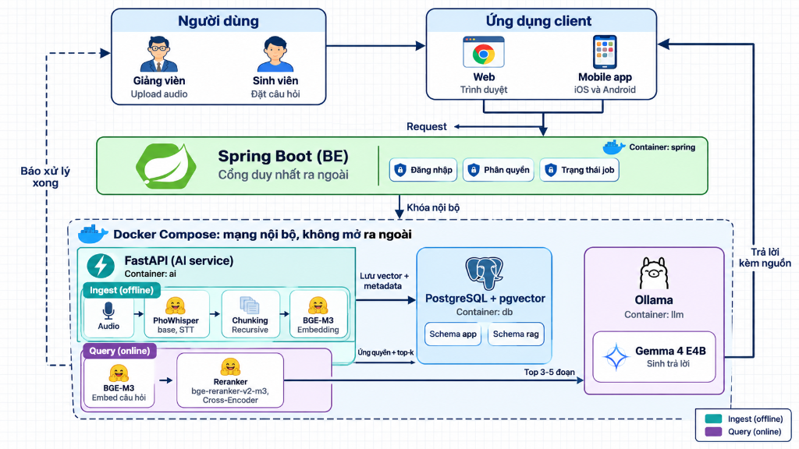
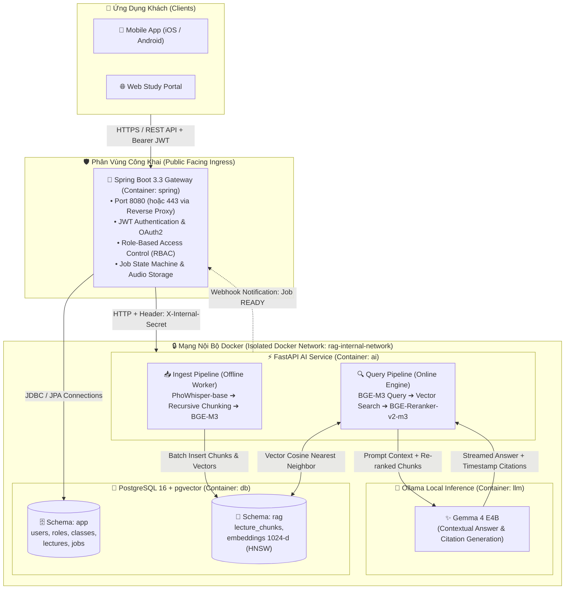
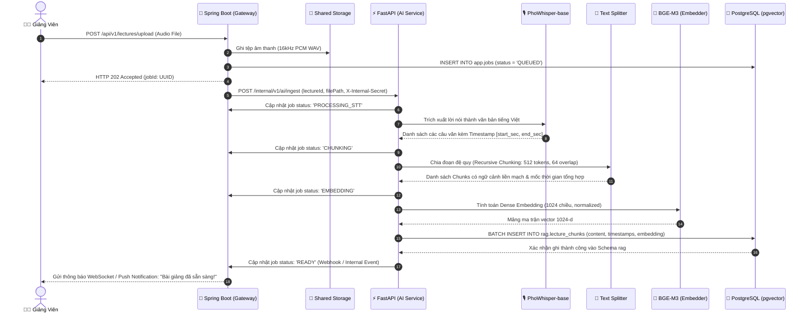
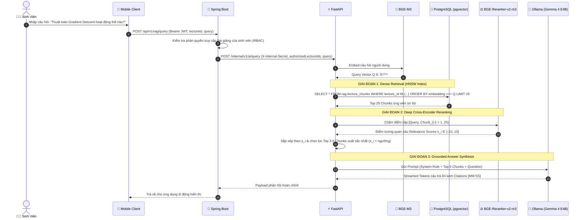

# 🎙️📚 LectureLens Backend – On-Premise 2-Stage Neural RAG Architecture

[](#2-kiến-trúc-hệ-thống-system-architecture)
[](https://spring.io/projects/spring-boot)
[](https://fastapi.tiangolo.com/)
[](https://github.com/pgvector/pgvector)
[](https://ollama.ai/)
[](https://pytorch.org/)
[](../LICENSE)

---

Tài liệu này đặc tả toàn diện kiến trúc kỹ thuật, quy trình xử lý dữ liệu âm thanh, cơ chế tìm kiếm tăng cường truy xuất (Retrieval-Augmented Generation — RAG) 2 giai đoạn, thiết kế cơ sở dữ liệu đa vùng (Multi-Schema), chính sách an toàn mạng và danh mục API cho hạ tầng **LectureLens Backend & AI Service** (Hạ tầng Backend & Dịch vụ Trí tuệ Nhân tạo xử lý bài giảng của dự án LectureLens).

---

## 📑 Mục Lục (Table of Contents)

- [1. Tổng Quan Kỹ Thuật (Technical Overview)](#1-tổng-quan-kỹ-thuật-technical-overview)
- [2. Kiến Trúc Hệ Thống (System Architecture)](#2-kiến-trúc-hệ-thống-system-architecture)
- [3. Đặc Tả Các Dịch Vụ Cốt Lõi (Core Services Specification)](#3-đặc-tả-các-dịch-vụ-cốt-lõi-core-services-specification)
  - [3.1. Spring Boot Gateway Service (`spring`)](#31-spring-boot-gateway-service-spring)
  - [3.2. FastAPI AI & RAG Engine (`ai`)](#32-fastapi-ai--rag-engine-ai)
  - [3.3. PostgreSQL 16 + pgvector Multi-Schema DB (`db`)](#33-postgresql-16--pgvector-multi-schema-db-db)
  - [3.4. Ollama LLM Runtime Engine (`llm`)](#34-ollama-llm-runtime-engine-llm)
- [4. Hai Luồng Xử Lý Dữ Liệu Cốt Lõi (Core Pipelines)](#4-hai-luồng-xử-lý-dữ-liệu-cốt-lõi-core-pipelines)
  - [4.1. Pipeline Ingest (Offline) — Audio Transcription & Vectorization](#41-pipeline-ingest-offline--audio-transcription--vectorization)
  - [4.2. Pipeline Query (Online) — 2-Stage Retrieval & Grounded Generation](#42-pipeline-query-online--2-stage-retrieval--grounded-generation)
- [5. Danh Mục Mô Hình AI & Quản Lý Trọng Số](#5-danh-mục-mô-hình-ai--quản-lý-trọng-số)
- [6. Thiết Kế Cơ Sở Dữ Liệu & Tối Ưu Chỉ Mục Vector (Database & Index Tuning)](#6-thiết-kế-cơ-sở-dữ-liệu--tối-ưu-chỉ-mục-vector-database--index-tuning)
- [7. Cơ Chế Bảo Mật & Cô Lập Mạng Docker (Security & Network Isolation)](#7-cơ-chế-bảo-mật--cô-lập-mạng-docker-security--network-isolation)
- [8. Yêu Cầu Phần Cứng & Phân Bổ Tài Nguyên (Hardware Sizing)](#8-yêu-cầu-phần-cứng--phân-bổ-tài-nguyên-hardware-sizing)
- [9. Đặc Tả Giao Diện Lập Trình (API Specifications)](#9-đặc-tả-giao-diện-lập-trình-api-specifications)
- [10. Hướng Dẫn Cài Đặt & Vận Hành (Deployment Guide)](#10-hướng-dẫn-cài-đặt--vận-hành-deployment-guide)

---

## 1. Tổng Quan Kỹ Thuật (Technical Overview)

Hạ tầng **LectureLens Backend & AI Service** được thiết kế nhằm đáp ứng 3 yêu cầu công nghệ khắt khe:

1. **Độ chính xác cao với tiếng Việt (Vietnamese Domain Specificity):** Sử dụng `PhoWhisper-base` cho nhận dạng tiếng nói (ASR) và `BGE-M3` cho embedding ngữ cảnh đa ngữ, có khả năng xử lý tốt thuật ngữ học thuật, từ mượn và dấu thanh điệu tiếng Việt.
2. **Tìm kiếm 2 giai đoạn chính xác tuyệt đối (2-Stage Neural RAG):** Kết hợp khả năng quét nhanh của chỉ mục vector xấp xỉ **HNSW** (Cosine Distance) với độ chính xác cao của bộ tái định vị **Cross-Encoder BGE-Reranker-v2-m3**, loại bỏ hoàn toàn các đoạn văn bản gây nhiễu trước khi đưa vào mô hình ngôn ngữ lớn.
3. **Bảo mật tuyệt đối & Vận hành Cục bộ (Zero Cloud Leakage — ADR 0001):** Hệ thống không sử dụng các dịch vụ AI bên thứ ba. Toàn bộ 4 mô hình AI đều được phục vụ trực tiếp trên hạ tầng Docker on-premise của tổ chức giáo dục.

---

## 2. Kiến Trúc Hệ Thống (System Architecture)

Hệ thống tuân thủ mô hình **Microservices Topology** với ranh giới phân tách rõ rệt giữa mạng công khai (Public Ingress) và mạng bảo mật nội bộ (Private Isolated Subnet):



<div align="center">
  <sub><b>Hình 1:</b> Sơ đồ kiến trúc tổng thể LectureLens Backend — Phân tách giữa Cổng Spring Boot công khai và Mạng nội bộ Docker an toàn.</sub>
</div>

<br/>

### Sơ đồ luồng tương tác hệ thống (System Interaction Flowchart)



---

## 3. Đặc Tả Các Dịch Vụ Cốt Lõi (Core Services Specification)

### 3.1. Spring Boot Gateway Service (`spring`)
- **Ngôn ngữ & Nền tảng:** Java 17 LTS / Spring Boot 3.3.x.
- **Vai trò:** Lối vào độc quyền từ Internet vào hạ tầng Backend của LectureLens.
- **Trách nhiệm kỹ thuật:**
  - **Bảo mật & Phân quyền:** Xác thực qua Spring Security 6 với JWT Stateless Tokens. Kiểm soát quyền hạn (RBAC) nghiêm ngặt: `ADMIN`, `LECTURER`, `STUDENT`.
  - **Quản lý Tệp Âm Thanh:** Tiếp nhận tệp âm thanh tải lên (`.mp3`, `.wav`, `.m4a`, dung lượng lên tới 500MB), phân tích metadata âm thanh và lưu trữ tạm thời tại volume dùng chung.
  - **Máy trạng thái tác vụ (Job State Machine):** Khởi tạo và theo dõi trạng thái bài giảng:
    $$\text{QUEUED} \longrightarrow \text{PROCESSING\_STT} \longrightarrow \text{CHUNKING} \longrightarrow \text{EMBEDDING} \longrightarrow \text{READY} \text{ (hoặc FAILED)}$$
  - **Đồng bộ liên dịch vụ:** Giao tiếp với FastAPI thông qua Spring `WebClient` có cấu hình Retry với Circuit Breaker (Resilience4j) và kiểm định khóa bí mật nội bộ (`X-Internal-Secret`).

### 3.2. FastAPI AI & RAG Engine (`ai`)
- **Ngôn ngữ & Môi trường:** Python 3.10+ / FastAPI 0.111 / Uvicorn.
- **Thư viện AI nền tảng:** `torch 2.3+ (CUDA 12.1)`, `transformers`, `sentence-transformers`, `FlagEmbedding`, `torchaudio`.
- **Vai trò:** Thực hiện tính toán trí tuệ nhân tạo chuyên sâu và điều phối các mô hình học máy.
- **Trách nhiệm kỹ thuật:**
  - **Nạp mô hình thông minh (Model Lifecycle Management):** Tải trước trọng số các mô hình `bge-m3`, `bge-reranker-v2-m3` và `phowhisper-base` vào bộ nhớ VRAM khi container khởi động thông qua FastAPI lifespan events.
  - **Background Ingestion Worker:** Phân luồng chạy nền bất đồng bộ (`BackgroundTasks` hoặc Celery worker) để phiên âm và sinh vector các bài giảng dài mà không làm nghẽn tiến trình HTTP.
  - **Xếp hạng & Tinh chỉnh ngữ cảnh:** Thực hiện tái sắp xếp Top-25 vector bằng Cross-Encoder trước khi định dạng prompt cho LLM.

### 3.3. PostgreSQL 16 + pgvector Multi-Schema DB (`db`)
- **Phiên bản:** PostgreSQL 16.3 đi kèm extension `pgvector 0.7.0+`.
- **Kiến trúc Multi-Schema:**
  - `Schema app`: Chứa toàn bộ thực thể quan hệ phục vụ nghiệp vụ (Người dùng, lớp học, bài giảng, tác vụ xử lý). Quản lý bởi Spring Data JPA / Hibernate.
  - `Schema rag`: Chứa dữ liệu tri thức học thuật không cấu trúc (`lecture_chunks`) và vector nhúng 1024 chiều. Quản lý bởi FastAPI qua SQLAlchemy / asyncpg.
- **Chỉ mục Vector HNSW:** Sử dụng thuật toán Hierarchical Navigable Small World với khoảng cách Cosine (`vector_cosine_ops`), đem lại tốc độ truy vấn milli-giây trên hàng triệu vector.

### 3.4. Ollama LLM Runtime Engine (`llm`)
- **Phiên bản:** Ollama v0.3.x+.
- **Mô hình phục vụ:** `google/gemma-4-E4B-it` (Gemma 4 Conditional Generation).
- **Cấu hình Modelfile:** Được cấu hình với nhiệt độ suy luận thấp (`temperature 0.2`) và hình phạt lặp lại (`repeat_penalty 1.15`) nhằm đảm bảo câu trả lời mang tính quy nạp, bám sát tuyệt đối vào ngữ cảnh trích xuất và không suy diễn thông tin ngoài bài giảng.

---

## 4. Hai Luồng Xử Lý Dữ Liệu Cốt Lõi (Core Pipelines)

### 4.1. Pipeline Ingest (Offline) — Audio Transcription & Vectorization

Quy trình tự động hóa chuyển đổi bài giảng âm thanh thô thành cơ sở tri thức vector:



#### Chi tiết kỹ thuật Ingestion:
1. **Chuẩn hóa âm thanh (Audio Preprocessing):** File tải lên được chuyển đổi tự động bằng `ffmpeg` sang định dạng chuẩn: **16,000 Hz, Mono channel, 16-bit PCM**.
2. **ASR Timestamp Extraction:** PhoWhisper xuất ra mảng các phân đoạn câu với độ phân giải thời gian chính xác đến từng mili-giây:
   $$\text{Segment} = \{ \text{id}, \text{start\_time}, \text{end\_time}, \text{text} \}$$
3. **Recursive Context Chunking:** Văn bản được gom cụm sao cho không vượt quá **512 tokens** (khoảng 350-400 từ tiếng Việt), duy trì **overlap 64 tokens** giữa hai đoạn liên tiếp để bảo toàn trọn vẹn ngữ nghĩa ở ranh giới đoạn. Mỗi chunk lưu giữ mốc thời gian bắt đầu của câu đầu tiên và mốc thời gian kết thúc của câu cuối cùng trong chunk đó.

---

### 4.2. Pipeline Query (Online) — 2-Stage Retrieval & Grounded Generation

Quy trình tìm kiếm ngữ nghĩa chuyên sâu và tổng hợp câu trả lời có dẫn nguồn:



#### Quy chuẩn cấu trúc Prompt suy luận (Grounding Guardrail):

```markdown
[HỆ THỐNG]
Bạn là Trợ lý Cú Mèo của LectureLens — hệ thống hỗ trợ học tập bài giảng tiếng Việt thông minh.
Nhiệm vụ của bạn là trả lời câu hỏi của người học DỰA TRÊN ngữ cảnh trích xuất dưới đây.

[QUY TẮC BẮT BUỘC]
1. Chỉ sử dụng thông tin có trong phần [NGỮ CẢNH BÀI GIẢNG]. Tuyệt đối không tự suy diễn thông tin ngoài bài giảng.
2. Mỗi khi đưa ra một luận điểm hoặc giải thích, PHẢI dẫn nguồn mốc thời gian bài giảng theo định dạng: [MM:SS].
3. Nếu ngữ cảnh không có thông tin để trả lời, hãy trả lời trung thực: "Bài giảng không đề cập đến nội dung này."

[NGỮ CẢNH BÀI GIẢNG]
- Đoạn 1 (08:15 - 09:40): Gradient descent cập nhật trọng số ngược chiều gradient của hàm mất mát...
- Đoạn 2 (14:20 - 15:55): Tốc độ học (learning rate) quyết định bước nhảy của thuật toán...

[CÂU HỎI CỦA SINH VIÊN]
{user_query}

[CÂU TRẢ LỜI CỦA LECTURELENS]
```

---

## 5. Danh Mục Mô Hình AI & Quản Lý Trọng Số

Hệ thống sử dụng bộ 4 mô hình AI chuyên trách:

| Thư mục cục bộ | Định danh Hugging Face | Dung lượng | Kiến trúc mạng | Ngữ cảnh tối đa | Nhiệm vụ kỹ thuật |
| :--- | :--- | :---: | :--- | :---: | :--- |
| **`phowhisper-base`** | [`vinai/phowhisper-base`](https://huggingface.co/vinai/phowhisper-base) | ~290 MB | Whisper (Encoder-Decoder) | 30s audio / chunk | Nhận dạng tiếng nói tiếng Việt, giải mã âm vị địa phương. |
| **`bge-m3`** | [`BAAI/bge-m3`](https://huggingface.co/BAAI/bge-m3) | ~2.2 GB | XLM-RoBERTa (1024-d) | 8192 tokens | Sinh dense embedding 1024 chiều cho cả đoạn văn và truy vấn. |
| **`bge-reranker-v2-m3`** | [`BAAI/bge-reranker-v2-m3`](https://huggingface.co/BAAI/bge-reranker-v2-m3) | ~2.27 GB | Cross-Encoder (XLM-RoBERTa) | 8192 tokens | Tái xếp hạng ngữ nghĩa sâu 25 đoạn văn bản ứng viên. |
| **`gemma-4-e4b`** | [`google/gemma-4-E4B-it`](https://ai.google.dev/gemma) | ~15.8 GB | Gemma 4 Decoder-only | 8192 tokens | Suy luận ngữ cảnh, giải thích bài tập và tạo trích dẫn. |

### Chiến Lược Quản Lý Trọng Số (~21.5 GB) Trên GitHub

> [!WARNING]
> GitHub từ chối tất cả các tệp có kích thước lớn hơn **100 MB**. Tuyệt đối không commit các tệp `.safetensors`, `.bin`, `.pt` vào Git repository!

1. **Cấu hình `.gitignore` chuẩn hóa (`backend/.gitignore`):**
   ```gitignore
   # Loại bỏ các tệp nhị phân trọng số AI nặng
   models/**/*.bin
   models/**/*.safetensors
   models/**/*.pt
   models/**/*.bpe.model
   models/**/*.gguf
   models/**/.cache/
   
   # Giữ lại cấu trúc thư mục và file metadata nhẹ
   !models/**/config.json
   !models/**/tokenizer.json
   !models/**/generation_config.json
   !models/**/.gitkeep
   ```

2. **Kịch bản tải tự động (`download_models.py`):**
   Dự án trang bị sẵn script tự động sử dụng `huggingface_hub` để tải đầy đủ weights khi clone về môi trường mới:
   ```bash
   cd backend
   pip install huggingface_hub
   python download_models.py
   ```

---

## 6. Thiết Kế Cơ Sở Dữ Liệu & Tối Ưu Chỉ Mục Vector (Database & Index Tuning)

Toàn bộ cấu trúc cơ sở dữ liệu được khởi tạo tự động trong hệ thống:

```sql
-- Kích hoạt extension tính toán vector
CREATE EXTENSION IF NOT EXISTS "uuid-ossp";
CREATE EXTENSION IF NOT EXISTS vector;

-- Thiết lập 2 phân vùng Schema độc lập
CREATE SCHEMA IF NOT EXISTS app;
CREATE SCHEMA IF NOT EXISTS rag;

-- ==========================================================
-- SCHEMA: app (Nghiệp vụ ứng dụng, Người dùng, Bài giảng)
-- ==========================================================
CREATE TABLE app.users (
    id UUID PRIMARY KEY DEFAULT gen_random_uuid(),
    email VARCHAR(255) UNIQUE NOT NULL,
    password_hash VARCHAR(255) NOT NULL,
    full_name VARCHAR(150) NOT NULL,
    role VARCHAR(50) NOT NULL CHECK (role IN ('ADMIN', 'LECTURER', 'STUDENT')),
    avatar_url VARCHAR(500),
    created_at TIMESTAMP WITH TIME ZONE DEFAULT CURRENT_TIMESTAMP
);

CREATE TABLE app.lectures (
    id UUID PRIMARY KEY DEFAULT gen_random_uuid(),
    title VARCHAR(255) NOT NULL,
    subject VARCHAR(100) NOT NULL,
    description TEXT,
    lecturer_id UUID NOT NULL REFERENCES app.users(id) ON DELETE CASCADE,
    audio_file_path VARCHAR(500) NOT NULL,
    duration_seconds INT NOT NULL DEFAULT 0,
    created_at TIMESTAMP WITH TIME ZONE DEFAULT CURRENT_TIMESTAMP
);

CREATE TABLE app.jobs (
    id UUID PRIMARY KEY DEFAULT gen_random_uuid(),
    lecture_id UUID NOT NULL REFERENCES app.lectures(id) ON DELETE CASCADE,
    status VARCHAR(50) NOT NULL DEFAULT 'QUEUED' 
        CHECK (status IN ('QUEUED', 'PROCESSING_STT', 'CHUNKING', 'EMBEDDING', 'READY', 'FAILED')),
    progress_percentage INT DEFAULT 0,
    error_message TEXT,
    created_at TIMESTAMP WITH TIME ZONE DEFAULT CURRENT_TIMESTAMP,
    updated_at TIMESTAMP WITH TIME ZONE DEFAULT CURRENT_TIMESTAMP
);

-- ==========================================================
-- SCHEMA: rag (Tri thức số hóa & Không gian Vector đa chiều)
-- ==========================================================
CREATE TABLE rag.lecture_chunks (
    id UUID PRIMARY KEY DEFAULT gen_random_uuid(),
    lecture_id UUID NOT NULL REFERENCES app.lectures(id) ON DELETE CASCADE,
    chunk_index INT NOT NULL,
    start_time_seconds NUMERIC(10, 2) NOT NULL,
    end_time_seconds NUMERIC(10, 2) NOT NULL,
    content TEXT NOT NULL,
    token_count INT NOT NULL DEFAULT 0,
    embedding vector(1024) NOT NULL, -- Sinh từ BGE-M3
    created_at TIMESTAMP WITH TIME ZONE DEFAULT CURRENT_TIMESTAMP
);

-- ==========================================================
-- TỐI ƯU HÓA CHỈ MỤC HNSW (Hierarchical Navigable Small World)
-- ==========================================================
-- m = 16: Số liên kết tối đa giữa các node (cân bằng giữa tốc độ tìm kiếm và bộ nhớ)
-- ef_construction = 64: Kích thước danh sách ứng viên khi xây dựng cây chỉ mục
CREATE INDEX IF NOT EXISTS idx_chunks_embedding_hnsw 
ON rag.lecture_chunks 
USING hnsw (embedding vector_cosine_ops)
WITH (m = 16, ef_construction = 64);

-- Chỉ mục hỗ trợ truy vấn lọc theo bài giảng siêu tốc
CREATE INDEX IF NOT EXISTS idx_chunks_lecture_id ON rag.lecture_chunks(lecture_id);
```

### Phân Tích Hiệu Năng Chỉ Mục HNSW
- **Khoảng cách Cosine (`vector_cosine_ops`):** Đo lường độ tương đồng góc giữa hai vector trong không gian $\mathbb{R}^{1024}$:
  $$\text{Cosine Similarity}(u, v) = \frac{u \cdot v}{\|u\| \|v\|} = 1 - (\text{embedding} \Leftrightarrow \text{query\_vector})$$
- **Thời gian tìm kiếm (Query Latency):** Dưới **15ms** cho tập dữ liệu 500,000 chunks với `ef_search = 40`.

---

## 7. Cơ Chế Bảo Mật & Cô Lập Mạng Docker (Security & Network Isolation)

```
        INTERNET (Untrusted Zone)
                   │
                   ▼ [Port 8080 - Public Ingress]
        ┌─────────────────────────────────────┐
        │     🍃 Spring Boot Gateway          │
        │  • JWT Auth & RBAC Verification     │
        │  • Rate Limiting & File Size Check  │
        └──────────────────┬──────────────────┘
                           │
    ╔══════════════════════╪══════════════════════════════════╗
    ║ MẠNG NỘI BỘ DOCKER (rag-internal-network - Trusted Zone) ║
    ║                                                          ║
    ║       Header: X-Internal-Secret: ${SECRET_KEY}           ║
    ║                      ▼                                   ║
    ║             ┌─────────────────┐                          ║
    ║             │ ⚡ FastAPI AI   │                          ║
    ║             └────┬───────┬────┘                          ║
    ║                  │       │                               ║
    ║         Internal │       │ Internal                      ║
    ║         JDBC     │       │ REST (11434)                  ║
    ║                  ▼       ▼                               ║
    ║    ┌──────────────────┐  ┌──────────────────┐            ║
    ║    │ 🐘 PostgreSQL    │  │ 🦙 Ollama        │            ║
    ║    │ (NO EXPOSE PORT) │  │ (NO EXPOSE PORT) │            ║
    ║    └──────────────────┘  └──────────────────┘            ║
    ╚══════════════════════════════════════════════════════════╝
```

1. **Cô Lập Mạng Cấp Container (Container Isolation):**
   - Chỉ duy nhất container `spring` được bind port ra host (`8080:8080`).
   - Các container `ai`, `db`, `llm` **hoàn toàn không mở cổng ra ngoài host** (`ports:` bị loại bỏ, chỉ dùng directive `expose:` nội bộ).
2. **Xác Thực Khóa Nội Bộ (Inter-Service Shared Secret):**
   - Mọi lời gọi HTTP từ Spring Boot sang FastAPI bắt buộc phải mang theo header:
     ```http
     X-Internal-Secret: ${INTERNAL_API_SECRET_KEY}
     ```
   - FastAPI trang bị Middleware chặn ngay lập tức mã `401 Unauthorized` nếu thiếu hoặc sai khóa này.
3. **Phân Quyền Ngữ Cảnh Dữ Liệu (Tenant & Scoped Access):**
   - API RAG Query bắt buộc nhận danh sách `authorizedLectureIds` do Spring Boot thẩm định từ vai trò của sinh viên. Không một sinh viên nào có thể truy vấn ngữ cảnh của môn học mà mình chưa đăng ký.

---

## 8. Yêu Cầu Phần Cứng & Phân Bổ Tài Nguyên (Hardware Sizing)

### Ma Trận Cấu Hình Phần Cứng

| Tiêu chí | Cấu hình Tối thiểu (Minimum) | Cấu hình Đề xuất (Production Recommended) |
| :--- | :--- | :--- |
| **GPU (VRAM)** | 1x NVIDIA RTX 3060 12GB (Quantized INT4) | 1x NVIDIA RTX 4090 24GB hoặc A10G / A100 |
| **CUDA Core** | CUDA Toolkit v12.1+ | CUDA Toolkit v12.4+ |
| **CPU** | 8 Cores (Intel i7 / AMD Ryzen 7) | 16+ Cores (Intel Xeon / AMD EPYC) |
| **Bộ Nhớ Hệ Thống (RAM)** | 32 GB DDR4/DDR5 | 64 GB DDR5 |
| **Ổ Cứng Lưu Trữ (SSD)** | 100 GB NVMe SSD | 500 GB NVMe PCIe 4.0 |

### Phân Bổ Bộ Nhớ VRAM Đề Xuất (Trên GPU 24GB):
- **Ollama Gemma 4 E4B (INT4/Q4_K_M):** ~6.5 GB VRAM
- **BGE-M3 (FP16):** ~2.2 GB VRAM
- **BGE-Reranker-v2-m3 (FP16):** ~2.4 GB VRAM
- **PhoWhisper-base (FP16):** ~1.2 GB VRAM
- **CUDA Cache & Activation:** ~3.0 GB VRAM
- **Tổng VRAM tiêu thụ dự kiến:** ~15.3 GB / 24 GB (An toàn cho các tác vụ tải cao song song).

---

## 9. Đặc Tả Giao Diện Lập Trình (API Specifications)

### 9.1. Public Ingress APIs (Spring Boot Gateway)

#### [POST] `/api/v1/auth/login`
- **Quyền:** Public.
- **Request Body:**
  ```json
  {
    "email": "sinhvien@lecturelens.edu.vn",
    "password": "SecurePassword123!"
  }
  ```
- **Response (200 OK):**
  ```json
  {
    "accessToken": "eyJhbGciOiJIUzI1NiIsInR5cCI6IkpXVCJ9...",
    "tokenType": "Bearer",
    "expiresIn": 86400,
    "user": {
      "id": "e4b2d192-3c12-4f33-912a-8742d4a5e011",
      "email": "sinhvien@lecturelens.edu.vn",
      "fullName": "Nguyễn Văn A",
      "role": "STUDENT"
    }
  }
  ```

#### [POST] `/api/v1/lectures/upload`
- **Quyền:** Bearer JWT (`LECTURER`, `ADMIN`).
- **Content-Type:** `multipart/form-data`.
- **Form Data:**
  - `file`: Tệp âm thanh (`bai_giang_tuan_3.mp3`).
  - `title`: "Đại Số Tuyến Tính - Tuần 3: Không Gian Vector".
  - `subject`: "Toán Cao Cấp".
- **Response (202 Accepted):**
  ```json
  {
    "jobId": "f103b415-992a-4bc8-8f55-1178a9c0012f",
    "lectureId": "a9010344-77bb-4e32-9112-229988776655",
    "status": "QUEUED",
    "message": "Bài giảng đã được đưa vào hàng đợi xử lý âm thanh."
  }
  ```

#### [POST] `/api/v1/rag/query`
- **Quyền:** Bearer JWT (`STUDENT`, `LECTURER`).
- **Request Body:**
  ```json
  {
    "lectureId": "a9010344-77bb-4e32-9112-229988776655",
    "query": "Cơ sở của không gian vector là gì?",
    "topK": 3
  }
  ```
- **Response (200 OK):**
  ```json
  {
    "answer": "Cơ sở của một không gian vector là một hệ vector độc lập tuyến tính và sinh ra toàn bộ không gian đó [12:40]. Số lượng vector trong một cơ sở được gọi là số chiều của không gian [15:10].",
    "citations": [
      {
        "chunkId": "3b1a2099-1a2b-4c3d-9e0f-112233445566",
        "startTime": "12:40",
        "endTime": "14:15",
        "textSnippet": "Một tập hợp các vector được gọi là cơ sở nếu nó thỏa mãn đồng thời hai điều kiện: độc lập tuyến tính và sinh ra không gian..."
      },
      {
        "chunkId": "8f902111-2b3c-4d5e-0f1a-998877665544",
        "startTime": "15:10",
        "endTime": "16:30",
        "textSnippet": "Số lượng phần tử trong cơ sở là một bất biến và chúng ta định nghĩa đó chính là số chiều của không gian vector..."
      }
    ]
  }
  ```

---

### 9.2. Private Internal APIs (FastAPI AI Service)

#### [POST] `/internal/v1/ai/ingest`
- **Header:** `X-Internal-Secret: ${INTERNAL_API_SECRET_KEY}`
- **Request Body:**
  ```json
  {
    "jobId": "f103b415-992a-4bc8-8f55-1178a9c0012f",
    "lectureId": "a9010344-77bb-4e32-9112-229988776655",
    "audioFilePath": "/shared/audio/a9010344-77bb.wav"
  }
  ```
- **Response (200 OK):**
  ```json
  {
    "status": "ACCEPTED",
    "message": "Ingest pipeline background task spawned successfully."
  }
  ```

#### [GET] `/internal/v1/ai/health`
- **Header:** `X-Internal-Secret: ${INTERNAL_API_SECRET_KEY}`
- **Response (200 OK):**
  ```json
  {
    "status": "HEALTHY",
    "gpuAvailable": true,
    "gpuDeviceName": "NVIDIA GeForce RTX 4090",
    "vramAllocatedMB": 14210.5,
    "loadedModels": {
      "stt": "phowhisper-base",
      "embedding": "bge-m3",
      "reranker": "bge-reranker-v2-m3"
    }
  }
  ```

---

## 10. Hướng Dẫn Cài Đặt & Vận Hành (Deployment Guide)

### Bước 1: Chuẩn Bị Môi Trường
Đảm bảo máy chủ đã cài đặt Docker v2.20+ và NVIDIA Container Toolkit:
```bash
# Kiểm tra driver GPU NVIDIA
nvidia-smi

# Kiểm tra docker nvidia runtime
docker run --rm --gpus all nvidia/cuda:12.1.0-base-ubuntu22.04 nvidia-smi
```

### Bước 2: Tải Trọng Số Các Mô Hình
```bash
cd backend
pip install huggingface_hub
python download_models.py
```

### Bước 3: Cấu Hình Biến Môi Trường
Sao chép `.env.example` sang `.env` và điền các khóa bí mật:
```bash
cp .env.example .env
```
Nội dung file `.env`:
```env
# Spring Boot Configuration
SPRING_PORT=8080
JWT_SECRET=lecture_lens_jwt_super_secure_key_min_256_bits_2026!
INTERNAL_API_SECRET_KEY=ll_internal_mesh_secret_token_998877

# PostgreSQL Database Configuration
POSTGRES_DB=lecturelens_db
POSTGRES_USER=ll_admin
POSTGRES_PASSWORD=ll_master_secure_password_2026
POSTGRES_PORT=5432

# Ollama LLM Configuration
OLLAMA_MODEL=gemma-4-e4b
```

### Bước 4: Khởi Chạy Hệ Thống Bằng Docker Compose
```bash
docker compose up -d --build
```

Kiểm tra sức khỏe cụm container:
```bash
docker compose ps
docker compose logs -f ai
```

---

<div align="center">
  <sub>Tài liệu đặc tả kỹ thuật dự án <b>LectureLens Backend & AI Service</b> 🚀</sub><br/>
  <sub>Phiên bản: <b>2.0.0-PROD</b> • Bản quyền thuộc về <b>LectureLens Engineering Team</b></sub>
</div>
