# 📡 LectureLens Canonical API Reference (Single Source of Truth)

Tài liệu đặc tả API chuẩn xác 1:1 với mã nguồn hiện hành cho toàn bộ hệ thống **LectureLens** — bao gồm **Public Ingress Gateway (Spring Boot 3.3 `:8080`)**, **Internal AI & RAG Engine (FastAPI 0.111 `:8000`)**, **Webhook Callback nội bộ**, **Hợp đồng dữ liệu Artifact (`manifest.json`, `transcript.json`, `chunks.json`)**, **Cơ sở dữ liệu `pgvector`**, và **Máy trạng thái Job State Machine**.

> [!IMPORTANT]
> Mọi endpoint nội bộ dưới tiền tố `/internal/v1/ai/*` và webhook `/internal/v1/jobs/{jobId}/status` chỉ hoạt động bên trong mạng Docker cô lập `rag-internal-network` và bắt buộc phải xác thực bằng header `X-Internal-Secret`. Client di động (`mobile/`) chỉ giao tiếp với Public Ingress `:8080` bằng `Bearer JWT` (xem [ADR 0001](./adr/0001-privacy-first-local-ai-architecture.md) và [ADR 0003](./adr/0003-native-mobile-architecture-expo-sdk58.md)).

---

## 📑 Mục Lục (Table of Contents)

- [1. Network Topology & Authentication](#1-network-topology--authentication)
- [2. Job State Machine (`app.jobs` & `manifest.json`)](#2-job-state-machine-appjobs--manifestjson)
- [3. Public Ingress APIs — Spring Boot Gateway (`:8080`)](#3-public-ingress-apis--spring-boot-gateway-8080)
- [4. Internal AI & RAG Service APIs — FastAPI (`:8000`)](#4-internal-ai--rag-service-apis--fastapi-8000)
  - [4.1. `GET /internal/v1/ai/health`](#41-get-internalv1aihealth)
  - [4.2. `POST /internal/v1/ai/ingest`](#42-post-internalv1aiingest)
  - [4.3. `POST /internal/v1/ai/chunk-and-embed`](#43-post-internalv1aichunk-and-embed)
  - [4.4. `GET /internal/v1/ai/audio/{job_id}/manifest`](#44-get-internalv1aiaudiojob_idmanifest)
  - [4.5. `GET /internal/v1/ai/chunks/{job_id}`](#45-get-internalv1aichunksjob_id)
  - [4.6. `POST /internal/v1/ai/search/hybrid`](#46-post-internalv1aisearchhybrid)
  - [4.7. `GET /internal/v1/ai/chunks/context/{chunk_id}`](#47-get-internalv1aichunkscontextchunk_id)
- [5. Internal Webhook Callback (`FastAPI -> Spring Boot`)](#5-internal-webhook-callback-fastapi---spring-boot)
- [6. Immutable Artifact Contracts (`volumes/rag_data/`)](#6-immutable-artifact-contracts-volumesrag_data)
- [7. Vector Database Schema & SQL RPCs (`rag.*`)](#7-vector-database-schema--sql-rpcs-rag)
- [8. Ready-to-Use Code Examples (`cURL`, `TypeScript`, `Python httpx`)](#8-ready-to-use-code-examples-curl-typescript-python-httpx)

---

## 1. Network Topology & Authentication

```
[Mobile App (Expo SDK 58)]
        │  HTTPS / REST + Authorization: Bearer <JWT>
        ▼
[Spring Boot Gateway :8080]  ──(Public DMZ / Only Public Port in Prod)
        │
        ├──► Shared Volume (volumes/rag_data): atomic {jobId}.tmp -> {jobId}.{ext}
        │
        ├──► HTTP + Header: X-Internal-Secret ──► [FastAPI AI Service :8000]
        │                                               │  (rag-internal-network)
        │                                               ├──► [PostgreSQL 16 + pgvector :5432]
        │                                               └──► [Ollama Gemma 4 E4B :11434]
        │
        ◄── PUT /internal/v1/jobs/{jobId}/status (X-Internal-Secret) ──┘
```

### Authentication Matrix

| Zone | Service | Base URL | Auth Mechanism | Rejection Behavior |
| :--- | :--- | :--- | :--- | :--- |
| **Public Ingress** | Spring Boot Gateway (`spring`) | `http://localhost:8080/api/v1` (iOS/Web)<br/>`http://10.0.2.2:8080/api/v1` (Android Emulator)<br/>Override: `EXPO_PUBLIC_GATEWAY_URL` | `Authorization: Bearer <JWT>` (Stateless RBAC: `ADMIN`, `LECTURER`, `STUDENT`) | `401 Unauthorized` / `403 Forbidden` |
| **Internal Mesh** | FastAPI AI Service (`ai`) | `http://ai:8000` (Docker `rag-internal-network`)<br/>`http://localhost:8000` (Dev compose) | `X-Internal-Secret: ${INTERNAL_API_SECRET_KEY}` (verified in constant time via `secrets.compare_digest`) | `401 Unauthorized`<br/>`{"detail": "Invalid or missing internal API secret token."}` |
| **Webhook Callback** | Spring Boot Internal Webhook | `${SPRING_BASE_URL}` (default `http://spring:8080`) | `X-Internal-Secret: ${INTERNAL_API_SECRET_KEY}` | `SpringJobReporter` retries 3x with exponential backoff (`0.5s -> 1.0s`, 5s timeout) |

- **Internal Swagger / OpenAPI (inside isolated network / dev compose):**
  - Swagger UI: `GET /internal/docs`
  - OpenAPI JSON: `GET /internal/openapi.json`
- **Dev Compose Port Binding:** `backend/docker-compose.ai-dev.yml` binds `8000:8000` (`ai`) and `5432:5432` (`db`) on `rag-internal-network` for local backend development and testing. In production deployment, only `spring` (`8080`) is exposed externally.
- **Architecture Diagram:** Sơ đồ trực quan đầy đủ 2 tầng + 14 steps + 7 Protocol Seams xem tại [`docs/KienTrucHeThong.drawio`](./KienTrucHeThong.drawio).

---

## 2. Job State Machine (`app.jobs` & `manifest.json`)

Toàn bộ pipeline xử lý bài giảng vận hành tuần tự qua 2 giai đoạn dưới sự điều phối của `IngestPipelineCoordinator` và khóa đồng bộ GPU toàn cục `GLOBAL_GPU_SEMAPHORE = asyncio.Semaphore(1)`:

```mermaid
stateDiagram-v2
    [*] --> QUEUED: Spring Boot saves audio + app.jobs row
    QUEUED --> PROCESSING_STT: POST /internal/v1/ai/ingest (5% -> 72%)
    PROCESSING_STT --> STT_COMPLETED: transcript.json persisted (75%, or 100% if Stage 1 only)
    STT_COMPLETED --> CHUNKING: Unload ASR if LOW_VRAM_MODE=true; [I5] RecursiveTokenChunker (85%)
    CHUNKING --> EMBEDDING: [I6] BgeM3Embedder acquires GPU Semaphore (92%)
    EMBEDDING --> READY: chunks.json + ChunkStore sync complete (100%)
    PROCESSING_STT --> FAILED: Preprocessor / ASR error (stt.status = FAILED, 0%)
    CHUNKING --> FAILED: Chunker error (chunking.status = FAILED, stt preserved, 0%)
    EMBEDDING --> FAILED: Embedder / Store error (chunking.status = FAILED, stt preserved, 0%)
    READY --> [*]
    FAILED --> [*]
```



### Progress & Manifest Transition Mapping

| `app.jobs.status` | `progressPercentage` | Stage / Trigger | `manifest.json` State |
| :--- | :---: | :--- | :--- |
| `QUEUED` | `0` | Spring Boot writes `ingest/incoming/{jobId}.{ext}` | *(manifest not yet created)* |
| `PROCESSING_STT` | `5` → `15` → `25` → `25..70` → `72` | Register SHA-256, FFmpeg 16kHz PCM DSP, PhoWhisper ASR | `stt.status = "PROCESSING"` |
| `STT_COMPLETED` | `75` *(or `100` if Stage 1 only)* | Atomic write of `transcripts/{jobId}/transcript.json` | `stt.status = "COMPLETED"`, `chunking.status = "PENDING"` |
| `CHUNKING` | `85` | Optional ASR `unload()` (`LOW_VRAM_MODE=true`), `[I5]` `RecursiveTokenChunker` | `stt.status = "COMPLETED"`, `chunking.status = "CHUNKING"` |
| `EMBEDDING` | `92` | `[I6]` `BgeM3Embedder.encode_passages()` inside GPU semaphore | `stt.status = "COMPLETED"`, `chunking.status = "EMBEDDING"` |
| `READY` | `100` | `ChunkStore.save_lecture_chunks()` + atomic write of `chunks.json` | `chunking.status = "COMPLETED"`, `chunking.db_synced = true|false` |
| `FAILED` | `0` | Unhandled exception in Stage 1 or Stage 2 | If `stt.status == "COMPLETED"`, sets `chunking.status = "FAILED"`; otherwise sets `stt.status = "FAILED"` |

> [!NOTE]
> Constraint kiểm tra trong PostgreSQL (`backend/db/init/06_app_jobs_status_migration.sql`) bắt buộc danh sách enum hợp lệ:
> `('QUEUED', 'PROCESSING_STT', 'STT_COMPLETED', 'CHUNKING', 'EMBEDDING', 'READY', 'FAILED')`.

---

## 3. Public Ingress APIs — Spring Boot Gateway (`:8080`)

Các endpoint công khai dưới tiền tố `/api/v1` là ranh giới duy nhất mà ứng dụng di động (`mobile/src/services/apiClient.ts`, `mobile/src/services/audioPipelineService.ts`, `mobile/src/modules/auth/infrastructure/authSeam.ts`) giao tiếp:

| Method & Path | Auth | Request Payload / Params | Success Response | Error Codes |
| :--- | :--- | :--- | :--- | :--- |
| `GET /api/v1/health` | Public | None | `200 OK`: `{"status": "UP", "timestamp": "<ISO-8601>"}` | `503` |
| `POST /api/v1/auth/login` | Public | `{"email": "str", "password": "str"}` | `200 OK`: `{"accessToken": "jwt", "tokenType": "Bearer", "expiresIn": 86400, "user": {"id", "email", "fullName", "role", "studentId?", "avatarUrl?"}}` | `401`, `400/422` |
| `POST /api/v1/auth/register` | Public | `{"fullName": "str", "email": "str", "password": "str", "agreeTerms": true}` | `200/201`: Auth response with `accessToken` (or `token`) and `user` | `409` (email exists), `400/422` |
| `POST /api/v1/auth/oauth` | Public | `{"provider": "apple" \| "google"}` | `200 OK`: Auth response with `accessToken` and `user` | `401`, `400` |
| `POST /api/v1/auth/forgot-password` | Public | `{"email": "str"}` | `200 OK`: `{"success": true, "message": "..."}` | `400/422` |
| `POST /api/v1/audio/upload` | `Bearer JWT` | `multipart/form-data`: `audio` (binary file), `lectureId` (UUID), `fileExtension` (`mp3\|wav\|m4a\|aac\|flac`) | `200/202`: `{"jobId": "uuid", "lectureId": "uuid", "status": "QUEUED\|ACCEPTED", "message": "..."}` | `401`, `400/422` |
| `GET /api/v1/audio/{jobId}/manifest` | `Bearer JWT` | Path: `jobId` (UUID) | `200 OK`: [`ManifestSchema`](#61-manifestjson-audiojobidmanifestjson) | `401`, `404` |
| `GET /api/v1/lectures/{lectureId}/transcript` | `Bearer JWT` | Path: `lectureId` (UUID) | `200 OK`: [`TranscriptSchema`](#62-transcriptjson-transcriptsjobidtranscriptjson) | `401`, `403`, `404` |
| `POST /api/v1/rag/query` | `Bearer JWT` (`STUDENT`, `LECTURER`) | `{"lectureId": "uuid", "query": "str", "topK": 3}` | `200 OK`: `{"answer": "...", "citations": [{"chunkId": "uuid", "startTime": "12:40", "endTime": "14:15", "textSnippet": "..."}]}` | `401`, `403`, `404` |

> [!NOTE]
> Trong `mobile/src/services/apiClient.ts`, client gọi `POST /api/v1/audio/upload` với tên trường multipart `audio`, `lectureId`, `fileExtension`. Một số tài liệu tổng quan cũ ghi nhận `/api/v1/lectures/upload` — nếu Spring Boot Gateway hỗ trợ route phụ cho cổng web giảng viên, cổng này cần ánh xạ về cùng quy trình ghi nguyên tử `{jobId}.tmp` $\rightarrow$ `{jobId}.{ext}` (ADR 0002).

---

## 4. Internal AI & RAG Service APIs — FastAPI (`:8000`)

Tất cả endpoint trong mục này nằm tại `backend/ai_service/routers/health.py` và `backend/ai_service/routers/ingest.py`, dùng tiền tố `/internal/v1/ai` và đều yêu cầu header `X-Internal-Secret`. Mọi Pydantic request model đều cấu hình `ConfigDict(populate_by_name=True)`, chấp nhận cả tên trường **camelCase alias** (`jobId`, `lectureId`, `fileExtension`, `syncToDb`, `lectureIds`, `topK`, `includeContext`) lẫn **snake_case** (`job_id`, `lecture_id`, ...).

---

### 4.1. `GET /internal/v1/ai/health`

Trả về trạng thái dịch vụ AI, phần cứng CUDA/VRAM, cấu hình `LOW_VRAM_MODE`, trạng thái kết nối PostgreSQL `pgvector` và sự tồn tại của trọng số mô hình cục bộ.

- **Headers:** `X-Internal-Secret: <INTERNAL_API_SECRET_KEY>`
- **Response (`200 OK`):**

```json
{
  "status": "HEALTHY",
  "service": "lecturelens-ai-service",
  "configured_device": "auto",
  "low_vram_mode": true,
  "cuda_available": true,
  "vram": {
    "device_name": "NVIDIA GeForce RTX 3050 Laptop GPU",
    "allocated_mb": 0.0,
    "reserved_mb": 0.0
  },
  "pgvector_connected": true,
  "models": {
    "phowhisper_path_exists": true,
    "bge_m3_path_exists": true
  }
}
```

- **Lưu ý:** Khi `cuda_available` là `false` (chế độ CPU), trường `"vram"` là `{}`.
- **Error Responses:** `401 Unauthorized` nếu thiếu hoặc sai `X-Internal-Secret`.

---

### 4.2. `POST /internal/v1/ai/ingest`

Kích hoạt bất đồng bộ toàn bộ pipeline **Stage 1 (FFmpeg DSP + PhoWhisper ASR $\rightarrow$ `transcript.json`)** và **Stage 2 (`[I5]` Recursive Chunking + `[I6]` BGE-M3 Dual Embedding $\rightarrow$ `chunks.json` + `ChunkStore`)** cho tệp âm thanh đã được Spring Boot ghi sẵn tại `ingest/incoming/{jobId}.{ext}`.

- **Headers:**
  - `Content-Type: application/json`
  - `X-Internal-Secret: <INTERNAL_API_SECRET_KEY>`
- **Request Body (`IngestRequest`):**

| Field (snake_case) | Alias (camelCase) | Type | Constraints / Notes |
| :--- | :--- | :--- | :--- |
| `job_id` | `jobId` | `UUID` | Bắt buộc. UUID v4 định danh tác vụ do Spring Boot cấp. |
| `lecture_id` | `lectureId` | `UUID` | Bắt buộc. UUID v4 bài giảng. |
| `file_extension` | `fileExtension` | `string` | Bắt buộc. Không có dấu chấm. Regex: `^(mp3\|wav\|m4a\|aac\|flac)$`. Cấm truyền arbitrary path (ADR 0002). |

```json
{
  "jobId": "f103b415-992a-4bc8-8f55-1178a9c0012f",
  "lectureId": "a9010344-77bb-4e32-9112-229988776655",
  "fileExtension": "mp3"
}
```

- **Success Response (`202 Accepted` — `IngestResponse`):**

```json
{
  "status": "ACCEPTED",
  "message": "Ingest pipeline background task spawned successfully."
}
```

- **Error Responses:**
  - `401 Unauthorized`: Thiếu hoặc sai `X-Internal-Secret`.
  - `404 Not Found`: `{"detail": "Audio file '{job_id}.{file_extension}' not found in incoming volume."}`
  - `422 Unprocessable Entity`: Sai định dạng UUID hoặc `fileExtension` nằm ngoài danh sách cho phép (`mp3`, `wav`, `m4a`, `aac`, `flac`).

---

### 4.3. `POST /internal/v1/ai/chunk-and-embed`

Thực thi đồng bộ **Stage 2 (`[I5]` Recursive Token Chunking + `[I6]` BGE-M3 Dual Embedding + `ChunkStore` sync)** từ tệp `transcripts/{job_id}/transcript.json` đã tồn tại trên volume (hữu ích khi cần re-chunk/re-embed bài giảng mà không cần chạy lại ASR).

- **Headers:**
  - `Content-Type: application/json`
  - `X-Internal-Secret: <INTERNAL_API_SECRET_KEY>`
- **Request Body (`ChunkAndEmbedRequest`):**

| Field (snake_case) | Alias (camelCase) | Type | Default | Description |
| :--- | :--- | :--- | :--- | :--- |
| `job_id` | `jobId` | `UUID` | *(required)* | Job UUID của bản ghi `transcript.json` đã hoàn tất Giai đoạn 1. |
| `lecture_id` | `lectureId` | `UUID \| null` | `null` | Ghi đè `lecture_id` đích; nếu `null`, kế thừa `transcript.lecture_id`. |
| `sync_to_db` | `syncToDb` | `boolean` | `true` | Nếu `true`, đồng bộ idempotent các chunks vào `rag.lecture_chunks` trên PostgreSQL (nếu reachable). |

```json
{
  "jobId": "f103b415-992a-4bc8-8f55-1178a9c0012f",
  "lectureId": "a9010344-77bb-4e32-9112-229988776655",
  "syncToDb": true
}
```

- **Success Response (`200 OK` — `ChunkAndEmbedResponse`):**

```json
{
  "status": "COMPLETED",
  "job_id": "f103b415-992a-4bc8-8f55-1178a9c0012f",
  "lecture_id": "a9010344-77bb-4e32-9112-229988776655",
  "chunk_count": 14,
  "db_synced": true,
  "chunks_rel_path": "chunks/f103b415-992a-4bc8-8f55-1178a9c0012f/chunks.json"
}
```

- **Error Responses:**
  - `401 Unauthorized`: Thiếu hoặc sai `X-Internal-Secret`.
  - `404 Not Found`: `{"detail": "Transcript artifact not found for job '{job_id}'."}`
  - `422 Unprocessable Entity`: Payload không hợp lệ.

---

### 4.4. `GET /internal/v1/ai/audio/{job_id}/manifest`

Truy xuất $O(1)$ tệp `audio/{job_id}/manifest.json` theo `job_id`.

- **Headers:** `X-Internal-Secret: <INTERNAL_API_SECRET_KEY>`
- **Path Parameter:** `job_id` (`UUID`)
- **Success Response (`200 OK`):** Trả về JSON khớp [`ManifestSchema`](#61-manifestjson-audiojobidmanifestjson).
- **Error Responses:**
  - `401 Unauthorized`
  - `404 Not Found`: `{"detail": "Manifest for job '{job_id}' not found."}`

---

### 4.5. `GET /internal/v1/ai/chunks/{job_id}`

Truy xuất trực tiếp tệp artifact `chunks/{job_id}/chunks.json` do Giai đoạn 2 xuất bản.

- **Headers:** `X-Internal-Secret: <INTERNAL_API_SECRET_KEY>`
- **Path Parameter:** `job_id` (`UUID`)
- **Success Response (`200 OK`):** Trả về JSON khớp [`ChunksArtifactSchema`](#63-chunksjson-chunksjobidchunksjson).
- **Error Responses:**
  - `401 Unauthorized`
  - `404 Not Found`: `{"detail": "Chunks artifact for job '{job_id}' not found."}`

---

### 4.6. `POST /internal/v1/ai/search/hybrid`

Nhúng câu truy vấn tiếng Việt (hỗ trợ cả có dấu và không dấu) bằng `BGE-M3` và thực thi truy vấn lai 3 luồng **RRF Hybrid Search** (**Dense `halfvec(1024)` Cosine** + **Unaccented Full-Text `TSVECTOR`** + **Fuzzy Trigram `pg_trgm` > 0.15**), tùy chọn kèm mở rộng ngữ cảnh 3 chiều (`PREVIOUS`, `CURRENT`, `NEXT`).

- **Headers:**
  - `Content-Type: application/json`
  - `X-Internal-Secret: <INTERNAL_API_SECRET_KEY>`
- **Request Body (`HybridSearchRequest`):**

| Field (snake_case) | Alias (camelCase) | Type | Constraints / Default | Description |
| :--- | :--- | :--- | :--- | :--- |
| `lecture_ids` | `lectureIds` | `list[UUID]` | *(required)* | Danh sách UUID bài giảng mà người dùng được phép truy vấn (RBAC scoped). Nếu rỗng `[]`, trả về `total_results: 0` ngay lập tức. |
| `query` | `query` | `string` | *(required)* | Câu truy vấn tiếng Việt có dấu hoặc không dấu. Nếu toàn khoảng trắng, trả về `total_results: 0`. |
| `top_k` | `topK` | `integer` | `10` (`1 <= top_k <= 50`) | Số lượng phân đoạn ứng viên trả về sau xếp hạng RRF. |
| `include_context` | `includeContext` | `boolean` | `true` | Nếu `true`, tự động điền `expanded_context` cho từng kết quả. |

```json
{
  "lectureIds": ["a9010344-77bb-4e32-9112-229988776655"],
  "query": "khong gian vector doc lap tuyen tinh",
  "topK": 5,
  "includeContext": true
}
```

- **Success Response (`200 OK` — `HybridSearchResponse`):**

```json
{
  "query": "khong gian vector doc lap tuyen tinh",
  "lecture_ids": ["a9010344-77bb-4e32-9112-229988776655"],
  "total_results": 1,
  "results": [
    {
      "chunk_id": "3b1a2099-1a2b-4c3d-9e0f-112233445566",
      "lecture_id": "a9010344-77bb-4e32-9112-229988776655",
      "chunk_index": 1,
      "start_time_seconds": 12.5,
      "end_time_seconds": 48.0,
      "start_timestamp_display": "00:12",
      "end_timestamp_display": "00:48",
      "speaker_label": "LECTURER",
      "content": "Một tập hợp các vector được gọi là độc lập tuyến tính nếu...",
      "prev_chunk_id": "11111111-2222-3333-4444-555555555555",
      "next_chunk_id": "99999999-8888-7777-6666-555555555555",
      "dense_score": 0.7842,
      "lexical_rank": 1,
      "fuzzy_rank": 1,
      "rrf_total_score": 0.04918032786885246,
      "lexical_weights": {
        "vector": 0.5214,
        "tuyến": 0.4489,
        "tính": 0.4102
      },
      "expanded_context": [
        {
          "position": "PREVIOUS",
          "chunk_id": "11111111-2222-3333-4444-555555555555",
          "start_timestamp_display": "00:00",
          "end_timestamp_display": "00:12",
          "speaker_label": "LECTURER",
          "content": "Chào các em, hôm nay chúng ta học về không gian vector..."
        },
        {
          "position": "CURRENT",
          "chunk_id": "3b1a2099-1a2b-4c3d-9e0f-112233445566",
          "start_timestamp_display": "00:12",
          "end_timestamp_display": "00:48",
          "speaker_label": "LECTURER",
          "content": "Một tập hợp các vector được gọi là độc lập tuyến tính nếu..."
        },
        {
          "position": "NEXT",
          "chunk_id": "99999999-8888-7777-6666-555555555555",
          "start_timestamp_display": "00:48",
          "end_timestamp_display": "01:22",
          "speaker_label": "LECTURER",
          "content": "Từ định nghĩa trên, ta suy ra khái niệm cơ sở và số chiều..."
        }
      ]
    }
  ]
}
```

- **Error Responses:**
  - `401 Unauthorized`
  - `422 Unprocessable Entity` (ví dụ `topK` < 1 hoặc > 50, UUID sai định dạng).

---

### 4.7. `GET /internal/v1/ai/chunks/context/{chunk_id}`

Truy xuất ngữ cảnh 3 chiều (`PREVIOUS`, `CURRENT`, `NEXT`) của một `chunk_id` thông qua liên kết hai chiều `prev_chunk_id` / `next_chunk_id`.

> [!NOTE]
> Trong `backend/ai_service/routers/ingest.py`, route `/chunks/context/{chunk_id}` được khai báo **trước** `/chunks/{job_id}` để từ khóa `"context"` không bị khớp nhầm thành UUID `{job_id}`.

- **Headers:** `X-Internal-Secret: <INTERNAL_API_SECRET_KEY>`
- **Path Parameter:** `chunk_id` (`UUID`)
- **Success Response (`200 OK` — `ExpandedContextResponse`):**

```json
{
  "chunk_id": "3b1a2099-1a2b-4c3d-9e0f-112233445566",
  "context": [
    {
      "position": "PREVIOUS",
      "chunk_id": "11111111-2222-3333-4444-555555555555",
      "start_timestamp_display": "00:00",
      "end_timestamp_display": "00:12",
      "speaker_label": "LECTURER",
      "content": "..."
    },
    {
      "position": "CURRENT",
      "chunk_id": "3b1a2099-1a2b-4c3d-9e0f-112233445566",
      "start_timestamp_display": "00:12",
      "end_timestamp_display": "00:48",
      "speaker_label": "LECTURER",
      "content": "..."
    },
    {
      "position": "NEXT",
      "chunk_id": "99999999-8888-7777-6666-555555555555",
      "start_timestamp_display": "00:48",
      "end_timestamp_display": "01:22",
      "speaker_label": "LECTURER",
      "content": "..."
    }
  ]
}
```

- **Error Responses:**
  - `401 Unauthorized`
  - `404 Not Found`: `{"detail": "Chunk '{chunk_id}' not found."}`

---

## 5. Internal Webhook Callback (`FastAPI -> Spring Boot`)

Được phát bởi `SpringJobReporter` (`backend/ai_service/core/job_reporter.py`) mỗi khi máy trạng thái chuyển bước:

- **Method & URL:** `PUT ${SPRING_BASE_URL}/internal/v1/jobs/{jobId}/status`
- **Headers:**
  - `Content-Type: application/json`
  - `X-Internal-Secret: ${INTERNAL_API_SECRET_KEY}`
- **Request Body:**

```json
{
  "status": "EMBEDDING",
  "progressPercentage": 92,
  "errorMessage": null
}
```

| Field | Type | Constraints / Values |
| :--- | :--- | :--- |
| `status` | `string` | `PROCESSING_STT`, `STT_COMPLETED`, `CHUNKING`, `EMBEDDING`, `READY`, hoặc `FAILED` |
| `progressPercentage` | `integer` | Tự động giới hạn trong đoạn `[0, 100]` |
| `errorMessage` | `string \| null` | Thông báo lỗi chi tiết khi `status == "FAILED"`, ngược lại `null` |

- **Accepted Responses:** `200 OK` hoặc `204 No Content`.
- **Fault Isolation:** Thời gian chờ `5.0s`, thử lại tối đa `3` lần với độ trễ lũy thừa (`0.5s` $\rightarrow$ `1.0s`). Nếu Spring Boot Gateway không phản hồi, lỗi chỉ được ghi log và **không làm sập** pipeline đang chạy.

---

## 6. Immutable Artifact Contracts (`volumes/rag_data/`)

Mọi tệp JSON trên volume chia sẻ đều được ghi nguyên tử bằng `tempfile.mkstemp(..., dir=target.parent)` + `fsync` + `os.replace` để tránh lỗi `EXDEV` trên Linux container:

```
volumes/rag_data/
├── ingest/incoming/{jobId}.{ext}       # Spring Boot ghi nguyên tử ({jobId}.tmp -> rename); FastAPI chỉ đọc
├── audio/{jobId}/
│   ├── normalized.wav                  # 16,000 Hz, Mono (1 ch), 16-bit PCM (pcm_s16le)
│   └── manifest.json                   # Nguồn sự thật O(1) theo jobId
├── transcripts/{jobId}/
│   └── transcript.json                 # Hợp đồng đầu ra Giai đoạn 1 (ASR)
└── chunks/{jobId}/
    └── chunks.json                     # Hợp đồng đầu ra Giai đoạn 2 ([I5] + [I6])
```

### 6.1. `manifest.json` (`audio/{jobId}/manifest.json`)

```json
{
  "schema_version": 1,
  "job_id": "f103b415-992a-4bc8-8f55-1178a9c0012f",
  "lecture_id": "a9010344-77bb-4e32-9112-229988776655",
  "original": {
    "filename": "f103b415-992a-4bc8-8f55-1178a9c0012f.mp3",
    "extension": "mp3",
    "size_bytes": 18432910,
    "sha256": "8f3c...64_hex_chars...",
    "created_at": "2026-11-14T12:00:00+00:00"
  },
  "normalized": {
    "rel_path": "normalized.wav",
    "sample_rate_hz": 16000,
    "channels": 1,
    "bits_per_sample": 16,
    "duration_seconds": 1842.5
  },
  "stt": {
    "status": "COMPLETED",
    "model": "phowhisper-base",
    "device": "cuda:0",
    "attempts": 1,
    "last_error": null,
    "transcript_rel_path": "transcripts/f103b415-992a-4bc8-8f55-1178a9c0012f/transcript.json"
  },
  "chunking": {
    "status": "COMPLETED",
    "model": "bge-m3",
    "chunk_count": 14,
    "chunks_rel_path": "chunks/f103b415-992a-4bc8-8f55-1178a9c0012f/chunks.json",
    "db_synced": true,
    "last_error": null
  }
}
```

- `stt.status`: `"PENDING" | "PROCESSING" | "COMPLETED" | "FAILED"`
- `chunking.status`: `"PENDING" | "CHUNKING" | "EMBEDDING" | "COMPLETED" | "FAILED"` (tương thích ngược: manifest cũ thiếu khóa `chunking` tự nhận mặc định `ChunkingMeta()`).

### 6.2. `transcript.json` (`transcripts/{jobId}/transcript.json`)

```json
{
  "schema_version": 1,
  "job_id": "f103b415-992a-4bc8-8f55-1178a9c0012f",
  "lecture_id": "a9010344-77bb-4e32-9112-229988776655",
  "generated": {
    "model": "phowhisper-base",
    "language": "vi",
    "device": "cuda",
    "created_at": "2026-11-14T12:01:10+00:00",
    "processing_seconds": 38.4
  },
  "audio": {
    "duration_seconds": 1842.5,
    "sample_rate_hz": 16000
  },
  "full_text": "Chào các em, hôm nay chúng ta học về không gian vector. Định nghĩa: ...",
  "segments": [
    {
      "id": 0,
      "start_time_seconds": 0.0,
      "end_time_seconds": 7.42,
      "timestamp_label": "00:00",
      "text": "Chào các em, hôm nay chúng ta học về không gian vector."
    },
    {
      "id": 1,
      "start_time_seconds": 7.42,
      "end_time_seconds": 15.03,
      "timestamp_label": "00:07",
      "text": "Định nghĩa: ..."
    }
  ]
}
```

### 6.3. `chunks.json` (`chunks/{jobId}/chunks.json`)

```json
{
  "schema_version": 1,
  "job_id": "f103b415-992a-4bc8-8f55-1178a9c0012f",
  "lecture_id": "a9010344-77bb-4e32-9112-229988776655",
  "model": "bge-m3",
  "max_tokens": 512,
  "overlap_tokens": 64,
  "total_chunks": 2,
  "processing_seconds": 1.42,
  "created_at": "2026-11-14T12:01:15+00:00",
  "chunks": [
    {
      "id": "3b1a2099-1a2b-4c3d-9e0f-112233445566",
      "lecture_id": "a9010344-77bb-4e32-9112-229988776655",
      "chunk_index": 0,
      "start_time_seconds": 0.0,
      "end_time_seconds": 15.03,
      "start_timestamp_display": "00:00",
      "end_timestamp_display": "00:15",
      "speaker_label": "LECTURER",
      "content": "Chào các em, hôm nay chúng ta học về không gian vector. Định nghĩa: ...",
      "token_count": 21,
      "embedding_half": [0.03125, -0.01953125, "... 1024 FP16 floats ..."],
      "lexical_weights": {
        "vector": 0.5214,
        "không": 0.3412,
        "gian": 0.3298
      },
      "prev_chunk_id": null,
      "next_chunk_id": "8f902111-2b3c-4d5e-0f1a-998877665544",
      "metadata": {
        "segment_ids": [0, 1]
      }
    }
  ]
}
```

- **Bất biến `[I5]` & `[I6]`:**
  - `token_count <= 510` (chừa `2` special tokens `<s>`, `</s>` để tổng chuỗi BGE-M3 `<= 512`).
  - `embedding_half`: độ dài đúng `1024`, chuẩn hóa L2 ($\|v\|_2 = 1$), lượng tử hóa FP16 (`.half().float()`).
  - `lexical_weights`: tối đa `64` token có trọng số dương $\ge 0.01$ (đã loại bỏ special tokens `<s>`, `</s>`, `<pad>`, `<unk>` và dấu gạch dưới SentencePiece `\u2581`), làm tròn 4 chữ số thập phân.
  - Chuỗi liên kết đôi: `chunks[0].prev_chunk_id == null`, `chunks[-1].next_chunk_id == null`, `chunks[i].next_chunk_id == chunks[i+1].id`, `chunks[i+1].prev_chunk_id == chunks[i].id`.

---

## 7. Vector Database Schema & SQL RPCs (`rag.*`)

### 7.1. Bảng `rag.lecture_chunks` (`backend/db/init/02_rag_chunks_schema.sql`)

| Column | Type | Notes |
| :--- | :--- | :--- |
| `id` | `UUID PRIMARY KEY DEFAULT gen_random_uuid()` | Khớp `LectureChunkSchema.id` |
| `lecture_id` | `UUID NOT NULL` | Khóa logic liên kết bài giảng (`UNIQUE (lecture_id, chunk_index)`) |
| `chunk_index` | `INT NOT NULL` | Chỉ số tuần tự `0..N-1` |
| `start_time_seconds` | `NUMERIC(10, 3) NOT NULL` | Mốc bắt đầu (giây, mili-giây) |
| `end_time_seconds` | `NUMERIC(10, 3) NOT NULL` | Mốc kết thúc (giây, mili-giây) |
| `start_timestamp_display` | `VARCHAR(10) GENERATED ALWAYS` | Sinh tự động `rag.format_timestamp_display(start_time_seconds)` (`IMMUTABLE`, `[MM:SS]` / `[HH:MM:SS]`) |
| `end_timestamp_display` | `VARCHAR(10) GENERATED ALWAYS` | Sinh tự động `rag.format_timestamp_display(end_time_seconds)` (`IMMUTABLE`, `[MM:SS]` / `[HH:MM:SS]`) |
| `speaker_label` | `VARCHAR(50) DEFAULT 'LECTURER'` | Nhãn người nói |
| `content` | `TEXT NOT NULL` | Nội dung tiếng Việt có dấu |
| `content_unaccent` | `TEXT GENERATED ALWAYS` | Sinh tự động qua `rag.immutable_unaccent(content)` |
| `token_count` | `INT NOT NULL DEFAULT 0` | Số token payload ($\le 510$) |
| `embedding_half` | `halfvec(1024) NOT NULL` | Vector BGE-M3 FP16 (`idx_chunks_hnsw_cosine` với `m=16, ef_construction=64`) |
| `lexical_weights` | `JSONB DEFAULT '{}'::jsonb` | Trọng số từ vựng học được từ `sparse_linear.pt` |
| `tsv_content` | `TSVECTOR GENERATED ALWAYS` | Sinh tự động `to_tsvector('simple', rag.immutable_unaccent(content))` (GIN `idx_chunks_tsv`) |
| `prev_chunk_id` | `UUID` | Con trỏ tới chunk liền trước |
| `next_chunk_id` | `UUID` | Con trỏ tới chunk liền sau |
| `metadata` | `JSONB DEFAULT '{}'::jsonb` | Chứa `segment_ids` và siêu dữ liệu mở rộng |
| `created_at` | `TIMESTAMPTZ NOT NULL DEFAULT CURRENT_TIMESTAMP` | Thời điểm đồng bộ |

> `PostgresPgVectorChunkStore.save_lecture_chunks()` thực thi transaction đồng bộ idempotent: `DELETE FROM rag.lecture_chunks WHERE lecture_id = %s` rồi batch insert qua `psycopg2.extras.execute_values` với ép kiểu `%s::halfvec(1024)` và `Json(...)`. Trong PostgreSQL 16, `rag.format_timestamp_display(seconds numeric)` và `rag.immutable_unaccent(text)` đều được khai báo `IMMUTABLE PARALLEL SAFE STRICT` tại `backend/db/init/01_rag_extensions.sql` để hợp lệ trong cột `GENERATED ALWAYS AS (...) STORED`.

### 7.2. SQL RPC Functions (`backend/db/init/04_rag_hybrid_search_rrf.sql`)

#### `rag.search_vietnamese_rag_rrf(p_lecture_ids, p_query_embedding, p_query_text, p_top_k, p_rrf_k)`
- **Tham số:** `(UUID[], halfvec(1024), TEXT, INT DEFAULT 25, INT DEFAULT 60)`
- **Cơ chế 3 luồng (mỗi luồng lấy tối đa 50 ứng viên):**
  1. `dense_stream`: Khoảng cách cosine `embedding_half <=> p_query_embedding` qua chỉ mục HNSW (`dense_score = 1 - distance`).
  2. `lexical_stream`: Khớp từ khóa không dấu `tsv_content @@ plainto_tsquery('simple', rag.immutable_unaccent(p_query_text))` xếp hạng bằng `ts_rank_cd`.
  3. `fuzzy_stream`: Khớp mờ `similarity(content_unaccent, rag.immutable_unaccent(p_query_text)) > 0.15` qua `pg_trgm` GIN.
- **Công thức hợp nhất RRF:**
  $$\text{rrf\_total\_score}(d) = \sum_{m \in \{\text{dense, lexical, fuzzy}\}} \frac{1}{\text{p\_rrf\_k} + \text{rank}_m(d)}$$
- **Cột trả về:** `chunk_id, lecture_id, chunk_index, start_time_seconds, end_time_seconds, start_timestamp_display, end_timestamp_display, speaker_label, content, prev_chunk_id, next_chunk_id, dense_score, lexical_rank, fuzzy_rank, rrf_total_score`.

#### `rag.get_expanded_context(p_chunk_id UUID)`
- Trả về tối đa 3 dòng (`"position" IN ('PREVIOUS', 'CURRENT', 'NEXT')`, cột `"position" VARCHAR` được đặt trong ngoặc kép để tránh từ khóa dành riêng `POSITION` của PostgreSQL 16) gồm `("position", chunk_id, start_timestamp_display, end_timestamp_display, speaker_label, content)`.

---

## 8. Ready-to-Use Code Examples (`cURL`, `TypeScript`, `Python httpx`)

### 8.1. `cURL` — Public Ingress & Internal AI Service

```bash
# 1. [Public] Sign in to Spring Boot Gateway (:8080)
curl -sS -X POST "http://localhost:8080/api/v1/auth/login" \
  -H "Content-Type: application/json" \
  -d '{"email":"minh.tran@university.edu","password":"KitsuneSecret99"}'

# 2. [Public] Upload lecture audio from client
curl -sS -X POST "http://localhost:8080/api/v1/audio/upload" \
  -H "Authorization: Bearer ${JWT_TOKEN}" \
  -F "audio=@./lecture.mp3" \
  -F "lectureId=a9010344-77bb-4e32-9112-229988776655" \
  -F "fileExtension=mp3"

# 3. [Internal] Check AI Service health & pgvector connectivity
curl -sS "http://localhost:8000/internal/v1/ai/health" \
  -H "X-Internal-Secret: lecture_lens_internal_secret_token_xyz987"

# 4. [Internal] Trigger full Stage 1 + Stage 2 ingestion (HTTP 202)
curl -sS -X POST "http://localhost:8000/internal/v1/ai/ingest" \
  -H "Content-Type: application/json" \
  -H "X-Internal-Secret: lecture_lens_internal_secret_token_xyz987" \
  -d '{
    "jobId": "f103b415-992a-4bc8-8f55-1178a9c0012f",
    "lectureId": "a9010344-77bb-4e32-9112-229988776655",
    "fileExtension": "mp3"
  }'

# 5. [Internal] Run Stage 2 ([I5] + [I6]) directly from existing transcript.json
curl -sS -X POST "http://localhost:8000/internal/v1/ai/chunk-and-embed" \
  -H "Content-Type: application/json" \
  -H "X-Internal-Secret: lecture_lens_internal_secret_token_xyz987" \
  -d '{
    "jobId": "f103b415-992a-4bc8-8f55-1178a9c0012f",
    "syncToDb": true
  }'

# 6. [Internal] Fetch O(1) manifest.json and chunks.json
curl -sS "http://localhost:8000/internal/v1/ai/audio/f103b415-992a-4bc8-8f55-1178a9c0012f/manifest" \
  -H "X-Internal-Secret: lecture_lens_internal_secret_token_xyz987"

curl -sS "http://localhost:8000/internal/v1/ai/chunks/f103b415-992a-4bc8-8f55-1178a9c0012f" \
  -H "X-Internal-Secret: lecture_lens_internal_secret_token_xyz987"

# 7. [Internal] Execute 3-stream Vietnamese Hybrid RRF Search (supports unaccented queries)
curl -sS -X POST "http://localhost:8000/internal/v1/ai/search/hybrid" \
  -H "Content-Type: application/json" \
  -H "X-Internal-Secret: lecture_lens_internal_secret_token_xyz987" \
  -d '{
    "lectureIds": ["a9010344-77bb-4e32-9112-229988776655"],
    "query": "khong gian vector doc lap tuyen tinh",
    "topK": 5,
    "includeContext": true
  }'

# 8. [Internal] Fetch 3-way expanded context for a single chunk_id
curl -sS "http://localhost:8000/internal/v1/ai/chunks/context/3b1a2099-1a2b-4c3d-9e0f-112233445566" \
  -H "X-Internal-Secret: lecture_lens_internal_secret_token_xyz987"
```

### 8.2. `TypeScript` — Mobile / Node Gateway & Internal Client

```typescript
// Mobile Public Gateway flow (uses existing mobile/src/services/ seams)
import { ApiClient } from './services/apiClient'
import { AudioPipelineService } from './services/audioPipelineService'

const client = new ApiClient({ baseUrl: 'http://localhost:8080/api/v1' })
const pipeline = new AudioPipelineService(client)

const upload = await pipeline.uploadLectureAudio({
  fileUri: 'file:///path/to/lecture.m4a',
  lectureId: 'a9010344-77bb-4e32-9112-229988776655',
  fileExtension: 'm4a',
})
const manifest = await pipeline.pollJobUntilComplete(upload.jobId)

// Internal Node/TS tooling calling FastAPI AI Service directly
const AI_BASE = 'http://localhost:8000/internal/v1/ai'
const INTERNAL_SECRET = process.env.INTERNAL_API_SECRET_KEY ?? 'lecture_lens_internal_secret_token_xyz987'

const searchRes = await fetch(`${AI_BASE}/search/hybrid`, {
  method: 'POST',
  headers: {
    'Content-Type': 'application/json',
    'X-Internal-Secret': INTERNAL_SECRET,
  },
  body: JSON.stringify({
    lectureIds: ['a9010344-77bb-4e32-9112-229988776655'],
    query: 'khong gian vector doc lap tuyen tinh',
    topK: 5,
    includeContext: true,
  }),
})
const searchData = await searchRes.json()
```

### 8.3. `Python httpx` — Internal AI Service Client

```python
import httpx

AI_BASE = "http://localhost:8000/internal/v1/ai"
HEADERS = {"X-Internal-Secret": "lecture_lens_internal_secret_token_xyz987"}
JOB_ID = "f103b415-992a-4bc8-8f55-1178a9c0012f"
LECTURE_ID = "a9010344-77bb-4e32-9112-229988776655"

with httpx.Client(base_url=AI_BASE, headers=HEADERS, timeout=30.0) as client:
    health = client.get("/health").raise_for_status().json()
    print("Health:", health["status"], "pgvector:", health["pgvector_connected"])

    ingest_res = client.post(
        "/ingest",
        json={"jobId": JOB_ID, "lectureId": LECTURE_ID, "fileExtension": "mp3"},
    )
    ingest_res.raise_for_status()

    # Run or re-run Stage 2 from existing transcript.json
    stage2 = client.post(
        "/chunk-and-embed",
        json={"jobId": JOB_ID, "lectureId": LECTURE_ID, "syncToDb": True},
    ).raise_for_status().json()
    print("Chunks created:", stage2["chunk_count"], "DB synced:", stage2["db_synced"])

    # Execute 3-stream Vietnamese Hybrid RRF Search
    hits = client.post(
        "/search/hybrid",
        json={
            "lectureIds": [LECTURE_ID],
            "query": "khong gian vector doc lap tuyen tinh",
            "topK": 5,
            "includeContext": True,
        },
    ).raise_for_status().json()

    if hits["results"]:
        first_chunk_id = hits["results"][0]["chunk_id"]
        ctx = client.get(f"/chunks/context/{first_chunk_id}").raise_for_status().json()
        print("Expanded context positions:", [item["position"] for item in ctx["context"]])
```
